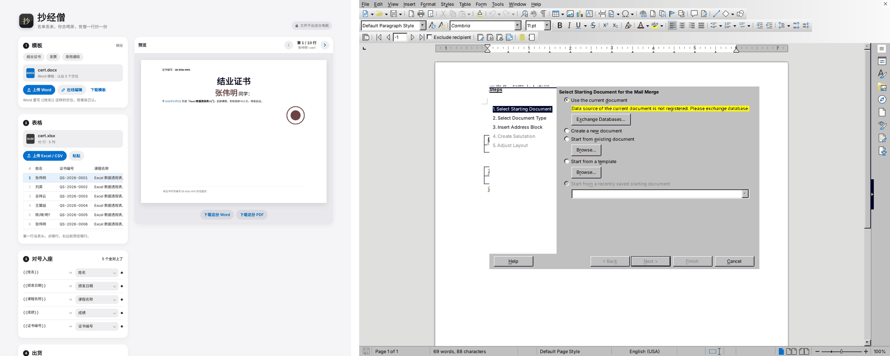

# 抄经僧 · 比武报告（2026-11-03）

结论先说：**Word 全胜；PDF 输了**，PDF 慢 7 倍，而且是图片型（字不能选、不能搜）。按「快不能明显落后」这条判，**这次不过关**，要先精加工 PDF。

## 对手

| 对手 | 比了吗 | 说明 |
|---|---|---|
| DocsAutomator | 没比 | 要注册账号；沙盒连它的网站被拦（403）。留给 Song 在自己电脑上比 |
| PDFMonkey | 没比 | 同上：要注册，网站被拦 |
| **LibreOffice Writer 邮件合并**（24.2.7） | 真比 | 免费、不用注册，普通人能拿到的标准做法。用 UNO 接口模拟用户的「最好情况」：把每个 `{{列名}}` 都换成数据库字段（GUI 里要一个一个手点），再用邮件合并输出 Word、PDF |
| **docxtpl + LibreOffice 转 PDF** | 真比 | 会写 Python 的人的做法（DocsAutomator/PDFMonkey 的「模板 + 数据」思路的开源版）。pandas 默认读表，文件名非法字符换 `_`，不做同名去重 |

LibreOffice 跑了两种设置：**默认**（CSV 字符集不动，GUI 向导也不问）和 **手选字符集**（懂行的用户在数据源属性里把 CSV 改成 UTF-8 / GB18030）。

## 材料（`bench/`）

- `gen_materials.py` 生成：证书（横版、页眉页脚、印章图）、发票（页眉 logo、两张表）、合同（页眉页脚、签字表）、工资条（logo、表格）四份 Word 模板；数据 `cert.xlsx`（真日期格子，中文日期格式）、`invoice.xlsx`（千分位金额、`yyyy-mm-dd`）、`contract.csv`（UTF-8 带 BOM，字段里有逗号、引号）、`payslip.csv`（GB18030，模拟中文 Excel 存的 CSV）、`invoice_500.xlsx`（500 行）。
- 刁钻点：占位符被拆成 2～3 段 run、加粗/变色/表格格子/页眉页脚里的占位符、`{{ 乙方 }}` 带空格；生僻字 䶮（扩展A）、𠮷（扩展B）、龑喆堃；空格子；金额千分位、日期格式、`00000001` 这种前导零；超长条款（200 多字）；名字带 `/ : ? * < >`；两行同名；`甲&乙<咨询>` 这种 XML 特殊字符。名字公司全是编的。
- 标准答案 `expected.json`：每行成品里必须出现的字（共 336 条，500 行那套 4399 条），加文件名检查。
- `check.py` 对答案：Word 解开 XML 查正文+页眉页脚+表格；PDF 有文字层用 pdftotext，没有就 OCR（tesseract chi_sim）。按唯一编号认是哪一行，认不出按内容认，再认不出这一行的字全算缺。
- `run_ours.js`（Playwright 点我们的网页）、`run_libreoffice.py`、`run_docxtpl.py`、`score.py`（汇总）。仓库里只放脚本和 `samples/`（4 套 10 行小样本），500 行和成品不进仓库。

复现：`python3 gen_materials.py` → 仓库根 `python3 -m http.server 8765` → `node run_ours.js work/materials work/ours` → 起 `soffice --headless --accept=...port=2002` → `python3 run_libreoffice.py work/materials work/lo` → `python3 run_docxtpl.py work/materials work/tpl` → `python3 score.py work`。

## 四样数字

### 1. 准（错几处，越少越好）

10 行 × 4 套，336 条应有的字 + 40 个文件名：

| | 证书 | 发票 | 合同 | 工资条 | **合计** |
|---|---|---|---|---|---|
| **抄经僧 Word** | 0 | 0 | 0 | 0 | **0** |
| LibreOffice 默认 Word | 20 | 39 | 118 | 101 | 278 |
| LibreOffice 手选字符集 Word | 20 | 39 | 30 | 10 | 99 |
| docxtpl Word | 18 | 45 | 21 | 22 | 106 |
| **抄经僧 PDF**（OCR 核对） | 15 | 13 | 17 | 8 | **53**，全是 OCR 自己认错（大写金额折行、生僻字），逐页看图内容全对 |
| LibreOffice 手选字符集 PDF（文字层） | 20 | 48 | 30 | 10 | 108 |
| LibreOffice 手选字符集 PDF（同样 OCR） | 36 | 53 | 47 | 24 | 160，可见 OCR 本身约有 50 处噪声 |
| docxtpl PDF（文字层） | 22 | 69 | 21 | 31 | 143 |

500 行发票（Word）：**抄经僧 0 错 / 500 份**；LibreOffice 1997 错；docxtpl 1529 错，只出了 499 份。

中文乱码：三家 Word/PDF 里都没出现乱码字符。LibreOffice 默认设置读 CSV 时字段全空（表头对不上），不算乱码，算缺字。

对手错在哪：
- **LibreOffice**：日期变 `10/04/26`、金额丢千分位（`56923.7`）；按姓名列命名时，只要有一行名字带 `/ : ?`，**整批合并失败，一份不出**，只能改回 `cert0.docx` 这种编号名重来；名字带 `/` 的列会建出 `HT/2026/001.docx` 这种多层文件夹；CSV 默认字符集下 UTF-8、GB18030 两种文件**字段全空**。
- **docxtpl**：两行同名后一份**覆盖**前一份（10 行出 9 份）；名字里带 `<` 直接把 docx 写坏，渲染失败；`00000003` 读成 `3`；日期变 `2026-01-03 00:00:00`；金额丢千分位；GB18030 的 CSV 要手动换编码。
- **抄经僧（比武前）**：openpyxl 等程序导出的 xlsx 里，扩展B区生僻字「𠮷」被读成「ஷ」（Word、PDF、文件名都错，4 处）。原因是 SheetJS 解码 `&#134071;` 用了 `fromCharCode`。**已修**（`lib/xlsx.full.min.js` 一处，改用 `fromCodePoint`，记在 `lib/README.md`），修后重跑 0 错。Excel 自己存的 xlsx 不受影响。

### 2. 少动手（一套 10 行，出 Word + PDF）

| | 点几下 |
|---|---|
| **抄经僧** | **6 下**（实测：上传模板 2、上传表格 2、选「都要」1、生成 1；4 套空位全部自动对上，不用手动配） |
| LibreOffice 邮件合并 | 约 41～71 下（估算：注册数据源约 5 + 每个空位约 3 下 × 6～16 个 + 向导约 8 + 存 Word 约 6 + 存 PDF 约 4；CSV 选字符集再加 3；按姓名命名失败要重来再加 6） |
| docxtpl | 要写约 40 行 Python，装 3 个库；跑一次 1 条命令 |

### 3. 快（沙盒 Chromium / 同一台机器）

| | 10 行 Word+PDF | 500 行 Word | 500 行 PDF | 500 份 PDF 体积 |
|---|---|---|---|---|
| **抄经僧** | 2.4～2.9 秒 | **3.3 秒** | **124.6 秒** | 72 MB |
| LibreOffice 邮件合并 | 1.3～1.6 秒 | 14.4 秒 | 17.2 秒 | 32 MB |
| docxtpl + LO | 1.1～1.4 秒 | 12.6 秒 | 43.4 秒（另加 12.6 秒出 Word） | 28 MB |

LibreOffice 的时间不含用户手插字段的工夫。我们的 PDF 每页约 0.25 秒，大头是 html2canvas 截图。

### 4. 好看

- 抄经僧电脑宽 `shots/ours-1280.png`、手机宽 `shots/ours-390.png`：四步卡片，右边实时预览，手机上单列不横滚。
- LibreOffice：`shots/libreoffice-wizard-1280.png`（邮件合并向导第一步就报「数据源未注册」）、`shots/libreoffice-fields-1280.png`。沙盒没装中文语言包，界面是英文，装了中文包也是同一套老式向导，手机上用不了。
- 我们的 PDF 有个小毛病：预览行距偏紧，发票页眉 logo 和标题挨得近（设计记录里已经记过）。

## 判

| 规矩 | 结果 |
|---|---|
| 准不许输 | **过**：Word 0 错，对手 99～278 错。PDF 内容全对，但是图片型，字不能选不能搜，算半个短板 |
| 动手不许多 | **过**：6 下，对手 41 下以上 |
| 快不能明显落后 | **Word 过**（快 4 倍）；**PDF 不过**：500 份 125 秒，LibreOffice 17 秒，慢 7 倍 |
| 好看不能明显落后 | **过** |

**总判：PDF 不过关，要精加工后再比一次。**

## 输在哪 / 精加工清单（按要紧排）

1. **PDF 提速**（最要紧）：现在每份都重新跑 docx-preview + html2canvas（scale 2）。办法：同一模板只渲染一次，每行只换 DOM 里的字再截图；scale 降到 1.5；开 2～3 个 iframe 并行。目标 500 份 30 秒内。
2. **PDF 要有文字层**：字能选能搜、体积小。办法：嵌入子集化中文字体用 jsPDF 写字；或在图片上叠一层透明文字（位置从 DOM 拿）。顺带把 72 MB 降下来。
3. **文件名兜底**：命名列为空时现在出 `-invoice.pdf`，应该退成「第 N 份」。
4. 预览/PDF 行距偏紧、页眉图片和正文挨得近（老问题）。
5. 明细行循环（一张发票多行商品）还没有，对手 docxtpl 支持，DocsAutomator 也支持，留给下一轮。

## 这趟改了什么

- 新增 `chaojing/bench/`（脚本、小样本、截图、本报告）。
- 修 `chaojing/lib/xlsx.full.min.js` 扩展B区生僻字解码 bug（见上），`lib/README.md` 记了改动。产品功能没动。

---

## 0.2.0 复赛（2026-11-03 12:55 新加坡）

结论：**过**。四样都不输。PDF 改成字可选的真字 PDF，500 份从 124.6 秒降到 3.0 秒，比 LibreOffice 邮件合并快 9.5 倍。

同一套材料（`gen_materials.py` 重新生成，内容不变），同一台沙盒（4 核），三家全部重跑。沙盒里没装 tesseract，这次 PDF 全用文字层核对（三家都有文字层了）。`check.py` 改了一处、三家一样用：PDF 除了 `pdftotext -layout` 再按阅读顺序抽一遍并起来，因为 `-layout` 会把表格格子里折行的字（大写金额）和隔壁格子交错，冤枉每一家。

### 1. 准（错几处）

| | 证书 | 发票 | 合同 | 工资条 | **合计** |
|---|---|---|---|---|---|
| **抄经僧 0.2.0 Word** | 0 | 0 | 0 | 0 | **0** |
| **抄经僧 0.2.0 PDF（文字层）** | 0 | 0 | 0 | 0 | **0** |
| LibreOffice 默认 Word / PDF | 20 / 21 | 39 / 50 | 118 / 118 | 101 / 101 | 278 / 290 |
| LibreOffice 手选字符集 Word / PDF | 20 / 21 | 39 / 50 | 30 / 31 | 10 / 11 | 99 / 113 |
| docxtpl Word / PDF | 18 / 23 | 45 / 64 | 21 / 22 | 22 / 32 | 106 / 141 |

500 行发票：抄经僧 Word 0 错 / PDF 0 错（各 500 份）；LibreOffice Word 1997 错、PDF 2255 错；docxtpl Word 1529 错、PDF 2929 错，只出 499 份。
生僻字：䶮（扩展A）、𠮷（扩展B）字体里没有，画成小图贴在原位，文字层照样是这个字，`pdftotext` 能抽出来。

### 2. 少动手（一套 10 行出 Word + PDF）

抄经僧 **6 下**（不变；4 套空位全自动对上）。LibreOffice 约 41～71 下，docxtpl 要写约 40 行 Python。
新增：一张发票多行商品（同一单号占几行）不用设置，自动并成一份，表格行按商品数长出来；想拆开点一下。

### 3. 快（沙盒 Chromium，4 核；对手同机重跑）

| | 10 行 Word+PDF | 500 行 Word | 500 行 PDF | 500 份 PDF 体积 |
|---|---|---|---|---|
| **抄经僧 0.2.0** | **0.5 秒** | **3.8 秒** | **3.0 秒**（含首次搬字体） | **13.5 MB** |
| 抄经僧 0.1（上回） | 2.4～2.9 秒 | 3.3 秒 | 124.6 秒 | 72 MB |
| LibreOffice 邮件合并 | 约 2.1～3.0 秒 | 23.3 秒 | 28.5～30.1 秒 | 27 MB |
| docxtpl + LO | 约 2.7～3.8 秒 | 16.2 秒 | 73.2 秒（另加 16.2 秒出 Word） | 23 MB |

这台机器比上回慢（LibreOffice 500 份 PDF 上回 17.2 秒，这回 28.5 秒），所以只跟同机数字比。

怎么快的：模板只用 docx-preview 排一次，空位换成可改字的小格子，每份只换字、浏览器重排；从排好的版面读出每个字的位置、线、底色、图片，交给 3 个后台线程写 PDF（字体按这一份用到的字现切子集嵌进去）。主线程每份约 5 毫秒。模板里有用户自己写的 `{{#循环}}` 时退回每份重排，照样是真字 PDF，只是慢。

### 4. 好看

`shots/ours-1280.png`、`shots/ours-390.png`（已换成 0.2.0）、`shots/ours-1280-dark.png`、PDF 成品 `shots/ours-pdf-invoice-0.2.0.png`。PDF 用 Noto Sans SC 常规+粗体，表格线、底色、页眉页脚、印章图、页面花边都在；跟 LibreOffice 打开同一份 Word 转出来的版式基本重合。行距按 Word 单倍 ≈ 1.32 倍字号补过，页眉 logo 跟标题的距离跟 LibreOffice 一致。

### 判

| 规矩 | 结果 |
|---|---|
| 准不许输 | **过**：Word、PDF 都 0 错；对手 99～290 错 |
| 动手不许多 | **过**：6 下 |
| 快不能明显落后 | **过**：500 份 PDF 3.0 秒，对手最快 28.5 秒 |
| 好看不能明显落后 | **过** |

### 还没补的

1. Word 自动编号（「1.」「一、」这类列表编号）docx-preview 用 CSS 计数器画，PDF 里读不到，**会丢编号**；Word 文件本身不受影响。
2. 字距（`w:spacing`）、文本框、浮动图片、分栏：docx-preview 不画或画不准，预览和 PDF 跟着走样。
3. PDF 只有一套黑体（Noto Sans SC），宋体/楷体模板出来也是黑体；超长内容分页是按行切的，不管「段中不分页」「与下段同页」。

---

## 0.2.1 复赛（2026-11-03 16:20 新加坡）

结论：**过**。这趟补三样：Word 自动编号进 PDF、宋体/楷体、分页规矩。准、动手、好看照旧不输；快照旧领先，500 份 PDF 比上回慢了一倍多（见「快」）。

新加一套 **通知**（`notice.docx` + `notice.xlsx`，10 行）：编号全是 Word 自动编号（`numbering.xml`，正文里没有一个手打的「一、」）——「一、」「（一）」「1.」「(1)」四级多级列表、「第一条」、「1. / 1.1」法条式、一个用 `startOverride` 重新起号的清单；「公文标题」样式自带编号 + 与下段同页 + 段中不分页；两段长段落带段中不分页；正文开孤行控制；字体 方正小标宋简体 / 仿宋_GB2312 / 宋体 SimSun / 黑体 / 楷体_GB2312 / KaiTi。数据的长短故意拉开，让每份的分页落点都不一样。
核对：`check.py` 多认一个 `pdf_must`（这 16 个编号字只在 PDF 里查，Word 里编号本来就是 numbering.xml）；新增 `check_layout.py` 查「标题落页底」「长段落被拆开」和 PDF 里嵌没嵌宋体、楷体。

为了公平，沙盒给 LibreOffice 装了同两套开源字（Noto Serif SC、霞鹜文楷），fontconfig 把 宋体/SimSun/仿宋_GB2312/方正小标宋简体 指到 Noto Serif SC、楷体/KaiTi 指到霞鹜文楷，模拟 Windows 上有宋体楷体。没这一步，沙盒里的 LibreOffice 只有文泉驿黑体，宋体楷体全出成黑体。

### 1. 准（错几处）

| | 证书 | 发票 | 合同 | 工资条 | **通知** | **合计** |
|---|---|---|---|---|---|---|
| **抄经僧 0.2.1 Word / PDF** | 0 / 0 | 0 / 0 | 0 / 0 | 0 / 0 | **0 / 0** | **0 / 0** |
| 抄经僧 0.2.0 PDF（同一套通知） | | | | | 160 | 编号全丢：10 份 × 16 个 |
| LibreOffice 默认 Word / PDF | 20 / 21 | 39 / 50 | 118 / 118 | 101 / 101 | 10 / 10 | 288 / 300 |
| LibreOffice 手选字符集 Word / PDF | 20 / 21 | 39 / 50 | 30 / 31 | 10 / 11 | 10 / 10 | 109 / 123 |
| docxtpl Word / PDF | 18 / 23 | 45 / 64 | 21 / 22 | 22 / 32 | 15 / 15 | 121 / 156 |

通知套对手的错全是老毛病：LibreOffice 按「单位」命名，名字带 `/ : ?` 整批失败退成 `notice0.pdf`（10 处文件名）；docxtpl 名字带 `&` 渲染失败、两行同名覆盖，10 行出 8 份。编号三家都对（LibreOffice 本来就会编号）。
500 行发票：抄经僧 Word 0 错 / PDF 0 错（各 500 份）；LibreOffice Word 1997、PDF 2255；docxtpl Word 1529、PDF 2929，只出 499 份。

### 版式（通知套 10 份，每家 40 页上下）

| | 标题落页底 | 长段落被拆开 | 嵌了宋体 | 嵌了楷体 |
|---|---|---|---|---|
| **抄经僧 0.2.1** | **0** | **0** | 10/10 | 10/10 |
| 抄经僧 0.2.1 关掉分页规矩（对照） | 0 | 8 | | |
| 抄经僧 0.2.0 | 5 | 0 | 0/10 | 0/10 |
| LibreOffice（两种设置） | 0 | 0 | 10/10 | 10/10 |
| docxtpl + LO | 0 | 0 | 8/8 | 8/8 |

对照组说明分页规矩是真起作用的：同一版 0.2.1 把规矩关掉，10 份里 8 次长段落被切在两页。0.2.0 那 5 次「标题落页底」是旧版行距不同落点不同。孤行控制没单独计数（开着，逐页看过）。

### 2. 少动手

抄经僧 **6 下**（5 套空位全自动对上，通知套 7 个空位）。编号、字体、分页都是自动的，没加任何开关。LibreOffice 约 41～71 下，docxtpl 要写约 40 行 Python。

### 3. 快（沙盒 Chromium 4 核；对手同机重跑）

| | 10 行 Word+PDF | 500 行 Word | 500 行 PDF | 500 份 PDF 体积 |
|---|---|---|---|---|
| **抄经僧 0.2.1** | **1.4～2.6 秒** | **4.7 秒** | **6.0～7.6 秒**（一次跑出 11.6 秒，机器抖） | 16.3 MB |
| 抄经僧 0.2.0（同机重跑） | 0.8 秒 | 4.8 秒 | 4.7 秒 | 13.5 MB |
| LibreOffice 邮件合并 | 约 2.2～3.8 秒 | 29.3 秒 | 36.4～41.0 秒 | 27 MB |
| docxtpl + LO | 2.9～3.5 秒 | 18.8 秒 | 91.5 秒（另加 18.8 秒出 Word） | 23 MB |

慢在哪：发票模板（python-docx 默认模板）的主题字体是 Cambria + 宋体，Word 在中文系统上就是用宋体显示。0.2.0 不认字体一律黑体，0.2.1 照实用宋体，宋体字形比黑体复杂，每份 PDF 里嵌的子集更大、压缩更久（13.5 → 16.3 MB）。10 行慢一点是头一回要多搬一套宋体（之后进缓存）。仍比 LibreOffice 快 5 倍以上。

### 4. 好看

`shots/side-by-side-notice-0.2.1.png`（左两页抄经僧 PDF，右两页 LibreOffice）：编号、缩进、悬挂对齐、字体、行距、分页落点基本重合。`shots/ours-pdf-0.2.1.png`（通知 + 发票）、`shots/ours-preview-notice-0.2.1.png`（预览跟 PDF 同一套编号和字）、`shots/ours-1280.png`、`shots/ours-390.png`、`shots/ours-1280-dark.png`。

### 判

| 规矩 | 结果 |
|---|---|
| 准不许输 | **过**：五套 Word、PDF 全 0 错；编号 160 处从丢到全有 |
| 动手不许多 | **过**：6 下 |
| 快不能明显落后 | **过**：500 份 PDF 6～8 秒，对手最快 36 秒 |
| 好看不能明显落后 | **过**：宋体楷体、编号、分页跟 LibreOffice 版式基本重合 |

### 这趟改了什么

- 编号：`prepDocx()` 读 `numbering.xml`（含 `lvlOverride/startOverride`、`lvlRestart`、`isLgl`、`numStyleLink`、样式挂编号、编号定义里 `pStyle` 认级别），自己算号写成真字插在段首；编号格式认 20 来种（一二三、壹贰叁、甲乙丙、①、⑴、罗马、字母、全角……），Symbol/Wingdings 的项目符号换成 Unicode。编号后的制表符排好版再按悬挂缩进算宽（`fixNumTabs`）。预览和 PDF 走同一条路，Word 成品不动。
- 字体：`fonts/serif/`（Noto Serif SC 常规/粗体，102 块）、`fonts/kai/`（霞鹜文楷 常规/粗体，97 块，woff2 转 woff），各带 `index.json`，生成脚本 `fonts/make_index.py`。字体名按「像哪种」归三类：宋/仿宋/明朝/Times 这类 → 宋体，楷 → 楷体，其余 → 黑体；一个 run 同时有西文和中文字体名时听中文的。用到哪套才搬哪套；宋体楷体里没有的字用黑体补，再没有画成小图。预览里也挂同一套宋体楷体（@font-face 按块，浏览器只下这页用到的块）。
- 分页：每段的「与下段同页 / 段中不分页 / 孤行控制」按段落→样式链→文档默认算出来，做成书签记号；切页时整段挪、少挪一行、或带着上一段一起挪；挪完这页会空就不挪。表格里的段落不管。
- 顺手修：没写样式的段落显式挂上默认样式。docx-preview 原来只给段落、不给字套「正文」的字号，通知套正文 14 磅被画成 11 磅。

### 还没补的

1. 字距（`w:spacing`）、文本框、浮动图片、分栏：docx-preview 不画或画不准（老问题）。
2. 表格行「不跨页断行」、表格内段落的分页规矩、段前分页（pageBreakBefore）没做。
3. 仿宋没有单独的开源字，归到宋体；中文段里西文用中文那套字（Times New Roman + 仿宋 的段落，西文也是 Noto Serif）。
4. DocsAutomator、PDFMonkey 要注册账号，仍没比，只能在 Song 的电脑上比。

---

## 0.3.0 复赛（2026-11-03 18:20 新加坡）：去掉没必要的步骤 + 好看

结论：**过**。准 0 错不变；500 份 PDF 同机交替跑跟 0.2.1 在误差里；第一次用 7 下 → 5 下，第二次用 7 下 → 4 下；界面照 `_ops/设计规范.md` 重做。

### 步骤账（Playwright 真走，`bench/walk_steps.js`；场景：通知套 notice.docx + notice.xlsx 出 PDF；第二次 = 同一个浏览器关掉重开、丢这个月的表）

「下」= 点一下 / 在文件框里选一次。0 下的是看一眼或程序自己做的。

| # | 0.2.1 第一次 | 必要？ | 理由 / 0.3.0 怎么办 | 0.3.0 第一次 |
|---|---|---|---|---|
| 1 | 打开（先摆着结业证书示例） | — | 示例占着首屏，自己的文件还得先替掉它。0.3.0 首屏空着：一句话 + 丢文件 + 「用示例试试」 | 打开（空状态） |
| 2 | 点「上传 Word」 | 没必要 | 模板和表格分两次丢，程序看后缀就分得清。**并成一次** | 点「选文件」 |
| 3 | 选 notice.docx | 必要 | 给程序它不知道的东西：用哪份模板 | 一次选 notice.docx + notice.xlsx |
| 4 | 点「上传 Excel / CSV」 | 没必要 | 同 2，并进上一下 | — |
| 5 | 选 notice.xlsx | 必要 | 用哪张表；并进 3 | — |
| 6 | 对号入座（自动） | 0 下 | 程序自己对；0.3.0 全对上就收成一行（能点「改」展开），没对上的标黄 | 同（0 下） |
| 7 | 点「下一份」翻预览核对 | **必要** | 人判断抄得对不对。留着，只让它好做：预览大、能翻、点表格哪行看哪份 | 同 |
| 8 | 点「PDF」 | 第一次必要 | 要 Word 还是 PDF 程序不知道 | 同 |
| 9 | 点「生成 10 份」→ 自动下载 zip | **必要** | 核对完的那一下就是下载（0.2.1 已经是生成即下载，没有单独的下载钮）。0.3.0 按钮照直写「下载 10 份 PDF」 | 点「下载 10 份 PDF」 |
| | **合计** | | | **7 下 → 5 下** |

| # | 0.2.1 第二次 | 必要？ | 理由 / 0.3.0 怎么办 | 0.3.0 第二次 |
|---|---|---|---|---|
| 1 | 打开：又是结业证书示例，上回的模板、格式全没了 | — | 0.3.0 开机自己接上上回的模板和表格，底下写「接着上回的 · 11月3日」，一下「清掉」，清掉能撤销 | 打开（上回的都在） |
| 2–3 | 点「上传 Word」+ 再选一次同一份模板 | 没必要 | 模板跟上回一样。**记住上回的** | — |
| 4–5 | 点「上传 Excel」+ 选这个月的表 | 必要 | 这个月的名单是新信息 | 点「选文件」+ 只选新表（2 下） |
| 6 | 点「下一份」核对 | **必要** | 同上 | 同 |
| 7 | 又点「PDF」 | 没必要 | 上回选过。**记住上回的**（看得见：格式控件显示 PDF，下面一行写「格式和文件名按上回的，改了也记着」） | — |
| — | 上回改过文件名规则、手动对过号：又来一遍 | 没必要 | **记住上回的**（按「模板名 + 空位」记，同一个模板照旧） | — |
| 8 | 点「生成」→ zip | **必要** | 核对完那一下就下载 | 点「下载 10 份 PDF」 |
| | **合计** | | | **7 下 → 4 下**（拖进来算 1 下的话 3 下） |

留着的必要步骤：选文件（给模板、给这个月的表）；第一次选格式（Word / PDF 程序不知道）；翻预览核对（人判断）；核对完那一下下载。

自动做掉的都摆在明面上、能撤：对号（「对号入座」里一行列出谁对谁，点「改」逐个改，改的记住）；同号的行并成一份（写着「「单号」相同的行并成一份：n 行 → m 份」，一下「拆开」）；接上回的文件（「接着上回的」+「清掉」，清掉给「撤销」）；格式和文件名（控件里显示当前值，下面一行说按上回的）。

### 准（`check.py`，0.3.0 新跑）

| | 证书 | 发票 | 合同 | 工资条 | 通知 | 500 行发票 |
|---|---|---|---|---|---|---|
| 0.3.0 Word / PDF | 0 / 0 | 0 / 0 | 0 / 0 | 0 / 0 | 0 / 0 | 0 / 0（各 500 份） |
| 0.2.1 Word / PDF | 0 / 0 | 0 / 0 | 0 / 0 | 0 / 0 | 0 / 0 | 0 / 0 |

通知套版式（`check_layout.py`）：标题落页底 0、长段落被拆开 0、没嵌宋体 0、没嵌楷体 0，跟 0.2.1 一样。生成引擎（填空、分组、PDF 排版和写字）这趟一行没动，只改界面和记性。

### 快（沙盒 Chromium 4 核，跟别的会话共用机器；0.2.1 和 0.3.0 同机交替跑）

| | 10 行 Word+PDF | 500 行 Word | 500 行 PDF |
|---|---|---|---|
| 0.3.0 | 1.4～2.8 秒 | 4.0～5.1 秒 | 低负载交替 10 回：中位 7.2 秒（6.6～8.1） |
| 0.2.1 同机 | 1.4～2.7 秒 | 4.1～4.4 秒 | 低负载交替 10 回：中位 7.1 秒（6.5～8.2） |

差 0.1 秒，在同一版自己来回跑的抖动（±0.8 秒）里，不算退步。机器负载高那阵（load 4）两版都到 8～10 秒。

### 少动手（`run_ours.js`，每套新浏览器 = 第一次用）

6 下 → **4 下**（选文件 + 一起选两个 + 格式 + 下载）。五套 + 500 行全自动对上，0 个没对上。

### 好看（截图 `bench/shots-0.3/`：16 张 = 手机 390 / 电脑 1280 × 浅 / 深 × 空状态 / 干活中 / 结果 / 出错；参照 `apple-macos-1280.png`、`apple-iphone-390.png`）

对着 `_ops/设计规范.md` 逐节：

- [x] 总原则：没文件时一屏一件事（丢文件）；干活界面一个主按钮（下载），其余灰底或纯文字；能自动的（对号、分组、接上回的、格式文件名）不出按钮。
- [x] 颜色：规范 CSS 变量原样抄；主色抄经僧红 #E5484D 白字对比 3.91 不到 4.5 → 按钮、链接加深到 #D63A40（4.63）；深色模式文字 / 链接 / 进度提亮到 #FF6369，按钮底仍 #D63A40 保白字对比。主色只用在主按钮、选中、进度、链接；没对上的空位用 --doubt 标黄，不用红框。
- [x] 字：只用系统字体栈；数字 tabular-nums；首屏大标题 clamp(40px,6vw,64px)；正文电脑 15、手机 17；辅助 13；注脚 12；字重 400/600/700。
- [x] 形：卡片 18、按钮 12（大按钮 14）、输入框 10、小标签 8；间距 4 的倍数；分组列表行高 ≥ 56，分隔线从文字左边起；能点的 ≥ 44（翻页钮 44×44）；顶栏毛玻璃；深色无阴影。
- [x] 图标：跟总舵首页卡片同一个图形同一套红（`icon.svg` 当 favicon，`apple-touch-icon.png` 180 满版当主屏图标）；界面图标全换 2px 线性圆头，删掉旧版写着「抄」的黑块和 DOCX/XLSX 彩色色块。
- [x] 动：过渡 240ms、--ease；细进度条；完成时对勾描一笔；尊重 prefers-reduced-motion。
- [x] 控件：下拉重画；三选一（格式、示例）用分段控件；文件框藏起来；整页能丢、拖进来整页高亮；空状态一句话 +「用示例试试」；出错一句人话 + 怎么办，放在丢文件那块（不用 toast，不用 alert / confirm / prompt：在线编辑「新空位」原来用 prompt，改成菜单里直接填）；「清掉上回的」不问确定，给「撤销」。
- [x] 布局：工具区最宽 1120；手机 390 单列，下载钮贴底（毛玻璃），没有横向滚动（`flow_03.js` 两个宽度都查）。
- [ ] 表格预览里的生僻字（䶮 𠮷）沙盒里显示成方块：沙盒系统字体没这几个字，成品 PDF 里有（check.py 0 错）。

### 这趟改了什么

- 一次选 / 一次拖：模板和表格一起，按后缀分；先模板后表格，对号一次到位。
- 记性：格式、文件名规则、手动对过的号存 localStorage（按「模板名 + 空位」记）；上回的模板和表格存 IndexedDB，开机接上。都只在这台电脑的浏览器里。
- 首屏空状态；对号全对上就收成一行；按钮照直写「下载 10 份 PDF」；抄的时候只留进度条。
- 测试：`walk_steps.js`（步骤账，两版都走）、`flow_03.js`（真流程回归 17 项 × 两个宽度，0 报错）、`shots_03.js`（16 张交货截图 + 主屏图标），`run_ours.js` 改成一次选两个文件。

### 还没补的

1. 真 iPhone / Windows 上的拖放、主屏图标只能在 Song 的机器上看。
2. 「接着上回的」按浏览器记；换浏览器或清了网站数据就回到空状态。
3. 老问题照旧：字距、文本框、浮动图片、分栏预览走样；DocsAutomator、PDFMonkey 要注册，没比。

---

## 0.4.0 复查（2026-11-03 22:38 新加坡）：只动字，中文润色 + 英文重写一套

结论：**没退步**。生成引擎一行没动；功能、准、快跟 0.3.0 一样，中英两种语言真流程 0 报错。

### 功能（`bench/flow_04.js`：英文、中文界面 × 1280、390 = 4 遍，共 132 项）

132 项全过，页面 0 报错。多查的：第一次打开是英文，中文浏览器开也一样（Song 22:19 定的：默认英文，不跟浏览器语言走）；`<html lang>`、`<title>`、meta description 跟着当前语言；英文界面没漏一个中文字（右上角「中文」切换钮除外）；英文示例是英文证书 / 发票 / 录用信、英文文件名规则（`{{Name}} - Certificate`）；英文发票 8 行照样并成 4 张；按钮没撑破、没折成两行、没出屏；390 没有横向滚动；右上角换语言：示例跟着换、记住、关掉重开还是这门语言，用户自己的模板和表格一个字不动。`flow_03.js`（0.3.0 的 17 项 × 两个宽度）加 `?lang=zh` 照跑全过。

### 准（`check.py`，0.4.0 新跑）

| | 证书 | 发票 | 合同 | 工资条 | 通知 | 500 行发票 |
|---|---|---|---|---|---|---|
| 0.4.0 Word / PDF | 0 / 0 | 0 / 0 | 0 / 0 | 0 / 0 | 0 / 0 | 0 / 0（各 500 份） |

通知套版式（`check_layout.py`）：标题落页底 0、长段落被拆开 0、没嵌宋体 0、没嵌楷体 0。五套 + 500 行 0 个没对上，6 套都是 4 下出货。

### 快（沙盒 Chromium 4 核；0.3.0 和 0.4.0 同机交替跑两批）

| | 500 行 Word（中位，范围） | 500 行 PDF（中位，范围） |
|---|---|---|
| 0.4.0 第 1 批 / 第 2 批 | 4.6（4.4～4.7）/ 4.6（4.3～4.7） | 8.0（7.5～9.0）/ 7.95（7.3～8.8） |
| 0.3.0 第 1 批 / 第 2 批 | 4.6（4.2～4.7）/ 4.4（4.0～4.5） | 7.65（7.0～8.9）/ 8.45（8.1～9.2） |

两批里谁快谁慢倒了个个儿，差在 ±0.5 秒的抖动里，不算退步。这次机器负载比 0.3.0 复赛那会儿高（跑的时候 load 1～4），两版都比上回的 7.2 秒慢一点。10 行 Word + PDF 1.6～1.7 秒，通知套 3.0 秒。

### 字（`bench/strings-0.4/zh.txt`、`en.txt`，一行一条；截图 `bench/shots-0.4/`：中英 × 390 / 1280 × 空状态 / 结果 8 张）

- 界面字全收进 `strings.js`：中、英各 117 个键，一一对应；原来写死在代码里的 9 处（示例表名后缀、文件名兜底「第 N 份」、zip 名、列表分隔「、」、「留空」、日期格式、粘贴框示意、编辑器起手模板、Word 元数据里的名字）也收进去了；0.3.0 漏了 `fontFail` 这个键（字体下不来时报错显示 undefined），补上。
- 中文：免责声明 0 处（本来就没有）；翻译腔 / 公文腔 5 处，全在录用通知示例和打包提示里（「我们很高兴地通知你」「期待与你共事」「感谢你对……的信任」「如有疑问」「正在打包」）。
- 英文：名字 Chaojing · Doc Batcher，首屏 “Leave the copying to the monk.”；按钮 1～3 个词；梗用英文自己的（修士抄书、“Very zen, not very useful.”、Matchmaking、Ship it）。

### 还没补的

1. 英文 PDF 里弯引号、间隔号、破折号是全角宽（PDF 只有中文字体），字不少但看着松；要配一套西文字体才根治。英文示例先绕开了。
2. 真 Mac / iPhone / Windows 浏览器上英文的字宽、折行只在沙盒 Chromium 里看过；Safari 的 `text-wrap:balance` 要 17.5 以上，老 Safari 只是折得不那么匀。
3. 技术报错（`e.message`）原样露出，中英都一样，少见。

---

## 0.4.1 复查（2026-11-03 23:23 新加坡）：队长验收后改三处

改的：顶栏、底栏、提示条底色 98% 不透明（浅白、深 #1c1c1e，毛玻璃照旧）；英文界面换西文在前的字体栈，等宽数字只留给行号、计数、进度；PDF 配西文字体 Noto Sans / Noto Serif（拉丁字母、数字一律走它；弯引号、破折号、省略号、间隔号只在没有中文的段落走它，中文段落照旧全角），英文示例恢复弯引号、破折号、间隔号。

### 准

| | 证书 | 发票 | 合同 | 工资条 | 通知 | 500 行发票 |
|---|---|---|---|---|---|---|
| 0.4.1 Word / PDF | 0 / 0 | 0 / 0 | 0 / 0 | 0 / 0 | 0 / 0 | 0 / 0（各 500 份） |

通知套版式：标题落页底 0、长段落被拆开 0、没嵌宋体 0、没嵌楷体 0（40 页，跟 0.4.0 一样）。中文 PDF 里的数字、字母从 Noto Sans SC / Serif SC 换成了 Noto Sans / Serif，pdftotext 抽出来的字一个不差。

### 快（同机交替跑两批；机器这阵 load 3～6）

| | 500 行 Word（中位） | 500 行 PDF（中位，范围） | 500 份 PDF 包 |
|---|---|---|---|
| 0.4.1 第 1 批 / 第 2 批 | 4.5 / 4.4 秒 | 4.2（3.5～4.6）/ 3.95（3.6～4.2）秒 | 17.7 MB |
| 0.3.0 引擎（= 0.4.0）同机 | 4.7 / 4.3 秒 | 8.75（7.6～9.7）/ 8.75（8.1～10.1）秒 | 16.3 MB |

刚加西文字体时 PDF 慢到 12 秒：每份多四块要压，原来的压缩写法（绕 `Blob.stream().pipeThrough()`）每块固定开销 1.8 毫秒。改成直接往 `CompressionStream` 里写（小块 1000 次 1.8 秒 → 0.11 秒），再把每份都一样的字体子集缓存起来，PDF 反而比 0.4.0 快一倍。包大 9%，是每份多了两套西文子集（各 1 KB 左右）。

### 功能

`flow_04.js` 中英 × 1280 / 390 共 132 项 0 错 0 报错；`flow_03.js`（`?lang=zh`）全过。截图 `shots-0.4/` 重拍 8 张，另加英文 PDF 标点局部图 `shots-0.4/en-pdf-punctuation.png`。

### 还没补的

1. 中英混排的段落（英文句子里夹中文名字）算中文段落，里面的弯引号还是全角。
2. 真 Mac / iPhone / Windows 浏览器上的英文字体栈和折行只在沙盒 Chromium 里看过。
3. 技术报错（`e.message`）原样露出，少见。
