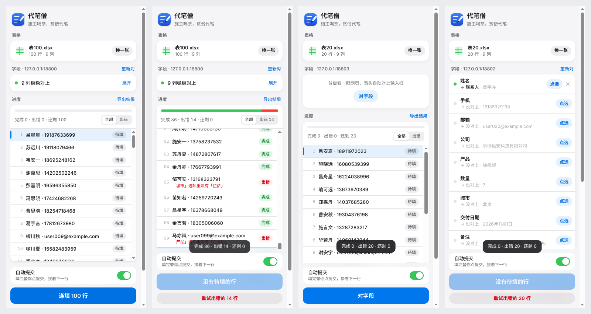
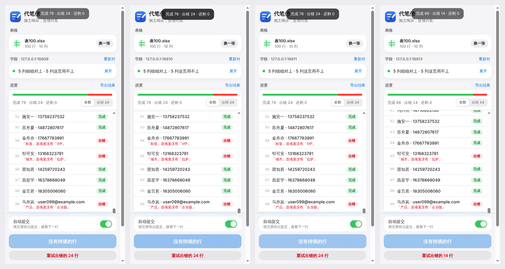

# 代笔僧比武报告（2026-11-03，云端沙盒）

一句话：**少动手、快两样大胜；准不过——自定义下拉、iframe、日历控件三个场景基本填不进去（20 行 744 格错 169，其中 168 格错在这三处，其余 570 格只错 1 格）。** 这趟没改产品代码，没撞上致命 bug（三处是设计记录里写明的已知缺口；按 Song 改判的拍板第 3 条，排在文件上传/Google 表格之后）。

比的是 **0.2.0**（比武进行中另一支队推了 0.2.0：上传框、Google 表格直连）。20 行在 0.1.0 和 0.2.0 上各跑一遍，结果一格不差；100 行的数字是 0.2.0 上跑的。

## 对手

| 对手 | 比了没 | 说明 |
|---|---|---|
| Bardeen | 没比 | 要注册账号，这趟不注册。留给 Song 的电脑 |
| Axiom.ai | 没比 | 要注册账号。留给 Song 的电脑 |
| UI.Vision RPA（开源替补） | **没比成** | GitHub 源码拉得下来（A9T9/RPA 10.0.276），但仓库只有源码，插件要 `npm install` + webpack 编译；沙盒拦了「装外来代码」，编不出来；GitHub Release 下载和插件商店都 403。留给 Song 的电脑（Chrome 商店直接装，免费免注册）。下面给了按它官方做法数的动手次数估计，**没实测** |
| 手工复制粘贴（真比的对手） | 真比（按格数动手，时间估） | 白领不用工具时就是这么干的：Excel 和浏览器并排，一格一格搬。动手次数逐格数出来（`baseline.py`），时间按 KLM 击键模型估；**准确率假定人一格不错**（偏向对手） |

## 怎么比的

- 测试站 `site.js`：一个进程 9 个端口 = 9 个不同网站（不同 origin），8 种真实场景：
  `plain` 普通表单（文本/邮箱/下拉/数字/城市下拉/原生日期/多行）· `react` 框架管的输入框（仿 React value tracker，直接改 value 不算数还会被改回去）· `dd` 自定义下拉（div 模拟，像 AntD）· `iframe` 表单在另一个网站的 iframe 里 · `wizard` 三页向导 + 成功页 · `ajax` 不跳页提交后清空 · `valid` 必填 + 手机 11 位 + 备注最多 100 字 · `date` 只读框 + 弹出日历。
- 测试表 `gen.py`：20 行（`data/表20.xlsx`，入库）和 100 行（生成，不入库）。刁钻处：随机拼的中文假名字、空格子、只有空格的格子、日期 6 种写法（真日期单元格 / `2026/11/5` / `2026年11月5日` / `2026.11.05` / `11/05/2026` / `20261105`）、下拉里没有的值（企业版、拉萨）、超长多行备注、`1,200` 这种带千分位的数量。
- 标准答案：每个网站每一行，服务器该收到的每一格；该报错不该交的行（下拉没有的值、必填空、备注超长）答案是「不交」。
- 判卷 `score.py`：按姓名把服务器收到的记录对到表里的行。没交上的行，整行该有的格子全算错；交了的，错一格算一格；不该交却交了算 1 错；重复交算 1 错。
- 我们上场 `run_ours.js`：真插件装进 Playwright 的 Chromium（`--load-extension`），侧栏当标签页开，读 xlsx → 自动对字段 → 没对上的照人的做法「点选」→ 开自动提交 → 连填。全自动模式计时。
- 跑法：`cd daibi/bench && python3 gen.py && xvfb-run -a node run_ours.js 20 && python3 score.py results/ours-20.json 20 && python3 baseline.py 20`

## 四样数字

### 1. 准（服务器收到的格子错几个，20 行）

| 场景 | 该对的格子 | 代笔僧 错 | 手工（假定） | 说明 |
|---|---|---|---|---|
| plain 普通 | 162 | **0** | 0 | 企业版、拉萨两行正确报错没交 |
| react 框架 | 114 | **1** | 0 | 第 13 行数量收到 `1,200`（文本框，没去千分位） |
| dd 自定义下拉 | 54 | **54** | 0 | 下拉认不出、点选也绑不上；网站弹框「请选择」拦下，18 行全没交上 |
| iframe | 80 | **80** | 0 | iframe 里的框一个都看不见，连「点选」入口都没有 |
| wizard 三页向导 | 144 | **0** | 0 | 第 2、3 页的字段跑着跑着自动补上 |
| ajax 不跳页 | 80 | **0** | 0 | |
| valid 必填校验 | 70 | **0** | 0 | 手机空 2 行、备注超长 4 行，都正确报错没交 |
| date 日历控件 | 40 | **34** | 0 | 只读日期框自动对不上；点选能绑，但日期原样写进去（`2026/11/5`），网站要 `YYYY-MM-DD`，17 行被拦 |
| **合计** | **744** | **169** | 0 | 去掉 dd/iframe/date 三处：570 格错 1 |

100 行（只跑能填的 5 个场景）：2768 格错 7，全是 `1,200` 那一种（react 场景每 13 行一次）。坏数据交进对方系统：0 次。

### 2. 少动手（点几下）

代笔僧（按真用户数：点图标 1、选表格 1、文件框里选文件 2、开「自动提交」1、点授权「允许」1、点连填 1；自动没对上的列每列点选 2 下）：

| | 第一次在这个网站 | 同一网站再来一次 |
|---|---|---|
| 代笔僧 | **7 下**（date 场景要点选 1 列，再加可能的「展开」：9–10 下） | **5 下**（对应、授权、自动开关都记住了） |
| 手工复制粘贴（20 行） | plain 514 / react 417 / wizard 496 / ajax 304 / valid 270 / iframe 320 / dd 162 / date 160 下 | 同左，每次一样多 |
| UI.Vision（估，没实测） | 约 65 下（Excel 另存 CSV 4、开插件建宏录制 3、录一行约 20、9 个 type 命令改成 `${!COLn}` 约 27、加 csvRead 并上传 CSV 约 6、循环播放填次数 3）| 约 10 下（另存 CSV 4、上传 3、循环播放 3） |

### 3. 快（20 行用时，自动模式，从点「连填」到最后一行完成）

| 场景 | 代笔僧 | 手工（KLM 估） |
|---|---|---|
| plain | **8.0 s** | 781 s（13 分钟） |
| react | 14.1 s | 583 s |
| wizard（3 页） | 25.9 s | 814 s |
| ajax | 14.4 s | 418 s |
| valid | 7.2 s | 373 s |
| dd / date | 90 s / 77.6 s（每行等 4.5 秒判「提交了没动静」，白等） | 278 s / 252 s |

100 行：plain 40.2 s、react 68.5 s、wizard 129.9 s、ajax 73.1 s、valid 38.5 s。

### 4. 好看



从左到右：plain 准备好（9 列稳稳对上，折叠成一行）· plain 跑完（完成 86 出错 14，出错行红字写明原因）· iframe（找不到框，只剩「对字段」）· dd（9 列里 8 列「没对上」一长串）。
手工没有界面可比；UI.Vision 没装上，界面截图留给 Song 的电脑。自己看出来的毛病：底部提示条压住了列表最后一行。（截图是 0.1.0 的侧栏；0.2.0 已把「这页用不上的列」收成一行，dd 那张的一长串噪音没了，但要点选时得先点「展开」，多 1 下。）

## 判

| 规矩 | 结果 |
|---|---|
| 准不许输 | **不过**。能填的 5 个场景 570 格错 1；自定义下拉、iframe、日历控件三处 174 格错 168。手工（和 UI.Vision 用 click/selectFrame 命令手搭宏）都能填这三种 |
| 动手不许多 | **过**。第一次 7 下、再来 5 下；手工 20 行要 160–514 下，UI.Vision 估 65 / 10 下 |
| 快不能明显落后 | **过**。20 行 7–26 秒，手工估 6–14 分钟 |
| 好看不能明显落后 | 没有对手界面可比，自评过；有一处小毛病（见下 7） |

## 精加工清单（按要紧排）

1. **自定义下拉**（div 模拟的 select：AntD / Element / MUI / 自家组件）：认出 `role=combobox`、带隐藏 input 的下拉，填的时候点开、按选项文字点中；点选能绑上 div。—— dd 54 格全错。
2. **iframe 里的表单**：注入 all_frames，扫描和对应按 frame 记（含跨 origin 的嵌入表单，授权时一并问）；点选能点进 iframe。—— 80 格全错。
3. **日历控件 / 只读日期框**：只读框也算可填（label 像日期、placeholder 像「选择日期」）；写之前按框的格式（placeholder / 现有值 / 默认 `YYYY-MM-DD`）把日期规整好，必要时触发 input/change。—— 34 格错。
4. **网站弹框拦提交时说人话**：网页 `alert` 的文字读出来当出错原因，立刻标出错，不要等 4.5 秒写「提交了没动静」。dd/date 每行白等，20 行多花 80 秒。
5. **有数据的列没对上就开跑前先提醒**：「产品、城市这两列有数据，还没对上网页的框，要先点选吗？」—— 现在会闷头跑 20 行全错。
6. **数字列去千分位**：整列是数字（含 `1,200`）且框像数量/金额时，填进文本框也去掉逗号。—— 100 行 7 格错。
7. 底部提示条不要盖住行列表（往上挪或给列表留底边距）。
8. Song 的电脑上补比：Chrome 商店装 UI.Vision 跑同一套测试站和 20 行表（它要 CSV，用 Excel 另存）；Bardeen、Axiom 注册后同样跑，记四样。

## 文件

```
daibi/bench/
  gen.py          生成 表20.xlsx（入库）、表100.xlsx 和 answers.json（不入库）
  site.js         测试站，9 个端口
  run_ours.js     代笔僧上场
  score.py        判卷
  baseline.py     手工复制粘贴的动手次数和 KLM 估时
  results/        判卷结果（*-score.json）、手工结果（manual-*.json）
  shots/          截图
```

## 0.2.1 复赛（2026-11-03，云端沙盒，同一套测试站和表）

一句话：**准从 744 格错 169 到 744 格错 0；100 行 8 个场景 3626 格错 0；动手第一次 7 下（日历场景原来 9–10 下）、再来 5 下；20 行 7.0–24.8 秒。** 精加工清单 1–7 条做完，第 8 条（对手实测）留给 Song 的电脑。

跑法同上：`cd daibi/bench && python3 gen.py && xvfb-run -a node run_ours.js 20 && python3 score.py results/ours-20.json 20`（100 行把 20 换成 100）。补测脚本没进仓库（弹框、开跑前提醒、iframe 点选、下拉点选、没授权的 iframe），10 项全过；老的 `test/e2e.js` 全部通过、控制台 0 报错。

### 1. 准

| 场景 | 该对的格子 | 0.2.0 错 | **0.2.1 错** | 怎么补的 |
|---|---|---|---|---|
| plain | 162 | 0 | **0** | |
| react | 114 | 1 | **0** | 整列是数、带千分位的列，填文本框去逗号（`1,200` → `1200`） |
| dd 自定义下拉 | 54 | 54 | **0** | 认 div 下拉（role=combobox / aria-haspopup=listbox / 常见组件库外壳），自动对上；填时点开、按文字点中选项。企业版、拉萨两行正确报「选项里没有」没交 |
| iframe | 80 | 80 | **0** | 顶层 + iframe 都注入，一次问遍；iframe 里的框自动对上，点选也点得进去 |
| wizard | 144 | 0 | **0** | |
| ajax | 80 | 0 | **0** | |
| valid | 70 | 0 | **0** | |
| date 日历控件 | 40 | 34 | **0** | 只读日期框算可填，自动对上；按框的格式写（这里 `YYYY-MM-DD`），6 种日期写法全认 |
| **合计** | **744** | **169** | **0** | |

100 行，8 个场景全跑（0.2.0 只跑了能填的 5 个）：**3626 格错 0**，坏数据交进对方系统 0 次。

### 2. 少动手

| | 第一次在这个网站 | 同一网站再来一次 |
|---|---|---|
| 代笔僧 0.2.1 | **7 下**，8 个场景都是（不用点选、不用展开；iframe 场景本站和 iframe 的站一次授权弹窗一起问） | **5 下** |
| 代笔僧 0.2.0 | 7 下（date 9–10 下；dd/iframe 填不进去） | 5 下 |
| 手工（20 行） | 160–514 下 | 同左 |

新加的「开跑前提醒」只在网页上有框没对上、表里又有带数据没对上的列时出现，多 1 下（「照填」或「去点选」），同网站照填过不再问。8 个场景复赛里一次都没出现。

### 3. 快（20 行，自动模式）

| 场景 | 0.2.0 | **0.2.1** | 手工（KLM 估） |
|---|---|---|---|
| plain | 8.0 s | **7.9 s** | 781 s |
| react | 14.1 s | **14.2 s** | 583 s |
| dd | 90 s（白等） | **16.3 s** | 278 s |
| iframe | —（填不进去） | **7.8 s** | 433 s |
| wizard | 25.9 s | **24.8 s** | 814 s |
| ajax | 14.4 s | **14.6 s** | 418 s |
| valid | 7.2 s | **7.0 s** | 373 s |
| date | 77.6 s（白等） | **7.9 s** | 252 s |

100 行：plain 42.6 s、react 70.2 s、dd 82.2 s、iframe 40.4 s、wizard 123.7 s、ajax 74.0 s、valid 37.5 s、date 39.6 s（0.2.0 的 5 个场景 38.5–129.9 s，±5% 以内）。
网站弹框拦提交（补测：dd 解绑「产品」后连填 20 行）：每行立刻标「网页弹框不收：「请选择产品版本和城市」」，20 行 12.2 秒（0.2.0 每行白等 4.5 秒、原因写「提交了没动静」）；自动模式下弹框不再卡住网页。

### 4. 好看


从左到右：plain 准备好 · dd 跑完（3 列稳稳对上，出错 2 行写明「选项里没有」）· iframe 跑完（4 列对上，20 行全交）· 网站弹框拦下（原因就是弹框的话）。
提示条挪到侧栏顶上（压招牌不压数据）、页面底部按底栏实际高度留白，0.2.0「提示条压住列表最后一行」修掉。开跑前提醒见 `shots/ours-021-warn.png`。深色模式、介绍页 390/1280 宽浅深色都看过，没横向滚动。

### 判（复赛）

| 规矩 | 0.2.0 | 0.2.1 |
|---|---|---|
| 准不许输 | 不过（744 错 169） | **过**（744 错 0；100 行 3626 错 0） |
| 动手不许多 | 过 | 过（7 / 5 下） |
| 快不能明显落后 | 过 | 过（20 行 7.0–24.8 秒） |
| 好看不能明显落后 | 自评过，一处小毛病 | 自评过，小毛病修了；仍没有对手界面可比 |

### 还差什么

1. 对手实测：UI.Vision / Bardeen / Axiom 还是一个没装上，留给 Song 的电脑（清单第 8 条）。
2. 自定义下拉只在测试站自建的 div 下拉上实测；真 AntD / Element / MUI / select2 按它们的结构写了，没在真组件上跑过。多选的自定义下拉只选一个值。
3. 日历控件只测了「只读框 + 写 value 就认」这种；内部状态不跟 value 走的日期组件（要点日历格子才认）可能被网站拦下或交成空值，没测。
4. Shadow DOM 里的表单不认；跨站 iframe 的授权要用户在同一个弹窗里多允许一个站，自动化测不了这一下（测试副本预给了权限）。

## 0.2.2 复赛（2026-11-03，云端沙盒，真组件库 + 原 8 场景）

一句话：**原 8 场景 + 5 个真组件场景，20 行 1138 格错 0、100 行 5500 格错 0；0.2.1 在真组件上 394 格错 394，0.2.2 错 0；动手第一次 7 下、再来 5 下；20 行 7.1–37.2 秒，手工估 4–14 分钟。**

### 新加的 5 个场景（`bench/real/`，npm 官方源装真库，esbuild 打包；`bench/site.js` +9…+13）

| 场景 | 库（版本） | 里面有什么 |
|---|---|---|
| antd | antd 5.29.3 + React 18.3.1 | Select 单选、可搜单选、多选（`mode=multiple`），DatePicker `inputReadOnly`（只能点日历格子），提交钮字是「提 交」 |
| element | element-plus 2.14.7 + Vue 3.5.44 | el-select 单选、filterable、multiple，el-date-picker（可打字，值在组件里），提交钮不是 type=submit |
| mui | @mui/material 9.5.0 + @mui/x-date-pickers 9.17.0 | Select 单选、多选（`role=combobox` 的 div + 弹出菜单），DatePicker 分段输入框（MM/DD/YYYY 三个 spinbutton），英文日历 |
| select2 | select2 4.0.13 + jquery 3.7.1 | 原生 select 藏起来外面套皮：单选、可搜、多选；没选弹框拦 |
| shadow | 原生 Web Component | 整张表在 `<qs-signup>` 的 shadowRoot 里，「手机号码」再套一层 `<qs-field>` 自己的 shadowRoot；不跳页，交完清空 |

表加了一列「标签」给多选：分隔符混用（`、` `，` `,` `；`），有两行带选项里没有的「VIP」（该报错不交）。原 9 列一格没动（核对过）。

### 1. 准（20 行）

| 场景 | 该对的格子 | 0.2.1 错 | **0.2.2 错** |
|---|---|---|---|
| 原 8 场景 | 744 | 0 | **0** |
| antd | 80 | 80 | **0** |
| element | 80 | 80 | **0** |
| mui | 80 | 80 | **0** |
| select2 | 64 | 64 | **0** |
| shadow | 90 | 90 | **0** |
| **合计** | **1138** | **394** | **0** |

100 行 13 个场景：**5500 格错 0**，坏数据交进对方系统 0 次（企业版、拉萨、VIP 都在填之前报「选项里没有」，没交）。
0.2.1 在真组件上栽在哪：AntD 读屏用的 0 宽 `role=option` 被当成选项、MUI 页提交后多一条「已保存」把 nth-of-type 选择器整排挤错位（城市写进产品框）、select2 的原生 select 带 `aria-hidden` 被跳过、Shadow DOM 根本看不见、只读日期框硬写 value 组件不认。

### 2. 少动手

| | 第一次在这个网站 | 同一网站再来一次 |
|---|---|---|
| 代笔僧 0.2.2 | **7 下**，13 个场景都是（全部自动对上，一次点选、一次「开跑前提醒」都没出现） | **5 下** |
| 手工（20 行） | 原 8 场景 160–514 下；antd/element/mui 各 240、select2 192、shadow 262 下 | 同左 |

### 3. 快（20 行，自动模式）

| 场景 | 0.2.1 | **0.2.2** | 手工（KLM 估） |
|---|---|---|---|
| plain | 7.9 s | **8.1 s** | 781 s |
| react | 14.2 s | **14.2 s** | 583 s |
| dd | 16.3 s | **19.5 s** | 278 s |
| iframe | 7.8 s | **8.0 s** | 433 s |
| wizard | 24.8 s | **25.4 s** | 814 s |
| ajax | 14.6 s | **14.6 s** | 418 s |
| valid | 7.0 s | **7.1 s** | 373 s |
| date | 7.9 s | **9.9 s**（改成真点日历格子） | 252 s |
| antd | 填不进 | **32.9 s** | 418 s |
| element | 填不进 | **37.2 s** | 418 s |
| mui | 填不进 | **25.4 s** | 418 s |
| select2 | 填不进 | **7.6 s** | 334 s |
| shadow | 填不进 | **13.8 s** | 449 s |

100 行：plain 46.2、react 73.0、dd 103.8、iframe 46.2、wizard 147.1、ajax 75.7、valid 44.9、date 55.7、antd 183.6、element 203.2、mui 148.6、select2 48.6、shadow 72.1 秒。100 行这轮和 UI.Vision 实测同时跑在 4 核沙盒上，有几项比 0.2.1 慢 10–25%（dd 82→104、wizard 124→147），20 行那轮是单独跑的。
真组件每行 1.3–1.9 秒，大头是等组件的下拉/日历弹层动画；比手工快 11–17 倍。

测试台修正：0.2.1 的 `run_ours.js` 把侧栏当同一窗口的另一个标签开，网页在后台，组件库的动画/requestAnimationFrame 不走（自建表单无所谓）。0.2.2 起侧栏单开一个窗口、网页在前台，跟真用户「侧栏 + 网页并排」一样。

### 4. 好看



从左到右：antd · element · mui · shadow，100 行跑完。每张都是 5 列稳稳对上，出错行写明「选项里没有『VIP / 企业版 / 拉萨』」。侧栏界面这轮没改；深色、介绍页 390/1280 宽浅深色都看过，没横向滚动。

### 对手：UI.Vision 实测（这轮装上了）

- 从 Chrome 应用商店官方下载地址（clients2.google.com，id `gcbalfbdmfieckjlnblleoemohcganoc`）取到 UI.Vision RPA **10.0.303** 的 crx，解开装进 Playwright 的 Chromium，免注册能用。脚本在 `bench/uivision/`。
- 10.x 默认是 JS 宏（`uiv.page.fill / selectOption / uiv.csv.read`）。照它的做法：表另存 CSV 导入「CSV/TXT」，按第一行写好每一步、值换成 CSV 的列、每行 try/catch，跑 plain 场景 20 行。
- 结果：**437 秒只交上 6 行**，而且每行交付日期都是空的（表里 `2026/11/4`、`2026年11月7日` 这种写法，原生日期框写不进，它不规整日期）；每行越跑越慢（第 1 行 16 秒，第 6 行比第 5 行慢 147 秒）；另外两次跑到 550 秒左右浏览器整个关掉。准：20 行 162 格错 114（没交上的 12 行全算错 + 交上的 6 行日期全错）。
- 用老的命令表宏（JSON）：贴进编辑器它报「这是命令表宏，不能当 JS 跑」；按它说的用「导入宏」导进去，宏列表里不出现（新建的 JS 宏也不出现），没跑成。
- 动手：建宏 1 + 命名 2 + 导入 CSV 3 + 写 16 行脚本（按行算 ≥16）+ 保存 1 + 播放 1 ≈ 24 下，还得会写 JS；代笔僧 7 下。
- 慢和崩溃可能有沙盒因素（xvfb、没 GPU），不能当定论；在 Song 的 Windows 电脑上应该再跑一次。antd 场景的脚本写了（自定义下拉用 `uiv.browser.click` 点开再点选项），plain 都没跑完就没再跑。

### 判（0.2.2 复赛）

| 规矩 | 0.2.1 | 0.2.2 |
|---|---|---|
| 准不许输 | 原 8 场景过；真组件 394 格错 394 | **过**（1138 错 0；100 行 5500 错 0；UI.Vision plain 162 错 114） |
| 动手不许多 | 过 | **过**（7 / 5 下；UI.Vision 约 24 下 + 写脚本） |
| 快不能明显落后 | 过 | **过**（20 行 7.1–37.2 秒；手工 4–14 分钟；UI.Vision 437 秒 6 行） |
| 好看不能明显落后 | 自评过 | 自评过；UI.Vision 界面是一屏 IDE（编辑器 + 日志 + AI 聊天栏） |

### 还差什么

1. Bardeen、Axiom 要注册，没比；UI.Vision 只在沙盒跑了 plain，慢和崩溃要在 Song 的 Windows 电脑上复核。
2. Windows 真机（Edge/Chrome）没装过 0.2.2；跨站 iframe 的授权弹窗要多允许一个站，自动化点不了。
3. 没测：closed Shadow DOM（浏览器不让进）、日期范围选择器、日期时间选择器、网页在后台标签页时组件库下拉/日历（动画停摆会填不进，现在没提醒）。

## 0.3.0 复赛（2026-11-03，云端沙盒；去掉没必要的步骤 + 好看）

一句话：**默认手动模式（提交仍由人点，拍板 2A）下，3 行一批：订单站第一次 12→11 下、第二次 8→7 下；两页向导第一次 14→12 下、第二次 13→10 下（向导每多 1 行再少 1 下，20 行 65→46、64→44）。准：20 行 1138 格错 0、100 行 5500 格错 0。快：同一沙盒连着跑两版，13 个场景 20 行 0.3.0 是 7.3–38.1 秒、0.2.2 是 7.5–38.7 秒，没有一场变慢。侧栏、介绍页照设计规范重做。**

跑法：
```
xvfb-run -a node daibi/bench/steps.js <插件目录> daibi/bench/results/steps-<版本>.json   # 步骤账（0.2.2 用仓库里 0.2.2 那版 extension/ 跑）
cd daibi/bench && xvfb-run -a node run_ours.js 20 && python3 score.py results/ours-20.json 20   # 准、快（100 行把 20 换成 100）
xvfb-run -a node daibi/bench/shots03.js                                                # 截图 → shots-0.3/
```
`steps.js` 照真人做法走：开侧栏 → 选文件 → 看见什么点什么（黄条就去点选、填好了就看一眼点网页上的提交、主按钮能点就点）→ 3 行全交上为止，人动一下记一下。第一次 = 新浏览器、这个网站没答应过（侧栏里的 `chrome.permissions` 换成假的，第一次问某网站记一下「允许」）；第二次 = 隔天换一批同表头的新表、再开一次侧栏。结果在 `results/steps-0.2.2.json`、`results/steps-0.3.0.json`。

### 1. 步骤账（0.2.2 实测，逐步标必要 / 没必要）

**订单站（交完回空表单；16 列里「开发票」自动对不上）· 第一次**

| # | 0.2.2 人动的一下 | 判 | 理由 | 0.3.0 |
|---|---|---|---|---|
| 1 | 点工具栏图标，开侧栏 | 必要 | 侧栏只能人点开，这一下就是「要填表了」 | 留 |
| 2 | 点「选文件」 | 必要 | 用哪张表程序不知道 | 留（挪到底部主按钮；也能整个侧栏拖进来，拖就是一下） |
| 3 | 文件框里点 本周订单.csv | 必要 | 同上 | 留 |
| 4 | 文件框点「打开」 | 必要 | 同上 | 留 |
| 5 | 点侧栏「填第 1 行」 | 必要 | 第一次进这个网站：浏览器只在侧栏里有人点的时候才肯弹「允许吗」，这一下就是答应进站 | 留（只第一次） |
| 6 | 浏览器弹窗点「允许」 | 必要 | 人给权限 | 留 |
| 7 | 黄条「网页上『需要发票』还没对上」点「去点选」 | 必要 | 这个框该填哪列程序没把握，人判断 | 留（字段一对完就问，不等点「填」） |
| 8 | 网页上点「需要发票」 | 必要 | 人给答案，以后这个网站记住 | 留 |
| 9 | 再点侧栏「填第 1 行」 | **没必要** | 字段都有主了，人只会点「填」，没给程序任何新东西 | **去掉**：点选完自己填第 1 行，提示条「第 1 行填好了，看一眼，点网页上的提交」+「撤」 |
| 10–12 | 看一眼第 N 行，点网页上的「保存订单」× 3 | 必要 | 拍板 2A：提交由人点，人判断这行对不对 | 留；交完下一行自己填好（0.2.2 就是） |

**订单站 · 第二次（隔天换一批同表头的新表）**

| # | 0.2.2 人动的一下 | 判 | 理由 | 0.3.0 |
|---|---|---|---|---|
| 1–4 | 开侧栏、选文件（3 下） | 必要 | 同上 | 留 |
| 5 | 点侧栏「填第 1 行」 | **没必要** | 这个网站答应过、字段记着，人只会点「填」 | **去掉**：表一放就把第 1 行填进网页（只在当初对字段的那一页），提示条带「撤」 |
| 6–8 | 看一眼，点「保存订单」× 3 | 必要 | 拍板 2A | 留 |
| — | 再对一遍字段 | 0.2.2 已经没有 | 对应按网站记着（`maps[origin]`），实测第二次没出现这一步 | — |

**报名向导（两页 + 成功页，交完不回表单）· 第一次 / 第二次**

| # | 0.2.2 人动的一下 | 判 | 理由 | 0.3.0 |
|---|---|---|---|---|
| 1–4 | 开侧栏、选文件（3 下） | 必要 | 同上 | 留 |
| 5–6 | 「填第 1 行」+「允许」（只第一次） | 必要 | 第一次进站要人答应 | 留 |
| 5（第二次） | 「填第 1 行」 | **没必要** | 答应过、字段记着 | **去掉**：表一放就填 |
| 每行 | 看一眼第 1 页，点「下一步」 | 必要 | 第 1 页的值只在第 1 页看得到，看完点下一步是「看一眼」的一部分 | 留 |
| 每行 | 看一眼第 2 页，点「提交报名」 | 必要 | 拍板 2A | 留 |
| 第 2 行起每行 | 成功页上点侧栏「回表单，填第 N 行」 | **没必要** | 交完人肯定回表单填下一行，只有一种做法 | **去掉**：自己回表单、填好下一行，提示条「第 N 行交了，回表单填第 N+1 行」+「停」 |

另外一处（按界面数，没进脚本）：**同一张表又放进来**（上回交了 12 行）——0.2.2 状态一律清零，人得在列表里点第 13 行、再点「填第 13 行」（2 下；不点就把前 12 行再交一遍）。0.3.0 同名、同表头、同一个网站的表，交过的行记着，自己从第 13 行接着填，提示条「从头来」能撤（`test/e2e.js` [2] 验过）。换了网站不算交过。

自动提交模式（`run_ours.js` 的数法）：第一次 7 下、再来 5 下，跟 0.2.2 一样。「开自动提交」和「连填」是人决定「这一批让它替我交」，属于判断，留着。

### 2. 两边逐步对照（人动几下）

| 场景（手动模式） | 0.2.2 | **0.3.0** | 去掉的 | 20 行时（按上表推） |
|---|---|---|---|---|
| 订单站 第一次（3 行） | 12 | **11** | 点选完再点「填第 1 行」 | 29 → 28 |
| 订单站 第二次（3 行） | 8 | **7** | 「填第 1 行」 | 25 → 24 |
| 向导 第一次（3 行） | 14 | **12** | 「回表单，填第 N 行」× 2 | 65 → 46 |
| 向导 第二次（3 行） | 13 | **10** | 「填第 1 行」+「回表单」× 2 | 64 → 44 |
| 同一张表接着填 | 2 + 每行 | **0 + 每行** | 找第 13 行、点「填第 13 行」 | — |
| 自动提交模式 | 7 / 5 | **7 / 5** | — | — |

留下的每一下都是：给表（选文件）、答应进站（第一次的「填」+「允许」）、告诉它没把握的框填哪列（点选）、看一眼再交（每行的提交 / 下一步）。
自动做掉的每件事都有一句提示和一个撤销：自己填了 →「撤」（网页刷新回空表，这行退回待填，不再自己填）；自己回表单 →「停」；接着上回 →「从头来」。

### 3. 准

| | 0.2.2 | **0.3.0** |
|---|---|---|
| 20 行 13 场景 | 1138 格错 0 | **1138 格错 0** |
| 100 行 13 场景 | 5500 格错 0 | **5500 格错 0** |
| 坏数据交进对方系统 | 0 | **0** |

`test/e2e.js` 全过（52 项，比 0.2.2 多「撤」「从头来」「只剩出错时主按钮就是重试」几项），控制台 0 报错。

### 4. 快（20 行，自动模式；同一沙盒、同一天连着跑两版）

| 场景 | 0.2.2 | **0.3.0** |
|---|---|---|
| plain | 8.1 s | **8.1 s** |
| react | 14.3 s | **14.3 s** |
| dd | 19.5 s | **19.5 s** |
| iframe | 8.1 s | **8.1 s** |
| wizard | 27.1 s | **25.7 s** |
| ajax | 14.9 s | **14.9 s** |
| valid | 7.5 s | **7.3 s** |
| date | 10.4 s | **9.9 s** |
| antd | 33.3 s | **33.0 s** |
| element | 38.7 s | **38.1 s** |
| mui | 26.9 s | **25.8 s** |
| select2 | 8.7 s | **7.6 s** |
| shadow | 14.2 s | **13.8 s** |
| 合计 | 231.7 s | **226.1 s** |

填表引擎（content.js、page.js、match.js）这轮一行没动，差别是沙盒抖动（同一台机器上还跑着别的会话的测试）。
100 行：plain 40.5、react 70.5、dd 99.4、iframe 41.1、wizard 137.3、ajax 75.5、valid 40.0、date 51.3、antd 170.1、element 192.5、mui 132.9、select2 41.4、shadow 69.6 秒，合计 1162 秒（0.2.2 复赛报的是 1249 秒，那轮跟 UI.Vision 同时跑，不算同条件；这里只说明没变慢）。

### 5. 好看（照 _ops/设计规范.md 逐节打勾）

截图在 `bench/shots-0.3/`：侧栏 8 张 `panel-{1-empty,2-working,3-result,4-error}-{light,dark}.png`（380 宽）；介绍页 `site-{390,1280}-{light,dark}.png`（整页）；示例表单 `demo-form-*.png`；apple.com 参照 `ref-apple-macos.jpg`、`ref-apple-iphone.jpg`（沙盒打得开）。

| 规范 | 打勾 | 怎么做的 / 不合的原因 |
|---|---|---|
| 一屏一件事，一个主按钮 | ✓ | 侧栏底部一个主按钮（没表「选文件」→ 填 / 连填 → 只剩出错「重试出错的 N 行」→ 全交完「再放一张表」）；空状态的「用示例试试」是灰的次按钮 |
| 能自动的事不出按钮 | ✓ | 填第 1 行、回表单、接着上回都自动做，只给撤销 |
| 一个主色，其余灰 | ✓ | 代笔僧墨 #3A4150 只在主按钮、开关打开、进度条、当前行、链接；状态色只给字（完成绿、出错红） |
| 跟随浅深色，深色不是取反 | ✓ | 深色主色提亮成淡墨灰 #AEB7C6、按钮字改深色（对比 9.6:1）；浅色白字对比 10.2:1；深色不用阴影，卡片 #1c1c1e 抬起 |
| 颜色变量照抄 | ✓ | `extension/lib/ui.css`、`index.html`、`demo/index.html` 都是规范那段 |
| 存疑标黄 --doubt | ✓ | 「等你提交」、没对稳的字段行、开跑前提醒都是黄底，不用红框 |
| 系统字体、数字等宽 | ✓ | 没引任何网字；进度、行号、表信息 tabular-nums |
| 字号阶梯 | ✓ | 插件正文 15、辅助 13、注脚 12；介绍页大标题 clamp(40px,6vw,64px)、区块标题 28–40、正文 17 |
| 字重 400/600/700 | ✓ | 全部 CSS 只有这三种 |
| 中英文、数字空一格 | ✓ | 「第 3 行」「5 行 · 8 列」「把 Excel 丢进来」 |
| 圆角 18/12/10/8，同类一样 | ✓ | 卡片 18、大按钮 14、按钮 12、小按钮和标签 8；分段控件里的选中块 7（套在 8 里面，iOS 同款） |
| 间距 4 的倍数，区块 ≥ 32 | ✓ | 侧栏区块之间 24 + 标题行，介绍页区块 96；只有字下面 2 px 的行距微调和分段控件 2 px 内边不是 4 的倍数 |
| 阴影只用 --shadow，深色不用 | ✓ | 例外：开关的白钮带 iOS 同款小阴影（不然白钮在浅底上看不见） |
| 分组列表，行高 ≥ 44，分隔线从文字起 | ✓ | 字段行 56、进度行 48；分隔线从字左边起 |
| 能点的 ≥ 44×44 | ✓ | 小按钮看着 32 高，`::after` 把点的范围撑到 44 |
| 顶栏、浮层毛玻璃 | ✓ | 侧栏顶栏、底栏、提示条；介绍页顶栏 |
| 线性图标 2px 圆头，本尊图标统一 | ✓ | 侧栏和介绍页的小图标都是线性；本尊图标照总舵卡片（墨色渐变底 + 白纸三行 + 白笔），出 16/32/48/128，16 px 少一行、线加粗 |
| 过渡 200–300ms、--ease、不弹跳 | ✓ | 240ms |
| 超过 1 秒有进度，做完轻完成动效 | ✓ | 连填有细进度条 + 顶栏「在填第 N 行，共 20 行」；收工时进度条亮一下 + 一句「20 行全交了，收工」 |
| prefers-reduced-motion | ✓ | 全关 |
| 不裸露系统控件 | ✓ | 多工作表的原生 select 换成分段控件；「自动提交」iOS 开关；文件框藏起来；示例表单的下拉重画了箭头 |
| 拖放整页能丢、整页高亮 | ✓ | 整个侧栏都能丢，拖进来整页描边高亮「松手，贫僧接着」 |
| 空状态一句话 + 用示例试试 | ✓ | 「把 Excel 丢进来」+「用示例试试」：读 5 行示例表、打开示例表单、自己对字段、填第 1 行 |
| 出错一句人话 + 怎么办，放在出事的地方 | ✓ | 行内写原因（「『产品』选项里没有『企业版』」），主按钮变「重试出错的 1 行」；没有 alert / confirm |
| 插件宽 360–400，顶部名字 + 状态，主按钮在底部 | ✓ | 380；顶栏一句状态「第 3 行填好了，等你提交」 |
| 网页最宽 980，390 单列无横向滚动 | ✓ | 截图脚本量了 scrollWidth，390 宽介绍页、示例表单都没横向滚动 |
| 首屏一句大标题、一句副标题、主操作 | ✓ | 代笔僧 / 施主喝茶，贫僧代笔 / 下载插件 |
| 别这样（AI 味）清单 | ✓ | 没满屏渐变（只有本尊图标自带总舵卡片那道渐变）、没 emoji 图标（0.2.2 介绍页的 emoji 换成线性图标）、没全大写、没 12px 正文、没默认下拉 |

跟 apple.com 参照摆一起看：留白、字重层级、灰阶接近；侧栏信息密度比 apple.com 营销页高（工具界面，正常）。没对手界面可比（UI.Vision 是一屏 IDE，见 0.2.2 复赛）。

### 判（0.3.0）

| 规矩 | 0.2.2 | 0.3.0 |
|---|---|---|
| 准、快不退步 | 1138 错 0；20 行合计 231.7 s | **1138 错 0、100 行 5500 错 0；20 行合计 226.1 s，13 场没有一场变慢** |
| 没必要的步骤 | 手动模式：答应过的网站还要点「填第 1 行」、点选完还要再点「填」、成功页每行要点「回表单」、同一张表再放进来状态清零 | **全去掉**；留下的每一下都是给表、答应进站、告诉它没把握的框、看一眼再交 |
| 好看 | 自评过，系统默认蓝当主色 | **照设计规范重做**，逐节打勾见上 |

### 还差什么

1. 真 Chrome 侧栏里「第一次允许」那个弹窗和自动填第 1 行，沙盒点不了（测试副本预给权限、侧栏里换了假的 permissions）；要在 Song 的电脑上装 0.3.0 点一遍：开侧栏 →「用示例试试」→ 交一行 → 换自己的表。
2. Windows 真机（Edge / Chrome，微软雅黑）没装过 0.3.0，侧栏和介绍页的字形没看过。
3. 对手：Bardeen、Axiom 要注册，没比；UI.Vision 只在沙盒跑过 plain。
