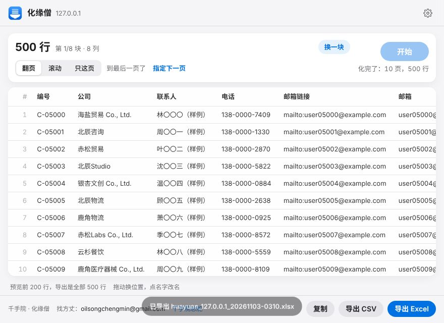
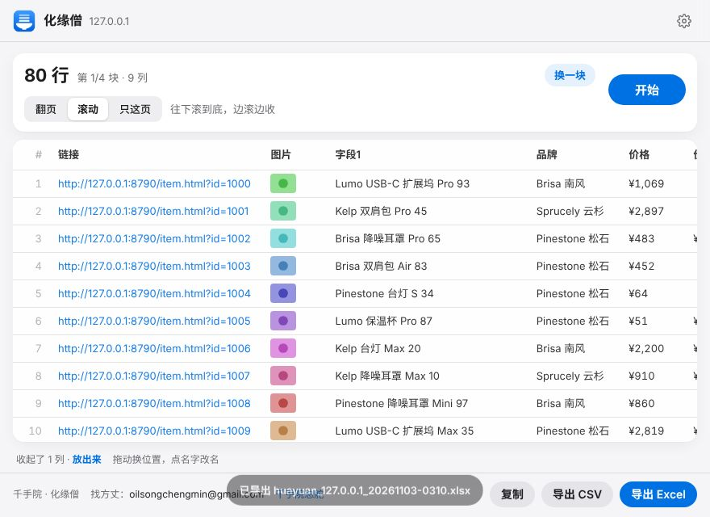
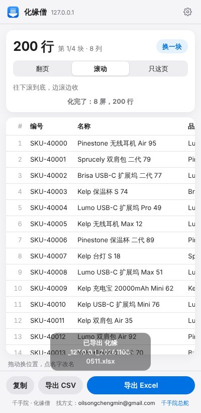
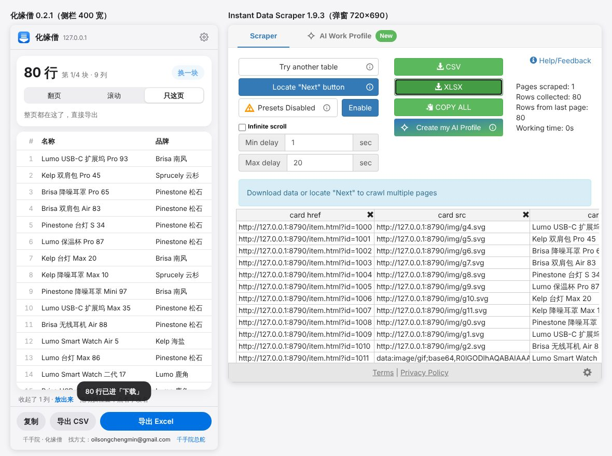
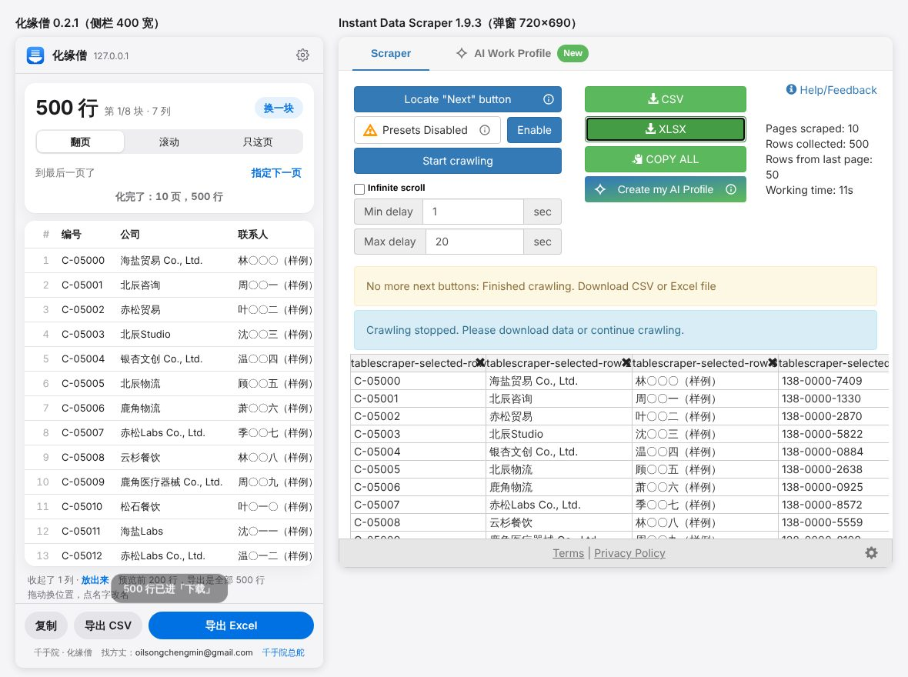
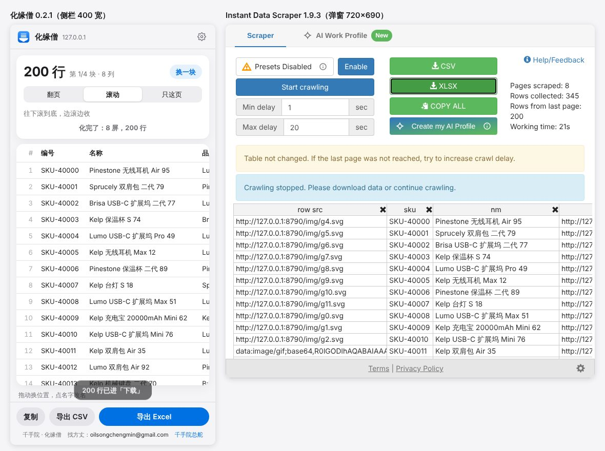

# 化缘僧 · 比武报告（2026-11-03，云端）

## 结论先说

- **我们自己：6 个场景 1,724 行，漏行 0、重复 0、多余 0、错列 0**；单页 2 下、翻页 / 加载更多 / 无限滚动 3 下；10 页 × 50 条整页翻页 22.1 秒。
- **对手这趟没能真跑。** 沙盒连插件商店都打不开（clients2.google.com、microsoftedge.microsoft.com 都是 403），Instant Data Scraper 本尊装不进来。按规矩找了 GitHub 上的两家开源替补，代码 clone 下来了，跑分脚本也写好了，但**运行外部下载代码这一步被沙盒的安全审核连续拒了两次**（理由是「外部代码」）。按规矩不绕。
- 所以对手那几列是**读源码推算出来的，不是实测**，下面凡是推算的都标了「推算」。判词只能下半截：「少动手」我们赢（推算），「准、快、好看」等实测。

## 对手是谁

| | 是什么 | 状态 |
|---|---|---|
| Instant Data Scraper（商店版） | 本尊，已经从 Web Robots 卖给 Flavr Technology | 商店下载 403，没装上。留给 Song 的电脑 |
| **Open Scraper**（Lygobate/Open-scraper-chrome-extention，v1.4.1） | IDS 1.4.1 原版代码反混淆后的分支，界面和流程跟本尊一样 | 已 clone、读完源码，**运行被拒** |
| **Open Data Scraper**（iblead/open-data-scraper，v1.3.0） | 从零重写的 IDS 克隆，MV3 | 已 clone、读完源码，**运行被拒** |
| Browse AI | 要注册 | 不比（拍板第 3 条），留给 Song 的电脑 |
| ohsusannamarie/instant-data-scraper-linkedin | 别人重新打包的 IDS 0.1.7，改过 | 来历不清、版本太老，没用 |

## 怎么比的

- 测试站：`bench/gen.js` 生成，本地 `127.0.0.1:8790`。数据是固定种子随机拼的（公司名带「样例」、邮箱都是 example.com、电话 138-0000-xxxx），没有真人真公司。每个场景配标准答案 `answers/<场景>.json`。仓库里只放脚本和一个小样本（`bench/sample/`），整站用 `node huayuan/bench/gen.js` 现生成。

| 场景 | 内容 | 行数 |
|---|---|---|
| a-table300 | 一页 300 行大表格，表头吸顶，中英混杂，邮箱是 mailto 链接 | 300 |
| b-cards | 卡片网格，中间夹 6 个广告卡，原价 / 评分有缺，图片懒加载（data-src） | 80 |
| c-paged | 整页跳转翻页，10 页 × 50 行 | 500 |
| d-ajax | Ajax 翻页（网址不变，400ms 延迟），10 页 × 50 条列表行 | 500 |
| e-loadmore | 「加载更多」按钮，6 批 × 24 张卡片 | 144 |
| f-infinite | 无限滚动，8 批 × 25 行，批与批之间夹广告条 | 200 |

- 跑法：`bench/run.js` 把插件装进 Playwright 的 chromium（launchPersistentContext + --load-extension），按「真人最少点几下」的路线点：点图标（用各家图标的处理函数代替，等价）→ 该点的按钮 → 导出 Excel。点一下记一下；用时从点图标算到 Excel 下载完。一律用各家默认设置（我们每页等 1.5 秒）。
- 打分：`bench/score.py` 读导出的 xlsx 对答案。按「编号」认行：漏行、重复、多余（广告等认不出编号的行）。每个答案列在表里找命中率最高的一列，命中 < 98% 记一处错列。值相等、数值相等，或者去掉 ≤6 字的标签前缀（「发货地：」）后相等都算对。
- 复现：
  ```
  node huayuan/bench/gen.js
  node huayuan/bench/run.js /tmp/bench ours
  node huayuan/bench/run.js /tmp/bench ids <Open Scraper 目录>
  node huayuan/bench/run.js /tmp/bench ods <Open Data Scraper 目录>
  python3 huayuan/bench/score.py huayuan/bench/site/answers /tmp/bench/ours
  ```

## 四样数字

### 准（实测，只有我们）

| 场景 | 抓到 / 应有 | 漏行 | 重复 | 多余 | 错列 |
|---|---|---|---|---|---|
| a-table300 | 300 / 300 | 0 | 0 | 0 | 0 |
| b-cards | 80 / 80 | 0 | 0 | 0（6 个广告卡都没混进来） | 0（懒加载图片拿到的是真图地址） |
| c-paged | 500 / 500 | 0 | 0 | 0 | 0 |
| d-ajax | 500 / 500 | 0 | 0 | 0 | 0 |
| e-loadmore | 144 / 144 | 0 | 0 | 0 | 0 |
| f-infinite | 200 / 200 | 0 | 0 | 0（7 条广告条没混进来） | 0 |

数据都对，但**列名和格式不干净**，用户还得自己动手（见精加工 1、3、4、6）：
- 卡片 / 列表行里：商品名那列叫「字段1」，评分叫「rate」，发货地叫「loc」，原价叫「价格2」。
- 列表行的评分值带着「评分 4.0」前缀没去掉（只认「：」，不认空格）。
- xlsx 把「4.0」存成数字，Excel 里显示成「4」。
- 表格多出一列「邮箱链接」（mailto:...），跟「邮箱」重复。
- 卡片里链接、图片两列排在最前面，名称和价格排到后面去了。

对手（推算，读源码得出，没跑）：
- **Open Scraper（≈IDS 1.4.1）**：图片取的是 `img.src`，不看 data-src。b-cards 屏幕外的卡片图片列拿到的会是 1×1 占位图（data:image/gif），这一列大概率错一大半。列名是 `/div.card/div/span.price` 这种结构路径。
- **Open Data Scraper**：单页只点「侦测」就导出的话，导出的是预览的前 100 行（`preview: rows.slice(0, 100)`），a-table300 会漏 200 行；想导全，得先选翻页方式再点 Start。翻页循环跑在网页里，整页跳转一次脚本就没了，c-paged 大概率停在第 1 页。

### 少动手：点几下拿到 Excel（含点图标）

| 场景 | 我们（实测） | Open Scraper ≈ IDS（推算） | Open Data Scraper（推算） |
|---|---|---|---|
| 单页（a、b） | **2** | 2 | 3（还只导前 100 行） |
| 整页翻页（c） | **3** | 5 | 5 |
| Ajax 翻页（d） | **3** | 5 | 5 |
| 加载更多（e） | **3** | 5 | 5 |
| 无限滚动（f） | **3** | 4 | 4 |

差别在：我们自己找「下一页 /加载更多」、自己判断要滚动；IDS 系两家都得先点「Locate Next」，再到网页上点一下下一页（IDS 同一个网站第二次去会记住，变成 4 下）。

### 快（实测，只有我们，默认每页等 1.5 秒）

| 场景 | 用时 |
|---|---|
| a-table300（300 行单页） | 1.1 秒 |
| b-cards | 0.9 秒 |
| **c-paged（10 页 × 50 行，整页跳转）** | **22.1 秒** |
| d-ajax（10 页 × 50 条） | 25.3 秒 |
| e-loadmore（6 批） | 14.4 秒 |
| f-infinite（8 批） | 33.0 秒，其中约 18 秒耗在到底以后（连续 3 次各空等 6 秒才收工） |

风险（推算）：IDS 默认每页等 1 秒加「网络请求停了」就收，整页翻页可能比我们快。Open Data Scraper 无限滚动到底后要空等 20 秒（maxDelay）才收。

### 好看

只截了我们的（`bench/img/ours-*.jpg`）。对手的界面要跑起来才能截，这趟没截成。




看我们自己截图发现的问题：
- 长单页会自动选上「滚动」，还亮着「开始」按钮，用户会以为必须点它。
- 导出成功的提示条盖住了页脚的邮箱。

## 判

- 准：我们 0 错。对手没实测，**不能判赢**。
- 少动手：我们 2–3 下，对手 2–5 下（推算），**不输**。
- 快、好看：对手没数，**不能判**。
- 这趟没撞上致命 bug，没改产品代码。

## 精加工清单（按要紧程度）

1. **补对手实测**：在 Song 的电脑上（或者在允许运行外部插件的会话里）装商店版 Instant Data Scraper，再加上 Open Scraper、Open Data Scraper，用 `bench/run.js` 跑同一套场景，补齐准 / 快 / 好看三样和并排截图。Browse AI 也放这一轮。
2. **列名**：
   - h3 / 标题元素叫「名称」，不叫「字段1」。
   - strings.js 的 hintWords 补上 `rate→评分`、`loc→地区`（现在只认 location）、`orig|was|del|line-through→原价`。
   - 同一行出现两个价格时，带删除线的那个叫「原价」，不叫「价格2」。
3. **无限滚动收尾**：页面高度不再长，或者出现「到底了 / 没有更多 / no more」，就立刻收，不再空等 3 × 6 秒。f-infinite 能从 33 秒压到 15 秒左右。
4. **值清洗和 xlsx 格式**：
   - 空格隔开的标签前缀（「评分 4.0」）也拆成列名。
   - 「4.0」这种带小数位的、以 0 开头的、编号类的值，按文本写进 xlsx，或者带数字格式，别丢掉小数位。
5. **列顺序**：链接、图片列放到文字列后面；或者按页面阅读顺序，以第一个文字字段为准。
6. **mailto / tel 链接列**：值跟文字列一样（去掉 mailto: 后相同）就自动收起。
7. **长单页的模式**：滚到底也不会再加载的页面，默认选「只这页」，或者提示「这页已全部抓到」，别亮着「开始」。
8. **翻页速度**：默认等 1.5 秒，10 × 50 要 22 秒。等实测完 IDS 再定，要不要改成「指纹稳定 + 网络空闲就收」，把固定等待降到 0.5–0.8 秒。
9. **提示条位置**：别盖住页脚。
10. 拍板.md 里的侧边栏、中文文件名照原计划做（不在本报告范围）。

## 0.2.0 复赛（2026-11-03 13:14 新加坡，云端）

同一套 6 个场景、同一个打分脚本，只跑我们自己。对手这趟照规矩**没跑**（外部下载的对手代码上一轮被沙盒安全审核拒过两次，这趟不再碰），对手那几列还是上一轮的读源码推算。新加了一项「名字对」：答案每一列在表里对上的那列，表头是不是叫对了（城市≈地区/发货地，链接≈名称链接），外加「杂列」（多出来的列）。结果存 `bench/results/ours-score-0.2.0.json`。

复现：`node huayuan/bench/gen.js && LANG=C.UTF-8 node huayuan/bench/run.js /tmp/bench ours && python3 huayuan/bench/score.py huayuan/bench/site/answers /tmp/bench/ours`（LANG 要 UTF-8，见下面「中文文件名」）。

| 场景 | 抓到 / 应有 | 漏 / 重 / 多 / 错列 | 名字对（0.1.0 → 0.2.0） | 杂列 | 点几下（0.1.0 → 0.2.0） | 用时（0.1.0 → 0.2.0） |
|---|---|---|---|---|---|---|
| a-table300 | 300 / 300 | 0 / 0 / 0 / 0 | 7/7 → 7/7 | 1 → 0 | 2 → 2 | 0.9 → 2.2 秒 |
| b-cards | 80 / 80 | 0 / 0 / 0 / 0 | 6/9 → **9/9** | 0 → 0 | 2 → 2 | 0.7 → 2.0 秒 |
| c-paged | 500 / 500 | 0 / 0 / 0 / 0 | 7/7 → 7/7 | 1 → 0 | 3 → 3 | 22.2 → **12.4 秒** |
| d-ajax | 500 / 500 | 0 / 0 / 0 / 0 | 5/8 → **8/8** | 0 → 0 | 3 → 3 | 25.0 → **15.2 秒** |
| e-loadmore | 144 / 144 | 0 / 0 / 0 / 0 | 6/9 → **9/9** | 0 → 0 | 3 → 3 | 14.2 → **8.6 秒** |
| f-infinite | 200 / 200 | 0 / 0 / 0 / 0 | 5/8 → **8/8** | 0 → 0 | 3 → **2** | 32.7 → **11.1 秒** |
| 合计 | 1,724 / 1,724 | 0 / 0 / 0 / 0 | 36/48 → **48/48** | 2 → **0** | 16 → **15** | 95.7 → **51.5 秒** |

- **准**：1,724 行 0 错照旧；列名 48/48 叫对，多余列 0。表头现在是「名称 / 品牌 / 价格 / 原价 / 评分 / 发货地 / 编号 / 链接 / 图片」，不再有「字段1 / rate / loc / 价格2 / 邮箱链接」。评分 4.0 在 xlsx 里存数字带一位小数格式，Excel 里显示 4.0。
- **少动手**：无限滚动从 3 下到 2 下（打开就替你试滚，出货就自己滚到底，不用点「开始」）。其余不变。对手 IDS 系推算 2–5 下（上一轮读源码），我们 2–3 下。
- **快**：翻页、加载更多、无限滚动合计 94.1 → 47.3 秒。f-infinite 33 → 11 秒（目标 15 秒）。**单页 a/b 慢了 1.2 秒**：长页面打开后要试滚 1.2 秒确认「整页都在」，表格本身 0.9 秒就出来了，导出不用等；这里按「确认完才算」计时。
- **好看**：侧边栏截图 `bench/img/ours-*-panel-0.2.0.jpg`。对手界面还是没截到。




### 精加工清单逐条

| # | 内容 | 0.2.0 |
|---|---|---|
| 1 | 补对手实测 | **没做**：沙盒里不跑外部下载的对手代码。留给 Song 的电脑 |
| 2 | 列名 | 做了：h1–h6 叫「名称」；hintWords 加 rate→评分、loc/region→地区、orig/was/old/del/划线价→原价、nm→名称；带删除线（del/s 标签或 line-through 样式）的值叫「原价」 |
| 3 | 无限滚动收尾 | 做了：看到「到底了 / 没有更多 / no more」立刻收；名单没动 + 页面没长 + 网络安静 3 秒 + 没「加载中」也收。33 → 11 秒 |
| 4 | 值清洗、xlsx 格式 | 做了：「评分 4.0」这种中文标签 + 空格 + 数字也拆成列名；带小数的数字写数字 + 对应小数位格式；表头像编号 / 电话 / ID / SKU 的列一律写文字 |
| 5 | 列顺序 | 做了：文字列在前（按页面顺序），链接、图片列排最后；用户拖过就听用户的 |
| 6 | mailto / tel 链接列 | 做了：去掉 mailto:/tel: 后跟别的列一样就自动收起 |
| 7 | 长单页的模式 | 做了：没下一页、能滚的页面先试滚 1.2 秒；没出新货就回原位、选「只这页」、写「整页都在这了」，不亮「开始」；出了新货就直接滚到底 |
| 8 | 翻页速度 | 做了（没等 IDS 实测，自己定）：每页「指纹连续两次一样 + 网络安静 300 毫秒」再多等 0.5 秒（原来固定 1.5 秒），设置里能改 0–30 秒 |
| 9 | 提示条位置 | 做了：浮在导出按钮上面，不盖页脚；文字改短（「300 行已进『下载』」） |
| 10 | 侧边栏、中文文件名 | 做了：点图标开 Chrome 侧边栏（每个标签页一份），浏览器不给开就退回靠右小窗；文件名「化缘_域名_时间.xlsx」，前缀在 strings.js |

### 中文文件名

沙盒默认 C 语言环境（LANG 为空），Chromium 会把任何中文下载名（不管是扩展页还是普通网页、blob 还是 data:）换成 `download`；`LANG=C.UTF-8` 一设，文件名就是「化缘_127.0.0.1_20261103-1309.xlsx」。上一轮改用英文名就是被这个骗了。真电脑（Windows / macOS / 正常 Linux 桌面）都是 UTF-8，不受影响。e2e 里已经断言下载名是中文。

### 判（复赛）

- 准：我们 0 错、列名全对；对手没实测，**还是不能判赢**。
- 少动手：2–3 下对 2–5 下（推算），**不输**。
- 快：比自己快一倍；对手没数。
- 好看：侧栏版截图在上面；对手没截。

## 0.2.1 复赛（2026-11-03 17:10 新加坡，云端）：对手本尊实测

这回 **Instant Data Scraper 商店版真装上了、真跑了**。Chrome 应用商店官方下载地址（clients2.google.com → clients2.googleusercontent.com）这次 200，拿到 `OFAOKHIEDIPICHPAOBIBBNAHNKDOIIAH_1_9_3_0.crx`，版本 **1.9.3**（Flavr Technology），sha256 `cadb3632cb1bb0793155cec58d7173e54886ac85867baa2d9e8ff71d9213acb1`。crx 和解包目录放在仓库外，没进仓库。Playwright Chromium（launchPersistentContext + --load-extension）里跑同一套 6 场景、同一个打分脚本，两家各跑 3 轮，准确度 3 轮一模一样，用时取中位数。明细：`bench/results/vs-ids-0.2.1.json`。

复现：
```
node huayuan/bench/gen.js
LANG=C.UTF-8 node huayuan/bench/run.js /tmp/bench ours
LANG=C.UTF-8 node huayuan/bench/run.js /tmp/bench ids <IDS 1.9.3 crx 解包目录>
python3 huayuan/bench/score.py huayuan/bench/site/answers /tmp/bench/ours   # ids 同理
```

**装上先过一道开户页**（一次性，4 下）：Get Started → 勾「服务条款」→ Confirm & Activate → 弹「Are you sure?」→ Continue with Basic Only。同一页还有一个勾选框，要你同意它**收集你的浏览记录、搜索词、点击、发给 AI 的内容和广告数据，并分享给关联公司、再卖给他们的客户、拿去训练 AI**。我们没勾，走「Basic Only」，抓取功能照常。不勾之前弹窗上盖着「You haven't finished setting up the extension」，导出点不了。

### 四样数字（我们 0.2.1 vs IDS 1.9.3）

| 场景 | 抓到 / 应有（我们 · IDS） | IDS 的毛病 | 列名叫对（我们 · IDS） | 点几下（我们 · IDS） | 用时中位数（我们 · IDS） |
|---|---|---|---|---|---|
| a-table300 | 300/300 · 300/300 | 多一列 mailto | 7/7 · 0/7 | 2 · 2 | **0.89 · 0.92 秒** |
| b-cards | 80/80 · 80/80 | 图片列 69 格是 1×1 占位图（不认 data-src） | 9/9 · 0/9 | 2 · 2 | **0.71 · 0.73 秒** |
| c-paged | 500/500 · 500/500 | 多一列 mailto | 7/7 · 0/7 | 3 · 5 | **9.8 · 13.7 秒** |
| d-ajax | 500/500 · **450/500** | 第 10 页没收（弹窗报错 `d.map is not a function`）；图片列 351 格占位图 | 8/8 · 0/8 | 3 · 5 | **11.6 · 13.3 秒** |
| e-loadmore | 144/144 · 144/144 | **重复 8 行**；图片列 128 格占位图 | 9/9 · 0/9 | 3 · 5 | **5.9 · 7.4 秒** |
| f-infinite | 200/200 · 200/200 | **重复 145 行**（345 行里 145 行是重的）；图片列 182 格占位图 | 8/8 · 0/8 | 2 · 4 | **7.5 · 26.4 秒** |
| 合计 | **1,724 行 0 错** · 漏 50、重 153、错格 730 | | **48/48 · 0/48** | **15 · 23**（IDS 另加开户 4 下） | **36.4 · 62.5 秒** |

- **准：赢。** IDS 表头是 `tablescraper-selected-row 2`、`card href`、`nm`、`loc`、`rate`，48 个列名一个都没叫对；值里「发货地：」前缀原样留着；工作表名直接用网址（`http://127.0.0.1:8790/b-cards.h`），带 `:` `/` 这些 Excel 不许的字符，openpyxl 正常模式打不开，只能只读模式读（真 Excel 会不会弹「修复」没在真 Excel 上验）。
- **少动手：赢。** 翻页 / 加载更多 IDS 要「Locate Next → 去网页上点一下下一页 → Start crawling」，我们自己找到下一页，点「开始」就行；无限滚动 IDS 要勾「Infinite scroll」再 Start，我们打开就自己滚。
- **快：赢。** 单页两家都是 0.7–0.9 秒，我们略快 0.02–0.03 秒（我们表一出来就能导出，跟 IDS 同一条路；后台试滚 1.1 秒确认「整页都在」，readyMs 另记）。翻页、加载更多、无限滚动我们全快，f-infinite 快 3.5 倍（IDS 到底后看样子在空等 Max delay 20 秒：Working time 21 秒）。
- **好看：不输。** 并排截图：





IDS 是 Bootstrap 3 老样子：绿按钮、蓝框提示条、表头是 CSS 路径，界面上有「AI Work Profile / Create my AI Profile」推广位。我们是侧栏、中文列名、跟随深浅色。

### 输了的项和补法（0.2.0 实测 → 0.2.1）

0.2.0 对上 IDS 本尊，准和少动手都赢，**快输了四场**：a 2.4 vs 0.9、b 2.2 vs 0.7、d 16.5 vs 13.3、e 11.0 vs 7.4 秒（c 13.5 打平，f 12.9 赢）。改了这些（只改速度，不碰准）：

1. **单页不再干等试滚**：试滚改成跟画表同时进行（先滚出去，画表的工夫顺便等）；看 0.45 秒没动静就下结论（原来 1.2 秒）；表一出来导出键就能点（原来就能点，跑分改成跟 IDS 一样表出来就导，试滚结论另记 readyMs 核对没漏，a、b 两场 × 3 轮全部「导出的就是全部」）。
2. **试滚看漏的兜底**：下结论后再盯 5 秒，名单自己长了（慢吞吞、又不写「加载中」的无限滚动）就改成「滚动」接着滚完。e2e 加了一场：demo/scroll.html?slow=1（每批 1.5 秒、不写加载中），自己收齐 120 件。
3. **网络安静不算图片**：懒加载图片、样式、字体不再算「网络还在忙」，只看 fetch / XHR / 脚本这些会改名单的。
4. **轮询从 300 毫秒改成 100 毫秒**：翻页后「指纹连续两次一样」最快 0.2 秒就认。
5. **追加式不多等**：加载更多 / 无限滚动旧行还在页面上，晚到的下一轮照样收，翻页后的「多等几秒」只给整页换内容的用；收工时统一补等一次再收一遍，最后一批不会漏。
6. **每页多等默认 0.5 → 0.3 秒**（设置里照样能改 0–30 秒；改过的人不受影响）。

结果 0.2.0 → 0.2.1：a 2.4 → 0.89、b 2.2 → 0.71、c 13.5 → 9.8、d 16.5 → 11.6、e 11.0 → 5.9、f 12.9 → 7.5 秒；准确度、列名、点击数不变（1,724 行 0 错、48/48、15 下）。

### 判（0.2.1 复赛）

- 准：我们 1,724 行 0 错、列名 48/48；IDS 漏 50、重 153、图片列错 730 格、列名 0/48。**赢。**
- 少动手：15 下 vs 23 下（IDS 另加首次开户 4 下）。**赢。**
- 快：6 场 4 场明显快、2 场单页打平（差 0.02–0.03 秒）；合计 36.4 vs 62.5 秒。**赢。**
- 好看：并排截图在上面。**不输。**

### 还差

- Open Scraper、Open Data Scraper 两家开源替补这回没跑（本尊都跑了，意义不大）；Browse AI 要注册，照旧不比。
- 真侧边栏（点工具栏图标开、整页跳转后还在）、activeTab 正式包在整页跳转后会不会弹「允许这个网站」，还是只能在 Song 的电脑上人工点一遍。
- 测试站是我们自己出的题，对 IDS 不一定公平；真网站（淘宝、领英、政府名录）的对比要在 Song 的电脑上、用他登录的账号做。

## 0.3.0 复赛（2026-11-03 新加坡，云端）：去掉没必要的步骤 + 好看

沙盒 Chromium（Playwright，新 headless）真跑。旧版 0.2.1 从 git 取出来，跟 0.3.0 同一台机器、同一份脚本轮流跑。脚本：`steps.js`（步骤账，新旧同一个脚本：只照「人要的结果」做，界面已经替人做了的就不点）、`vs-old.sh` + `vs-old-sum.py`（6 场景 × 3 轮，谁先跑轮流换）、`shots-0.3.js`（交货截图）。结果：`results/steps-0.2.1.json`、`results/steps-0.3.0.json`、`results/vs-old-0.3.0.json`。

### 步骤账

场景是 huayuan/demo 的假数据。客户名单那场，人要的表是：不要「编号」、「联系人」叫「对接人」、「邮箱」放第一列、5 页全要、Excel。

**客户名单（表格 5 页，整页跳转，要改列）：第一次 6 下 → 5 下；第二次 6 下 → 1 下**

| # | 0.2.1 这一步 | 必要？ | 理由 | 0.3.0 |
|---|---|---|---|---|
| 1 | 点工具栏图标 | 必要 | 告诉它抓哪一页，程序不知道 | 照旧 |
| 2 | 扫一眼认出的表对不对 | 必要 | 人判断：是不是要的那块名单 | 照旧，好做了：拿不准的标黄（列名只能叫「字段N」或照抄英文、还有一块分数到六成也像、翻到页数上限才停） |
| 3 | 删「编号」列 | 第一次必要 / 第二次没必要 | 第一次是人给的信息（不要哪列）；第二次跟上回一样 | 第一次照旧；记住，第二次自己删 |
| 4 | 「联系人」改名「对接人」 | 同上 | 同上 | 同上 |
| 5 | 把「邮箱」拖到第一列 | 同上 | 同上 | 同上 |
| 6 | 点「开始」 | 第一次必要 / 第二次没必要 | 第一次人要决定翻全部页还是只要这页（50 页的搜索结果常常只要第一页）；第二次：上回在这个网站这一块是翻完全部页才下的，这回只会一样 | 第一次照旧；第二次记住，打开就自己开翻，「停」一直在，「还原」也会停 |
| 7 | 点「导出 Excel」 | 没必要 | 翻完了、没有标黄，人只会点下载 | 自动做：化完自己下（格式照上回用的），状态写「化完了，已下载」，下面「以后别自己下」一点就关 |

**销售线索（卡片，Ajax 翻 4 页）：第一次 3 下 → 2 下；第二次 3 下 → 1 下**

| # | 0.2.1 这一步 | 必要？ | 理由 | 0.3.0 |
|---|---|---|---|---|
| 1 | 点工具栏图标 | 必要 | 同上 | 照旧 |
| 2 | 扫一眼 | 必要 | 同上 | 照旧，拿不准的标黄 |
| 3 | 点「开始」 | 第一次必要 / 第二次没必要 | 同上 | 第二次自己开翻 |
| 4 | 点「导出 Excel」 | 没必要 | 同上 | 化完自己下 |

**商品（无限滚动 120 件）：第一次 2 下 → 2 下；第二次 2 下 → 1 下**

| # | 0.2.1 这一步 | 必要？ | 理由 | 0.3.0 |
|---|---|---|---|---|
| 1 | 点工具栏图标 | 必要 | 同上 | 照旧 |
| 2 | 扫一眼 | 必要 | 同上 | 照旧（0.2.1 起就是打开自己滚完，不用点开始） |
| 3 | 点「导出 Excel」 | 第一次必要 / 第二次没必要 | 第一次人没点过「开始」，还没认过这张表，这一下就是「扫完了、对」的确认，确认和下载已经是同一下；第二次这一块上回在这个网站下过 | 第一次照旧（确认那一下就下载）；第二次滚完自己下 |

单页（比武 a、b 场景）：点图标 → 扫一眼 → 点「下载 Excel」，2 下不变。最后那一下就是确认，不是多出来的步骤；不在打开那一刻自动下，因为一页上常有好几块像名单的，自动下了万一是错的那块，就多一个废文件。

留着的必要步骤：扫一眼（判断）、第一次的改列（人给的信息）、第一次的「开始」（翻不翻全部页是人的决定）、单页和第一次无限滚动的那一下下载（确认）。

### 准和快（同一份 run.js 计时，6 场景 × 3 轮，取中位数）

| 场景 | 抓到 / 应有（两版一样） | 漏 / 重 / 多 / 错列 | 列名叫对 | 点几下 0.2.1 → 0.3.0 | 用时中位数 0.2.1 → 0.3.0 |
|---|---|---|---|---|---|
| a-table300 | 300 / 300 | 0 / 0 / 0 / 0 | 7/7 | 2 → 2 | 0.76 → 0.64 秒 |
| b-cards | 80 / 80 | 0 / 0 / 0 / 0 | 9/9 | 2 → 2 | 0.42 → 0.48 秒 |
| c-paged | 500 / 500 | 0 / 0 / 0 / 0 | 7/7 | 3 → **2** | 9.35 → 8.99 秒 |
| d-ajax | 500 / 500 | 0 / 0 / 0 / 0 | 8/8 | 3 → **2** | 10.76 → 10.49 秒 |
| e-loadmore | 144 / 144 | 0 / 0 / 0 / 0 | 9/9 | 3 → **2** | 5.44 → 4.86 秒 |
| f-infinite | 200 / 200 | 0 / 0 / 0 / 0 | 8/8 | 2 → 2 | 7.18 → 7.04 秒 |
| 合计 | **1,724 / 1,724，0 错**（3 轮每轮一样） | 0 | 48/48 | **15 → 12** | **33.9 → 32.5 秒** |

- 准：两版一模一样，1,724 行 0 错，列名 48/48。
- 快：翻页三场省掉「导出」那一下，各快 0.3–0.6 秒。b-cards 这一组中位数慢 0.06 秒（三轮 0.32–0.48 对 0.39–0.44，单页 0.4 秒级的场景抖动比这大）；只跑 a、b、f 的 5 轮专场里 b 是 0.443 → 0.419 秒、a 0.686 → 0.639 秒、f 7.07 → 7.13 秒——单页和无限滚动算打平，不算退步。
- 中途抓到过一回 f 慢 0.2–0.3 秒，两个原因：一是计时脚本对新版多等了一秒「自己下的」文件（改成状态写「已下载」才等）；二是侧栏顶栏底栏的毛玻璃在软件渲染下每屏重画都要算模糊，它们不压在内容上、后面没东西可透，去掉了。去掉后 f 单场 5 轮三方对比：0.2.1 7.16、0.3.0 7.03、0.3.0 换回旧样式表 7.03 秒。
- 对手 IDS 1.9.3 这一轮没重跑（只改了步骤和长相，抓取、翻页逻辑没动）：0.2.1 复赛时它 23 下（另加开户 4 下）、合计 62.5 秒、漏 50 重 153。我们现在 12 下。

### 好看（照 _ops/设计规范.md 逐节）

截图在 `bench/shots-0.3/`：侧栏 400 宽 × 浅 / 深 × 空状态、干活中、结果、出错 8 张（panel-*）；介绍页 390 / 1280 × 浅 / 深 4 张（intro-*）。介绍页的大图（img/side-*.jpg）也是新界面重截的。apple.com/macos、apple.com/iphone 沙盒能开（200），截了两张对着看；苹果的图不进公开仓库。

| 规范 | 打勾 | 说明 |
|---|---|---|
| 一屏一件事，一个主按钮 | ✓ | 「开始」亮着时下载是灰的；化完了下载是主按钮；空状态只有「用示例试试」是主按钮 |
| 能自动的事不出按钮 | ✓ | 化完下载、第二回改列和开翻都自动；自动做的写在状态和表下面，能「还原」/「以后别自己下」/「停」 |
| 只一个主色，其余灰 | ✓ | 化缘僧金只在主按钮、选中、进度、链接；网页上的高亮框也从蓝 / 橙换成金 |
| 浅色 / 深色两套 | ✓ | 深色：黑底、#1c1c1e 卡片、选中的分段 #636366、主色提亮 |
| 颜色 token 照抄 | ✓ | ui.css 和介绍页都是规范那段变量 |
| 主按钮白字对比度 ≥ 4.5 | ✓ | #D99A0B 上白字只有 2.45:1，浅色按钮加深到 #9A6700（4.87:1）。深色主色提亮到 #F5B931，白字只有 1.8:1，**改用深字 #1d1d1f（9.6:1）**——跟「白字」不一致，看得清更要紧 |
| 存疑标黄用 --doubt | ✓ | 拿不准的列名、「还有一块也像」、「到上限停的」都是 --doubt 底，不用红框 |
| 系统字体、数字等宽 | ✓ | 不引外部字体；行数、页数、序号都 tabular-nums |
| 字号阶梯 | ✓ | 侧栏正文 15、行数 22、辅助 13、注脚 12；介绍页大标题 clamp(40px,6vw,64px)、正文 17。表格格子 13（按「辅助」算） |
| 字重 400 / 600 / 700 | ✓ | |
| 圆角 18 / 12 / 14 / 10 / 8 | ✓ | 卡片 18、按钮 12、介绍页大按钮 14、输入框和分段外框 10、分段里和小标签 8；0.2.1 的胶囊按钮全换掉 |
| 间距 4 的倍数 | ✓ | 8 / 12 / 16 / 24；介绍页区块 96（手机 72） |
| 阴影一档、深色不用 | ✓ | |
| 列表行高 ≥ 44 | 部分 | 设置浮层每行 48、介绍页安装步骤每行 ≥ 56；**数据表格行高 36**——它是表不是设置列表，侧栏一屏要多看几行 |
| 能点的 ≥ 44×44 | 部分 | 插件按钮 36 高（规范允许插件 36）、设置按钮 36×36；表头的「×」删列 24×24，悬停才出现 |
| 顶栏、浮层毛玻璃 | 部分 | 设置浮层、提示条、介绍页顶栏用毛玻璃；**侧栏顶栏底栏改实底**：不压在内容上，没东西可透，还拖慢翻页（见上） |
| 图标线性 2px 圆头，不用 emoji | ✓ | 设置（滑杆）、删列、空状态、介绍页 6 个功能图标都是 2px 圆头线条 |
| 本尊图标跟总舵卡片统一 | ✓ | 同一个图形（金渐变圆角方块 + 两道名单 + 钵），img/icon.svg；插件 16/32/48/128 PNG 由 bench/icons.js 出，16 像素把两道线并成一道加粗 |
| 过渡 200–300ms、--ease | ✓ | 240ms |
| 超过 1 秒有进度 | ✓ | 不知道总页数：控制卡顶上一根细条来回走 + 小转圈 + 「第 3 页 · 已收 60 行」；化完打勾描一笔 |
| prefers-reduced-motion | ✓ | |
| 不裸露系统控件 | ✓ | 「化完自己下载」是 iOS 开关；翻页 / 滚动 / 只这页是分段控件；数字框重画过 |
| 拖放整页能丢 | 不适用 | 化缘僧没有拖文件进来的活 |
| 空状态：一句话 + 用示例试试 | ✓ | 「这页贫僧进不去」+「用示例试试」（侧栏里直接摆示例表，能下来看看）+「去示例网页化一回」 |
| 出错：人话 + 怎么办，放在出事的地方；不用 alert / confirm | ✓ | 网页关了：表上面一条「网页关了，已收的 12 行还在，照样能下」，下载照常（0.2.1 是换成空状态、下载变灰）；全程没有 alert / confirm |
| 侧栏宽 360–400，顶部名字 + 状态，主按钮在底部 | 部分 | 400 宽；顶部名字 + 网站名；下载主按钮在底部。**「开始」在控制卡里**，跟翻页 / 滚动选项挨着，它管的就是那几项 |
| 网页：内容 980、手机 390 无横向滚动、首屏一句大标题 + 副标题 + 主操作 | ✓ | shots-0.3.js 里量过 390 宽 scrollWidth 不超；副标题和介绍用 Song 11-03 18:19 圈定的「过路留名，见网扒皮」 |
| 别这样 | ✓ | 没满屏渐变（渐变只在图标上，跟总舵卡片一样）、没卡片套卡片、没 emoji、没 12px 正文、没默认下拉框复选框 |

### 判（0.3.0 复赛）

- 准：跟 0.2.1 一样，1,724 行 0 错、列名 48/48。不退步。
- 快：合计 33.9 → 32.5 秒；翻页三场各快 0.3–0.6 秒，单页和无限滚动打平。不退步。
- 步骤：账里标「没必要」的全去掉了——化完再点导出（自动下）、第二回再改列（记住）、第二回再点开始（记住）、第二回滚完再点导出（记住）。留下的每一步都说得出人在干嘛：点图标（抓哪页）、扫一眼（对不对）、第一次改列（要什么样的表）、第一次点开始（翻不翻全部）、单页那一下下载（确认）。
- 好看：照规范重做，不合的四处写了原因。

### 还差

- 真侧边栏、activeTab 正式包在整页跳转后的表现、「化完自己下」在开了「下载前询问保存位置」的 Chrome 里会不会每次弹框，都只能在 Song 的电脑上点一遍。
- 「记住上回」按网站 + 名单路径认块；网站改版、名单路径变了就认不上，当第一次用（不会套错，只是少省几步）。同一网站两块长得一样的名单，靠「这页只有一块长这样」兜底。
- 「以后别自己下」只关自动下载，已经下好的那份要自己去「下载」文件夹删：插件没要「管理下载内容」权限（加了会让已装的人被浏览器停用、要重新点同意），所以删不了文件。
