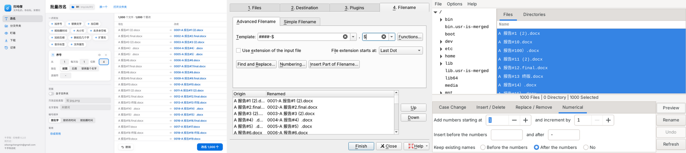

# 扫地僧 0.2.0 比武报告（2026-11-03，云端沙盒）

一句话：**准、少动手两样全过；改名和分文件夹比对手快；下载比 aria2 慢一截（6.2 秒对 0.4 秒），算明显落后，进精加工。** 这趟没改产品代码，也没撞上致命 bug。

## 对手

| 对手 | 比了没 | 说明 |
|---|---|---|
| Bulk Rename Utility | 没比 | 只有 Windows 版，留给 Song 的电脑 |
| File Juggler | 没比 | 只有 Windows 版（付费、试用），留给 Song 的电脑 |
| KRename 5.0.2（替补，改名） | 真比 | apt 装，Xvfb 里用 xdotool 点界面（它的 `--template` 命令行参数实测不生效，只能点） |
| GPRename 20210415（替补，改名） | 真比 2 项 | apt 装，xdotool 点界面；没有日期/EXIF 功能，只比了 R1 序号、R5 大小写 |
| organize-tool 3.3.0（替补，替 File Juggler） | 真比 | pip 装，开源规则式整理，写 YAML 跑命令，没有界面 |
| aria2 1.37.0（下载） | 真比 | apt 装，命令行 |

我们这边：核心逻辑在 Linux 沙盒里跑（`run_ours.py`，和界面点「执行」走同一个 `Api.rename_run / organize_run`）；界面用开发服务器 + 无头 Chromium 真点一遍（`ui_bench.py`，同一套 HTML 界面 + 真 Python 核心，exe 里是 WebView2 画同一个页面）。**Windows 真机跑 exe 那一轮没做**，留给 Song 的电脑。

## 测试材料（`gen.py` 现造，不进仓库）

8 个场景共 5050 个文件，标准答案在 `gen.py` 里独立算（不调扫地僧代码），`score.py` 按 inode 认文件对答案。

| 场景 | 文件数 | 规则 | 刁钻的 |
|---|---|---|---|
| R1 加序号 | 1000 | 名字前加 4 位序号 `0001-`，按自然顺序（2 在 10 前） | 中文、`# & 😀 【】（）` 等字符、主名里带点、251 字节长名（加序号就超 255）、1 个被占用（chattr +i 模拟） |
| R2 替换文字 | 350 | `IMG_` → `旅行_` | 20 个目标名已被现成文件占着；30 个扩展名里带 `IMG_` 不该动 |
| R3 加日期 | 300 | 前面加修改日期 `YYYY-MM-DD ` | 跨午夜 23:59:59 / 00:00:00 |
| R4 照片按拍摄时间 | 550 | 改成 `YYYYMMDD_HHMMSS` | 400 张带 EXIF（10 对同一秒）；EXIF 里的「修改时间」和文件修改时间都故意设错；100 张无 EXIF jpg、50 张 png（不改算对，用修改时间也接受，记「降级」） |
| R5 大小写 | 300 | 整个名字含扩展名改小写 | 15 对只差大小写（`PAIR0.TXT` 和 `pair0.txt` 同时在）、`ÄÖÜ`、全角字母 |
| R6 去多余空格 | 220 | 首尾空格去掉、连续空格（含全角空格）并成一个 | 10 对整理后撞名 |
| O1 按类型分 | 1512 | 按扩展名进 图片/文档/表格/…，认不出的进「其他」 | 大写扩展名、`.tar.gz`、目标文件夹已有同名 30 个、下载中 `.part/.crdownload`、`~$` 临时文件、隐藏文件、被占用、300+ 字符深路径、真 zip（里面中文名） |
| O2 照片按拍摄月份 | 810 | 照片进 `YYYY/YYYY-MM` | 月底 23:59:59、目标已有同名 10 张、150 张无 EXIF（按修改时间分或不动都算对）、pdf/docx 不该动 |
| D 下载 | 52 个网址 | 本地 http 服务 | 5 个 404、3 个前两次只给一半就断、60MB 大文件第一次断在 40%（看是不是带 Range 续）、不支持续传的 6MB 断一次、5 个文件名只在 Content-Disposition 里（`合同N.pdf`）、5 个中文网址、2 个不同网址同名 |

撞名的答案：原目标名 + 任意避让后缀（` (2)`、`_1`、`.1`）都算对，**跳过不改算错**（用户要的事没办成），覆盖/丢文件单独记。

## 一、准（错几个；0 是全对）

| 场景 | 扫地僧 | KRename | GPRename | organize | aria2 |
|---|---|---|---|---|---|
| R1 序号 1000 | **0** | 917（默认顺序）/ 0（手动切 Numeric 排序） | 918 | — | — |
| R2 替换 350 | **0** | 50 | 没跑 | — | — |
| R3 日期 300 | **0** | 0 | 不支持 | — | — |
| R4 拍摄时间 550 | **0**（降级 150） | 402 | 不支持 | — | — |
| R5 大小写 300 | **0** | 15 | 240 | — | — |
| R6 去空格 220 | **0** | 10 | 没跑 | — | — |
| O1 按类型 1512 | **0** | — | — | 4 | — |
| O2 按月份 810 | **0**（降级 150） | — | — | 0 | — |
| D 下载 52 | **0** | — | — | — | 1 |

所有工具都没丢文件、没覆盖文件。对手错在哪：

- **KRename**：撞名一律跳过（R2 20 个、R5 15 个、R6 10 个、R4 3 个）；替换文字连扩展名一起换（`说明_0.IMG_` → `说明_0.旅行_`，30 个）；拍摄时间只能原样吐 `2024:05:01 08:00:00`，带冒号，Windows 不认，要再配两条查找替换；没 EXIF 的照片被改成隐藏文件 `.jpg`、`.png`（2 个）；默认按字面排序编号，要手动切到 Numeric 才对。
- **GPRename**：按字面排序编号，没有自然排序选项（918 个序号错位）；超长名字那个文件卡在临时名 `…txt_gp`，扩展名坏了；R5 里 15 个撞名每个弹一个框，点完整批都没改。
- **organize**：把下载中的 `.part/.crdownload`、隐藏文件、`Thumbs.db` 也挪进了「其他」。
- **aria2**：服务器不支持续传又断线时直接报错放弃，留下半截文件 + `.aria2` 控制文件（加不加 `-c` 都一样）；其余全对，大文件带 Range 续上了。

扫地僧的「降级」：R4 里 150 张没 EXIF 的 jpg/png 用文件修改时间改了名，O2 里同样 150 张按修改时间分了月份。照规则不算错（界面有黄标签「没拍摄时间，用了修改时间」），但截图被改成下载那天的日期是会误导人的，进精加工。

## 二、少动手（点几下 + 打几处字；不含「选文件夹」，每家都一样要选）

| 场景 | 扫地僧 | KRename | GPRename | organize / aria2 |
|---|---|---|---|---|
| R1 | 3 + 1 | 7 + 1（含切 Numeric 排序 4 下；还得会写 `####-$`） | 6 + 1 + Ctrl+A | — |
| R2 | 4 + 2 | 8 + 2 | — | — |
| R3 | 2 | 3 + 1（得会写 `[modificationdate;yyyy-MM-dd] $`） | — | — |
| R4 | 4 | 3 + 1（结果还是错） | — | — |
| R5 | 3 | 4 + 2 | 4 + Ctrl+A + 15 个弹框 | — |
| R6 | 2 | 10 + 3（正则） | — | — |
| O1 | 2 | — | — | 写 28 行 YAML + 1 条命令 |
| O2 | 3 | — | — | 写 13 行 YAML + 1 条命令 |
| D | 2 + 1（贴网址） | — | — | 存网址列表 + 1 条 6 个参数的命令 |

扫地僧每项都不多于对手；R4 按「点+打字」算和 KRename 打平（4 对 4），而 KRename 出来的名字是错的。

## 三、快

| 项目 | 扫地僧 | 对手 |
|---|---|---|
| 1000 个文件加序号（R1） | 核心 0.05 s；界面点「改名」到弹完成 0.19 s | KRename 点 Finish 后 1.26 s，加 1000 个文件后界面 3-30 s 才能响应（3 s 时输入被吞）；GPRename < 0.5 s |
| 按类型分 1512 个（O1） | 核心 0.08 s；界面 0.15 s | organize 1.52 s |
| 照片按月份 810 个（O2） | 界面 0.25 s | organize 0.97 s |
| 下载 52 个网址（D） | **6.2 s** | aria2 **0.4 s** |

下载慢在重试退避：断线后固定等 1.5 s、3 s 再试，3 个「断两次」的文件光等就 4.5 s；aria2 断线后立刻续。这是「明显落后」。

## 四、好看（截图都在 `shots/`）



左扫地僧、中 KRename、右 GPRename，同一个 1000 文件加序号场景。扫地僧：中文、一点就加的规则卡片、右边实时预览、撞名有黄标签、按钮写明「改名 1,000 个」。KRename/GPRename：只有英文，Qt/GTK 老式控件，KRename 要懂模板语法。不落后。

扫地僧界面的小毛病：预览列窄的时候，黄标签被省略号截掉，看不到「撞名，自动避让」（见 `shots/saodi-R4.png` 里的 `(2).jpg...`）。

## 五、判

| 标准 | 结果 |
|---|---|
| 准不许输 | **过**：9 个场景全 0 错；对手真跑的 11 项里 8 项有错（KRename 按最好设置算） |
| 动手不许多 | **过**：每项 ≤ 对手（R4 打平） |
| 快不能明显落后 | 改名、分文件夹 **过**（快几倍到几十倍）；**下载不过**（6.2 s 对 0.4 s） |
| 好看不能明显落后 | **过**（预览列标签被截是小毛病） |

## 精加工清单（按要紧排）

1. **下载断线续得太慢**：断线时已经收到数据的，立刻带 Range 续，不等；退避改成 0.3 s → 1 s → 3 s；404 之外的失败才走长等待。目标：这套 52 个网址 ≤ 1 s。
2. **「按拍摄时间」碰到没 EXIF 的照片默认别改**：现在用修改时间顶上（150 张截图被改成下载那天），改成默认跳过、给个开关「没拍摄时间的用修改时间」；分文件夹「照片按拍摄月份」同理。
3. **预览列黄标签被截**：标签放到名字下面一行，或者窄的时候只显示一个小圆点 + 悬停说明。
4. **R4 默认格式**：默认 `YYYY-MM-DD hh.mm.ss`，手机/相机常见的是 `YYYYMMDD_HHMMSS`，可以在格式下拉把它排第一，少点两下。
5. （Windows 真机才知道）被占用文件、超长路径 `\\?\`、只差大小写在 NTFS 上的表现，这趟只在 Linux 模拟过。

## 留给 Song 电脑真机比的

- 扫地僧 exe（任务给的是 Releases `saodi-v0.1.0` 的 `SaodiSeng-0.1.0.exe`；version.json 已是 0.2.0，这趟比的是 0.2.0 源码，真机最好用最新 Release）在 Windows 上把 R1-R6、O1-O2、D 各跑一遍：材料可以在 Windows 上 `python gen.py D:\saodi-bench ALL` 现造（被占用那步 Windows 上不生效，要手动用 Word/Excel 开一个文件占着）。
- Bulk Rename Utility：R1-R6 同材料，记错几个、点几下、1000 个文件用时。
- File Juggler：O1、O2（试用版）。
- 重点看：Windows 下 `PAIR0.TXT`/`pair0.txt` 这种只差大小写的名字根本放不进同一个文件夹，R5 那 15 对要换成「改小写后撞上已有文件」的版本。

## 怎么复现

```bash
cd saodi/bench
python gen.py /tmp/sb ALL                      # 造材料 + 标准答案（/tmp/sb，别放仓库里）
python run_ours.py /tmp/sb R1,R2,R3,R4,R5,R6,O1,O2   # 扫地僧核心
python ui_bench.py /tmp/sb /tmp/sb/shots       # 扫地僧界面实点（要 playwright）
python dl_bench.py /tmp/sb saodi               # 下载：扫地僧
python dl_bench.py /tmp/sb aria2               # 下载：aria2
# 对手（root 下要建个普通用户 bench，KRename 用 root 开会弹警告框挡住；Xvfb :9）
python kr_drive.py /tmp/sb R1 '####-$' '$'     # KRename；FileListSorting=3 是 Numeric 排序
python gp_drive.py /tmp/sb R5 '[["click",17,403]]'   # GPRename
sed "s#ROOT#/tmp/sb/O1#g" organize_O1.yaml > /tmp/o1.yaml && organize run /tmp/o1.yaml
```

原始数字在 `results/`：`saodi-core.json`、`saodi-ui.json`、`download-*.json`、`rivals.json`。

## 这趟的取舍

- 没人可问，以下自己定的：撞名「跳过」算错（不算丢）；没 EXIF 的照片「不动」和「用修改时间」都算对；R1 的名字用 ASCII 字母打头分家，避开拼音排序的地区差异，让标准答案没争议；KRename 给它最好的设置（Numeric 排序）再比，默认设置的结果也列了。
- 点击数是按真人最少步骤数的，KRename/GPRename 用 xdotool 照这些步骤真点过（R2、R6 的查找替换框也真点了）。
- 没注册任何账号，所有操作只在 `/tmp/sb` 造出来的假文件夹里。
