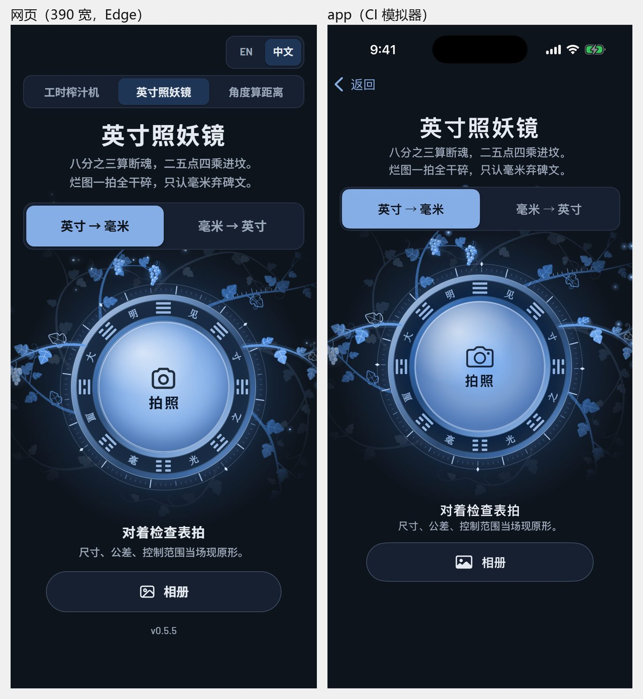
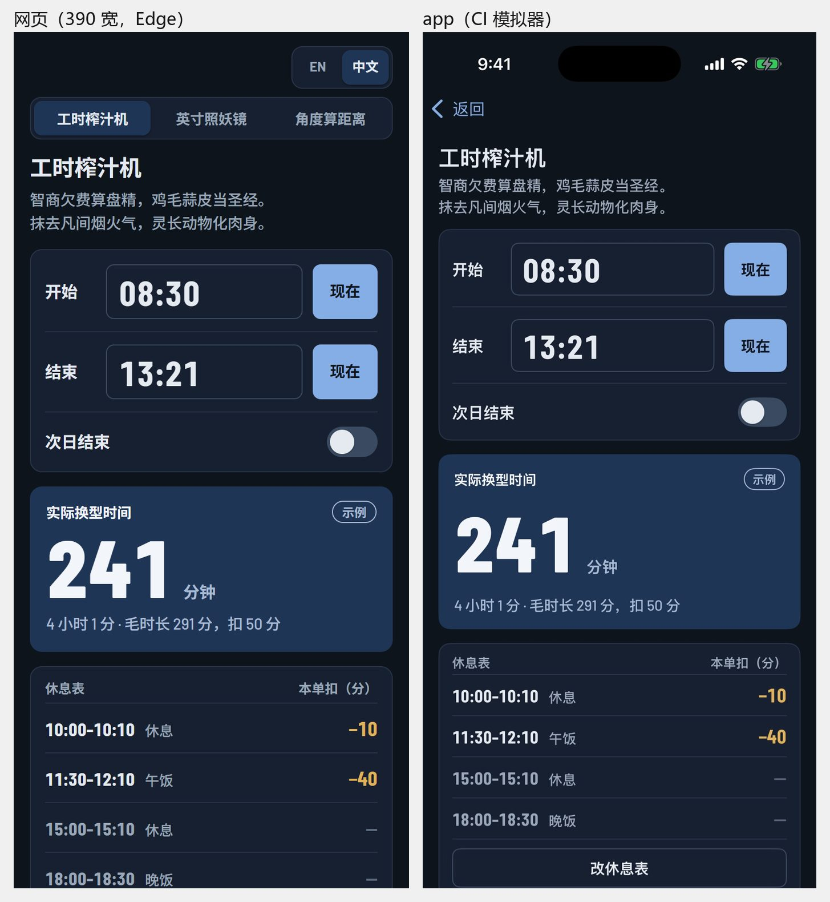
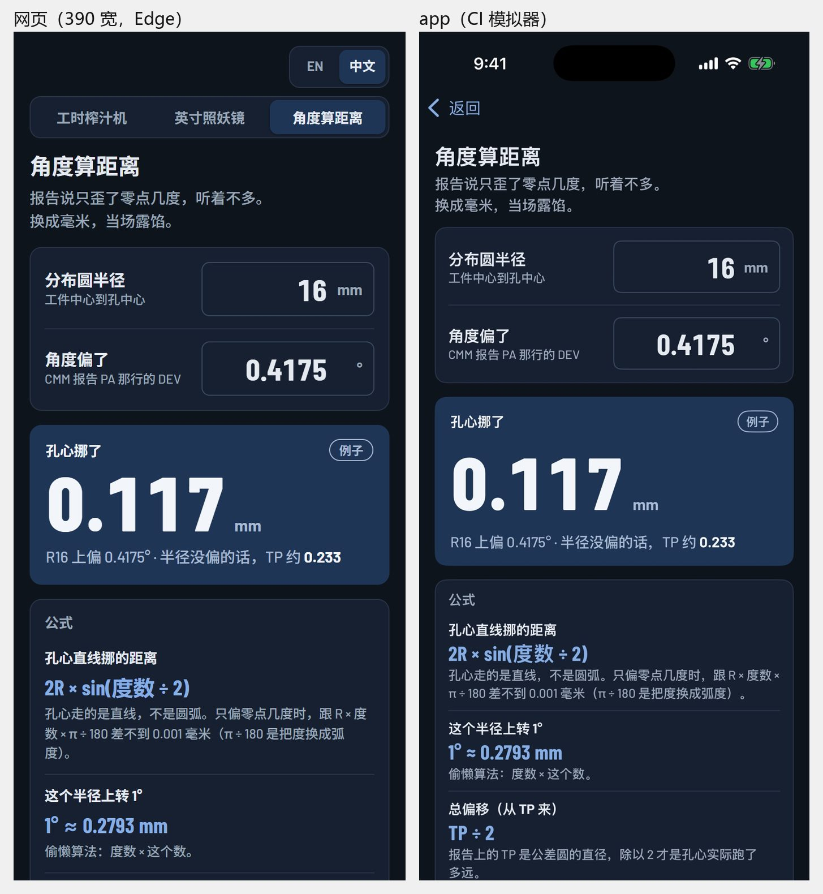

# 134 铁屑江湖：工具箱里的工具都用它原来的长相（0.3.2）

照妖镜、工时榨汁机、角度算距离点进去就是各自网页版的样子了：深色工单底、网页同款数字字体，照妖镜直接放在页面上。
工具箱选工具那页、铁件点钞机没动；算法、认字、单测一个没改，CI 全绿，0.3.2 已发（设置 → 有新版）。
网页铁屑江湖的副标题两句诗各占一行了。

施工：掌机自动工 134（Opus · 高），2026-11-24 22:32 认领，11-25 凌晨发版。

## 做了什么

- 每个工具的长相写在它自己的文件夹里：`Tools/英寸照妖镜/YingCunLook.swift`、`Tools/GongShi/GongShiLook.swift`、`Tools/JiaoDu/JiaoDuLook.swift`。颜色、字号、圆角、间距都照网页样式表抄的数（`--bg #0e141c`、`--surface #172030`、`--accent #86aee6`、`--band #1f3556`……）。三个工具穿的是同一套网页皮，但各抄一份，互不引用：删掉哪个，别的照样编译、照样好看（CI 的「拆掉工时榨汁机」每次照跑，过了）。
- 字：网页的数字和英文是 Barlow / Barlow Condensed（Google Fonts，SIL OFL 1.1）。每个工具文件夹带一份（`Barlow/`，文件名带工具前缀免得包里撞名，许可文件跟着），中文落到苹方，跟网页在 iPhone 上一样。
- 共用的 `ToolPage`（宣纸外壳）、`PaperCard`、`BigField`、`AnswerBand` 删了，只有这两个工具在用。`Shared/ToolKit.swift` 只剩：工具接口 `ToolEntry`、装工具自带字体的 `ToolFonts`、`toolChrome`（顶上那条跟着工具换色）、`InkButton`（铁屑江湖自己改秘籍、拍封面的页面还在用，没动）。
- 返回键：照旧是系统的「‹ 返回」，颜色换成工具的亮蓝，状态栏白字；退回工具箱换回墨色。
- 照妖镜：不要镜龛了，镜子整屏宽直接放在页面上，藤蔓往上伸到模式切换底下、往下伸到提示底下（网页就是这样叠的）；网页那 24 颗萤火加回来了（照网页的三种飘法，照妖时停住）。模式切换是网页的亮蓝滑块；进度、出错是网页的小卡；结果那句前面有网页的小圆点（绿 / 黄 / 橙）；点红字改数弹出的单子也换成网页的样子。
- 角度算距离：网页底下那张「原理，说人话版」（等腰三角形的图 + 六条）搬过来了，图照网页 SVG 的坐标画。
- 工时榨汁机：时间框靠左、「现在」亮蓝实底、网页的开关、休息表金色扣分、改休息表就地改（行在上，上下班和三个按钮在下，跟网页一样）。
- 字跟网页对齐的几处：公式第一条补「（π ÷ 180 是把度换成弧度）」；休息表提示「只存在这台手机上」；照妖镜提示去掉 122 加的第二句「认字在手机里跑……」（网页没有）。
- 网页上「中文按钮底下的英文小字」：中文界面这三页都没有（英文只在切到 EN 时才有），所以 app 也不加。
- 0.3.2 多修一处：照完一张，页面自动滚到结果时，结果原来顶到屏幕最上面，「‹ 返回」压在相册按钮上（122 就有）。现在滚到结果上方留出顶栏那一截。
- 顺手：`tiexie/index.html` 加 `.sub span { white-space: pre-line; }`。
- 别处只动了：`ci/shots.sh` 多截一张「照妖镜还没拍照」（跟网页首屏比）；`project.yml` 版本；`release-notes.md`；`tiexie/README.md`「改了啥」一行；三个工具的 README。工作流没碰。

## 并排截图

左边网页（390 宽，本机 Edge + Playwright，中文），右边 app（发版时 CI 的 iPhone 模拟器）。网页三页都只有深色一套：系统设成浅色、深色各截一遍，像素一样，所以每页一张。

英寸照妖镜（还没拍照）：

工时榨汁机：

角度算距离：

照妖镜真跑一张假表（`s6_persp_tilt_shadow.jpg`，透视 + 歪 + 阴影，本机 Vision）：[shots/09-tool-zhaoyao.jpg](shots/09-tool-zhaoyao.jpg)。2 个黄格（故意印错的那行），其余红字跟 122 一样。

## 跟网页版对不上的地方

- 顶上：网页是「切三个工具的标签 + EN / 中文」，app 是系统的「‹ 返回」和状态栏。故意的，见下面「我替你定了」。
- 网页底下的版本号「v0.5.5」app 没有。
- 答案带里的大数字（241、0.117）上面空得比网页多一点：网页把这行行高压到 0.95，SwiftUI 的字没法压行高，只能照字体自己的行高。
- 照妖镜「英寸 → 毫米」的箭头 app 细一点：网页这个箭头落到苹方粗体，app 落到苹方细一档的字重。
- 照妖镜：网页打开时藤蔓上有一道光顺着藤往外跑一次、几颗葡萄会闪；app 的藤蔓是网页截下来的整张图，跑光、闪光做不了，只有长出来的那一下和萤火。
- 照妖镜结果下面 app 多一个「横过来看」：app 只能竖屏（网页是叫你把手机横过来），这是 122 的功能，留着，样子换成网页的细框按钮。
- 角度算距离的「原理」那张截图里看不到（要往下滑），图和六条字都在。
- 模拟器比网页宽 3 点（393 对 390），字看着小一点点是缩图缩的。

## 网页副标题

`data.json` 的 `site.sub` 中间那个 `\n` 认了：「十步削一铁，千里不撞刀。」「屑落惊花雨，万转笑天骄。」各占一行，别的没动。

## 我替你定了这些

- 网页顶上切三个工具的标签和 EN / 中文：不搬。app 里从工具箱进出，只要中文；工具之间也不许互相引用。
- 网页底下的版本号不搬：放进 app 会跟铁屑江湖的版本号搅在一起。
- 角度算距离把网页底下的「原理」也搬了：单子说「就是网页版的样子」，网页上有。
- 字体文件直接进仓库（三份，每份约 430 KB），不像毛笔字那样 CI 现下：单子要每个工具的长相在自己文件夹里、删一个不影响别的。仓库根 `.gitignore` 忽略所有叫 `Fonts` 的文件夹，所以叫 `Barlow/`。
- 0.3.1 发出去以后才看见结果页跟返回键叠在一起，又发了 0.3.2，所以这单用了两个版本号。0.3.1 第一趟 CI 苹果机器 15 分钟没排上被 GitHub 取消，重推了一次。

## 测过

- CI（macos-26，iPhone 模拟器）：编译、全部单测（照妖镜 Vision 353 格那套、榨汁机、角度、点钞机、信箱……）过；「拆掉工时榨汁机」照样编译、过测试。0.3.1、0.3.2 两次发版都绿，`apps.json` 已是 0.3.2。
- 截图看了：返回键亮蓝、状态栏白字、三页跟网页并排见上。
- 没验：真手机（LiveContainer 里）；从工具退回工具箱以后返回键变回墨色（截图只能截进门那一下，看不到退出来）。

## Song 试

1. 铁屑江湖 → 设置 → 有新版 → 照它说的回 LiveContainer 装
2. 工具箱 → 照妖镜：跟网页版一个样
3. 工具箱 → 工时榨汁机、角度算距离：各自跟网页版一个样
