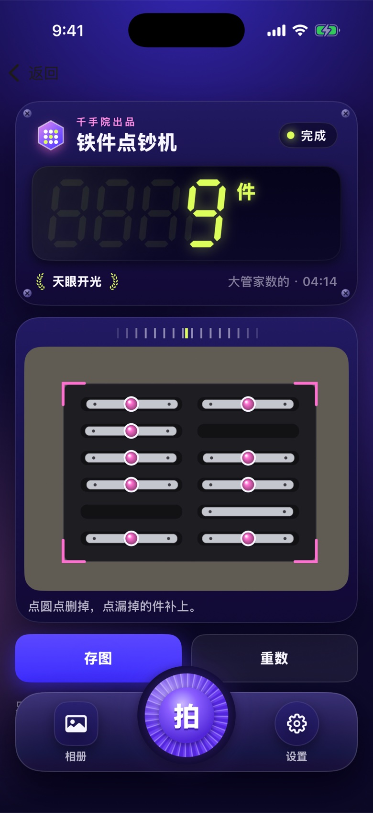
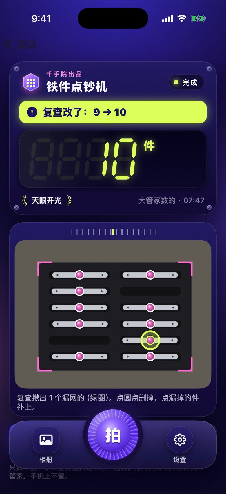

点钞机第一遍数一到就是「完成」：叮一声、数码管跑一下，存图和重数马上能点，界面上不再有「复查中」。
复查在后头悄悄跑，一样就什么都不动；不一样才改数和点、叮叮两声、震一下，上方写「复查改了：9 → 10」。
铁屑江湖 0.3.6 已发，CI 单测全绿；两声和震动没在真手机上听过，请你拍一盘试。

# 150 铁件点钞机：第一遍数完直接算数 报告（掌机自动工 150，Sonnet · 高，11-25）

## 第一遍刚到 / 复查改了一件

| 刚到就是「完成」 | 复查补了一件 |
|---|---|
|  |  |

（模拟器截图，用测试托盘摆的；改了那张的绿圈定住不闪，方便看。）

## 做成了什么（只动了 `tiexie/`）

- `first` 到了就算完成：右上角「完成」，数码管从 0 跑上去、叮一声，天眼开光、存图、重数、点圆点手改、「不算 / 也算上」马上能用。
- `final` 到了：
  - 一样：什么都不动，不叮、不闪、数码管不重跑。
  - 不一样：数和点换成复查的，「叮叮」两声、震一下，数码管上方一条亮绿色的「复查改了：45 → 46」；补上的点外头套绿圈、去掉的点原地红圈打叉，各闪 4 下（约 2.4 秒）；那一条留到下次拍。
- 复查没回来（200 秒超时、额度、出错）：用第一遍的数，不提示。
- 大管家那头一行没改。

## 跟 151 怎么接

做到一半，151（两个大脑一起数）已经装上了：`final` 可能是另一个大脑的点和盒子。手机这头照它的信认：

1. 带 `same: true` → 一样，手机上一点不动。
2. 各盒 `audit` 清单（跟第一遍比的加减）有东西 → 改了，照清单标。
3. 两样都没有 → 按位置配点（挪一点不算改）。

接口写进了 `大管家接口.md`。151 的报告提醒过「别逐个比坐标」，0.3.6 就是照这个做的。

## 版本

- 0.3.4：照单子做完，CI 一趟过。
- 0.3.5：发出去以后发现比对认死了坐标（151 会让它整盘误报），改成按位置配。
- 0.3.6：看到 151 实际寄的 `same` 和清单，改成直接认。**装这一版就行。**

## 验收

- 单测（`Tools/铁件点钞机/Tests/DianChaoTests.swift`，CI 全绿）：`first` → `final` 一样、多一件、少一件、复查没回来（超时和出错两种）；改了的时候那一行字、闪的点是哪几颗、叮几声；件数一样只换了点；复查前手改过 / 点过「也算上」；151 的 `same` 和换了盒子顺序；复查中点「重数」；两个声音在包里。
- UI 截图：上面两张（`shots/12`、`shots/13`，CI 里现拍）。
- 122、134、145 的测试照样全绿。其中跟新规矩相反的几句断言改了：第一封以后不再是「等复查」状态、状态行不写「复查一遍…」、边数边出点时第一封到了数码管也跑一下。

## 我替你定了这些

1. 原来 app 里没有声音，「叮」「叮叮」是我合成的两个小音效，走系统提示音：手机侧面拨了静音就不响（第一声只剩轻轻一下触感，改了照样震），也不打断正在放的歌。
2. 复查回来时数码管还在跑第一遍：数直接换过去，先响那一声叮、半秒多以后叮叮。
3. 件数一样、只是换了点：写「复查改了：45 → 45（补 1 个、去 1 个）」。
4. 复查回来前你手改过的、点过「不算 / 也算上」的都留着；复查要改的和你手改的是同一件就不重复算；改动全在你「不算」掉的那盒里就不提示。
5. `release-notes.md` 照老规矩只放本版这一条（整份换掉）。
6. 提交署名照单子的格式写的是 Opus，实际干活的是 Sonnet · 高。

## 没验到的

- 两声和震动：只在代码和单测里验过（单测确认声音文件在包里、该响的时候发了响的信号），LiveContainer 里真手机上响不响要你听。
- 闪的动画：截图是定住的一帧。
- 真大管家来回一趟：用的是照接口写的假大管家。
- 顺手看到、没动的：点钞机页左上角「返回」是深色字压在深色底上，不太看得清（原来就这样）。

## Song 试

1. 铁屑江湖 → 设置 → 有新版（0.3.6）
2. 点钞机拍一盘：数出来就是「完成」，叮一声，不用等复查（手机别拨静音）
