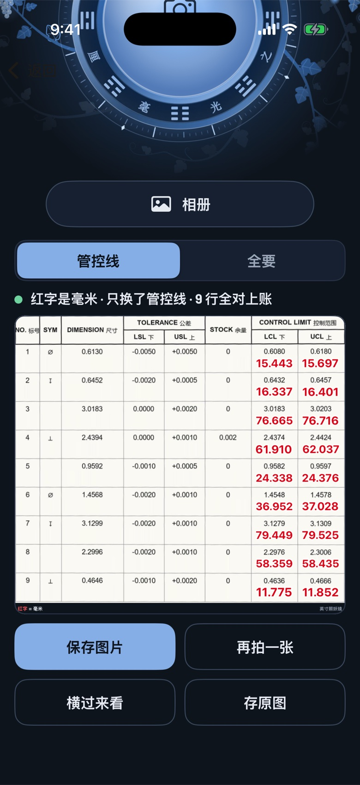
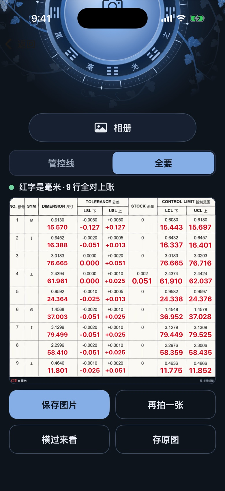
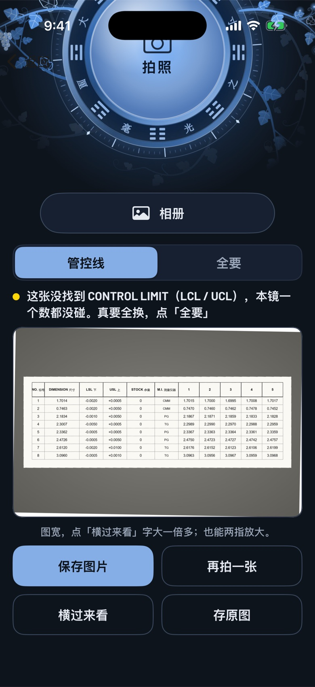
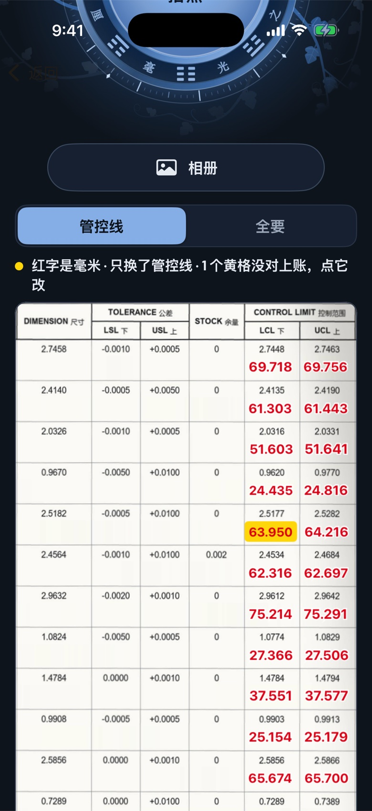
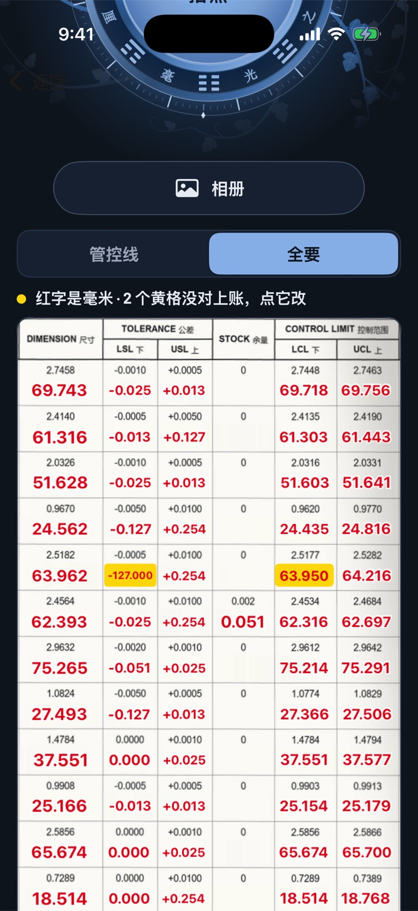

照妖镜现在默认只把控制下限 / 控制上限（LCL / UCL）两列变红，别的数不碰；点顶上「全要」照以前全换，选过就记住。结果页多了「存原图」。
你那张乱成一团的图，根子是 app 自己把一张拍正的整张单子转成了 45° 斜的，表头认不出才全换，红字又比原数大，一行压一行。这个修了：照着你那张画的整张横拍假单子（26 行、字小）两列 52 格全对，红字不再叠。
铁屑江湖 0.3.7 已发，CI 全绿。没有你的原图，截图里那块照片又不能进公开仓库跑苹果认字，所以真单子还没试过，请你拍一张。

# 166 英寸照妖镜：默认只换管控线，一键全要 报告（掌机自动工 166，Opus · 高，11-25 ~ 11-26）

## 截图（模拟器，假单子）

| 管控线（默认） | 全要 | 没管控线的单子 |
|---|---|---|
|  |  |  |

| 整张横拍 · 管控线 | 整张横拍 · 全要 | 点了存原图 |
|---|---|---|
|  |  |  |

深色外观：`shots/19-tool-zhaoyao.limits-dark.jpg`、`20-…all-dark`、`21-…none-dark`。照妖镜从 134 起整页就是网页版的深色工单皮，跟系统深浅色无关，所以两套长一个样。

## 做成了什么（只动了 `tiexie/ios/`）

- **结果顶上「管控线 / 全要」**：两段开关，跟单位那个一个样子、矮一点。默认管控线，记住上回选的；切了马上重画，不用重拍。
- **管控线**：只换 LCL、UCL 两列，别的数不动、不盖红字。
  - 「全要」读出的表里有 LCL、UCL 就直接用，对账照旧跑，黄格和「按尺寸和公差算该是…」只留这两列的。
  - 读表头放宽（`Tools/英寸照妖镜/YingCunLimits.swift`）：不再非要 DIMENSION / LSL / USL 都在。LCL、UCL 站一排就算；或者一格「CONTROL LIMIT / 控制范围」（中英文都认，认错两三个字母也算），底下分两格——写 LCL/UCL、下/上、什么都行，左下当 LCL、右下当 UCL；底下两格认不出字，就看它底下那两列数。
  - 两种读法谁的 LCL/UCL 格多用谁。
  - 找不到：一个数都不换，图是没盖红字的照片，顶上「这张没找到 CONTROL LIMIT（LCL / UCL），本镜一个数都没碰。真要全换，点「全要」」。
- **全要**：读法跟以前一样（网页版那套）。原来 8 张假单子 353 格照旧一格不差。
- **斜着拍、整张横拍**：
  - 根子在扶正第一步「投影法」：它在 ±45° 里找纸歪了几度，整张单子、字小的时候会被拐到 ±45°；后面 Vision 只在四个 90° 方向里挑，四个都是斜的，挑哪个都斜。你那张截图里照片右上、右下两块纯白三角，就是 app 转图时补的白边——原照片是正的。
  - 现在再在 ±15° 里也找一个角度，两组角度各转四个方向让 Vision 看一眼，认出字最多的是正的。真斜 45° 的单子照样转回来（s11），拍正的不再被转歪（s12）。
  - Vision 一次认整张图，偶尔整片不给字（s9：干净的图，UCL 那列第 2~9 行一个字都没认出来）。现在表头找到了、要换的列里有空格，就把表格那块裁出来放大再认；还有空格，再把那几列各裁一窄条放大认；补完格数多了才用。原来那儿是认不成数的一坨、这回认出了数，换成这回的。
  - 两种表头都没找到、原图又比 2016 大一截：用原图大小（最多 4032）再认一遍。
  - Vision 给不出某个词的位置时，这个词以前直接丢了；现在摆在左右邻居中间。
- **红字不叠**：
  - 有表（两种模式）：红字插在原数下面那条里，连边一起不超过这一列宽，隔壁两列碰不上。
  - 没表全换：红字框不高过原数那一格；先放右边，撞了别的字或别的红字就换下、左、上，还撞就缩一档；缩到原字一半（最少 7 像素）还放不下就不写，顶上说「N 个数挤得没地方写，没硬塞；凑近拍一段更清楚」。
- **存原图**：「横过来看」旁边。点了把这回没盖红字的原照片存进相册：相册挑的存原文件，现拍的存那张照片。只要「添加照片」权限，存好了下面一行「原图进相册了，没盖红字的那张」。不点不存。Info.plist 和千手院总源都加了 `NSPhotoLibraryAddUsageDescription`。LiveContainer 自己的 Info.plist 本来就带这个键（查过它的源码），在 LiveContainer 里点不会闪退。

## 怎么验的

- 新画了 5 张假单子（`Tests/Fixtures/s9`~`s13`，内容全是编的，照着你那张的样子：两层表头、M.I. 和实测值列、抬头和签字栏；真值在 `truth166.json`）：
  - s9 两层表头（TOLERANCE 底下 LSL/USL，CONTROL LIMIT 底下 LCL/UCL）＋ 五列实测值
  - s10 只有「CONTROL LIMIT 控制范围」，底下只写「下」「上」，没有 DIMENSION / LSL / USL
  - s11 s9 那样的单子斜 45° 拍
  - s12 整张单子横拍，4032 × 3024，26 行，字小
  - s13 有 DIMENSION / LSL / USL / STOCK，没有管控线
- 苹果 Vision 整条链（CI 模拟器）：

| 单子 | 管控线 | 全要 |
|---|---|---|
| s9 两层表头 | 18/18 | 46/46 |
| s10 只有 CONTROL LIMIT | 16/16 | 没 DIMENSION 那排，照旧整张全换；56 个数落了红字，13 个太挤没写，没有一个叠 |
| s11 斜 45° | 16/16（转回来了） | 40/40 |
| s12 整张横拍 | 52/52 | 131/132 |
| s13 没管控线 | 一个不换，提示对 | 24/24 |
| **合计** | **102/102** | **241/242** |

  s12 全要差的那一格：Vision 把小字「-0.0005」认成了「-5」（掉了小数点），对账会标黄。原图大小直接认 s12 也是 52/52。
- 单测（`Tests/YingCun166Tests.swift`）：网页版 8 张的字框上，管控线只落 LCL/UCL、个数和每格的数跟网页版一样，黄格只在这两列；单找管控线（不靠 DIMENSION 那排）也读得一样；「CONTROL LIMIT 控制范围 + 下/上」和「底下两格没字」都读得出；30 行 × 8 列挤在一起的数，红字一个不压字、不压红字、不高过原数。原来的 122 单测（Vision 353/353）照旧全过。
- 存原图：CI 里开模拟器、给「添加照片」权限、出结果就点一下：相册 6 → 7 张，新那张 2016 × 1400，跟原图一样大，是没盖红字的原图。

## 你那张截图

截图里的照片我裁出来、转回去看了：是正着拍的整张单子，被 app 转了 45°（白三角是转图补的边），上面又压满了红字。苹果的认字只在苹果机器上跑，这张截图又不能进公开仓库给 CI 跑，所以**没法拿它跑一遍管控线模式**。我在掌机上把扶正第一步（投影法）照搬成 Python 跑了这张：带着红字量是 -45°，把红字抹掉量是 4.7°。截图里的照片只有 800 来像素、又糊，说明不了你的原图当时量成了多少，只能说明白三角那个结论：原图是正的，是 app 转歪的。新办法多了 ±15° 那组、由 Vision 挑，拍正的单子不会再被选成斜的（s12 就是照这个情形画的）。看得见的表头里有「控制范围」、底下「下 / 上」，正是这回放宽认的那种。等你拍一张，看管控线那两列对不对。

## 我替你定了这些

- 「全要」那张表和单找管控线那张，谁的 LCL/UCL 格多用谁（一样多用全要那张，能对账）。
- 找不到管控线时给你看没盖红字的照片，不是空白。
- 相册里挑的图点「存原图」也会再存一份（存的是原文件），没拦。
- 补认（裁表格放大再认）只在要换的列有空格时才跑，多一两次 Vision；没空格的照片跟以前一样快。
- 表格里很窄的列红字会比以前小一点（连边不超过列宽）。
- CI 截图脚本不再开 `set -u`：macOS 自带的 bash 3.2 在 `set -u` 下截到第一张新屏就悄悄退出，原因没查到底，去掉以后 22 张都截了。

## 没做到 / 要注意

- 没在真 iPhone 上跑过；补认、原图大小重认在手机上多花几秒没量过。
- 网页版照妖镜（gongshi 仓库）这回没动：要不要也加「管控线 / 全要」、扶正也改，你定。
- 全要模式下 s12 那一格「-0.0005」认成「-5」，是小字掉小数点，对账会标黄。

## Song 试

1. SideStore → My Apps → 铁屑江湖 → UPDATE
2. 照妖镜拍一张 / 选一张带表头的检验报告
3. 默认只有控制上下限那两列变红；点「全要」全换
4. 点「存原图」，去相册看多了一张没盖红字的原图
