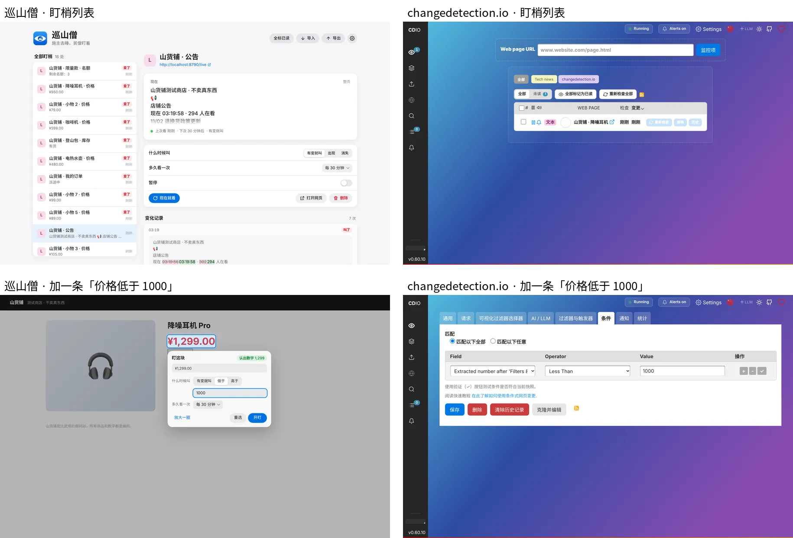
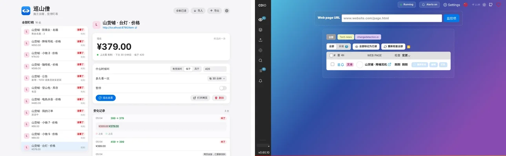
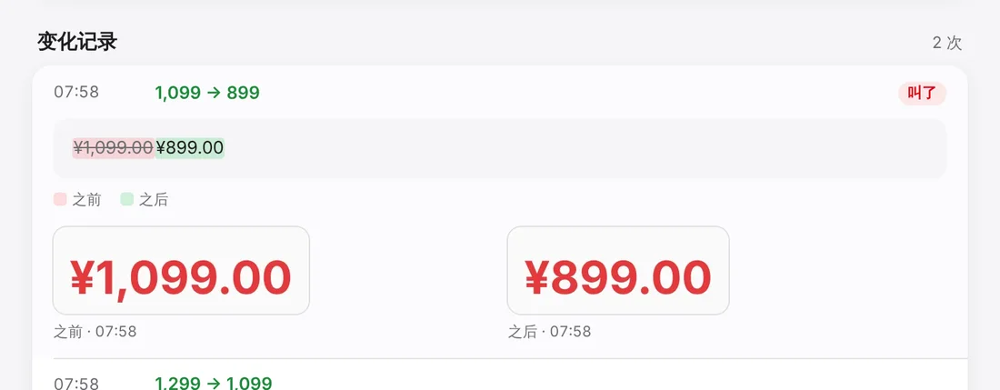

# 巡山僧 · 比武报告

2026-11-03，云端沙盒。比的是 0.1.0 毛坯（带一处致命 bug 修复，见文末）。

## 对手

| 对手 | 比没比 | 原因 / 方式 |
|---|---|---|
| Visualping | 没比 | 沙盒连不上 visualping.io，也要注册账号。留给 Song 的电脑 |
| Distill Web Monitor | 没比 | 沙盒连不上 distill.io 和 Chrome 商店，插件装不进来。留给 Song 的电脑 |
| changedetection.io 0.60.10 | 真比 | 开源，pip 装。最像 Visualping/Distill 的同类货（网页界面、CSS 选择器、条件、通知）。脚本渲染页用一个本地 Chromium 做它的浏览器抓取 |
| urlwatch 2.29 | 真比 | 开源，pip 装。命令行工具，写 YAML 配置，给程序员用的 |

changedetection.io 跑两套配置：
- **照默认**：填网址、填 CSS 选择器、设条件，其余不动（新手顺着界面走的样子）。
- **行家配置**：再加三样——脚本页改用浏览器抓取、整页加忽略规则（去掉时钟和在看人数）、要登录的页手抄 Cookie 进请求头。这些普通白领基本不会配。

urlwatch 只跑行家配置（CSS 过滤 + 去噪正则 + 浏览器抓取 + 手抄 Cookie）。它没有「低于多少才叫」这种条件，只会内容一变就叫。

## 测试材料（xunshan/bench/）

- `site.js`：本地测试店「山货铺」（编的商品和数字）。`scenario.js` 是剧本兼标准答案：8 个时刻、16 条盯梢、7 次切换，**该叫 20 次，其余 92 次不该叫**。
- 刁钻的地方：

| 盯梢 | 页面 | 坑 | 该叫 |
|---|---|---|---|
| W1 | 价格 | 低于 1000 才叫；没到线的降价不叫 | 3 |
| W2 | 库存 | 「缺货」消失才叫；「有货→仅剩 3 件」不叫 | 2 |
| W3 | 名额 | 脚本渲染；0 变成有名额才叫，2→1 不叫 | 2 |
| W4 | 公告 | 整页盯，页面带时钟和「N 人在看」，每次都变；只有新公告该叫 | 2 |
| W5 | 咖啡机 | 轮播广告每 1.5 秒换；页里引了 recaptcha 脚本（评论区用） | 2 |
| W6 | 台灯 | 第 3 步页面改版（结构变、价格没变），之后降价 | 2 |
| W7 | 订单 | 要登录；浏览器里已登录 | 2 |
| W8 | 热水壶 | 时不时出验证码页；验证码页不能当成「变了」 | 1 |
| W9 ×8 | 小物 1–8 号 | 同一个网站挂 8 条 | 4 |

- 怎么跑：每一步先把网站切到这一步，再让每个工具把每条都查一次（巡山僧用后台的「现在就看」，changedetection.io 用 API 的 recheck，urlwatch 跑一遍），记谁叫了。
- 脚本：`run_ours.js`（真装插件进 Playwright Chromium，用真框选建全部 16 条）、`run_cdio.py`、`run_urlwatch.py`、`score.js`（对答案）、`speed.js`（测快）。结果在 `results/`，截图在 `shots/`。

## 一、准

| | 叫对 | 漏报 | 误报 |
|---|---|---|---|
| **巡山僧** | 18 / 20 | 2 | 6 |
| changedetection.io 照默认 | 16 / 20 | 4 | 6 |
| changedetection.io 行家配置 | **20 / 20** | **0** | **2** |
| urlwatch 行家配置 | 20 / 20 | 0 | 11 |

巡山僧错在哪：
- W4 整页误报 5 次：时钟和在看人数每次都变，每次都叫。
- W6 漏报 2 次：改版后 nth-of-type 选择器找不到元素，只标「找不到了」，之后再也不查对。changedetection.io 用的是 `.price` 类名，改版没丢。
- W3 误报 1 次：「高于 0」条件下名额 2→1 也叫了（已经在线上，往坏的方向变也叫）。

巡山僧赢在哪：脚本渲染页自动切后台标签，要登录的页直接用浏览器自己的登录，验证码页认出来不乱叫——这三样 changedetection.io 照默认都丢（W3、W7 漏 4 次），要行家配置才补上。

changedetection.io 自己的毛病：「缺货消失」条件在「有货→仅剩 3 件」时也叫（两套配置都误报）；名额 2→1 行家配置也误报。

## 二、少动手（加一条「价格低于 1000」）

| | 点击 | 要打字的地方 | 备注 |
|---|---|---|---|
| **巡山僧** | **6** | 1（1000） | 点图标 → 框选一块 → 点价格 → 低于 → 开盯，第一次在这个网站会多一下「允许」 |
| changedetection.io | 17 | 3（网址、选择器、1000） | 复制网址 2 下；界面里 12 下（真用 Playwright 点过）；还得右键 → 检查 → 关开发者工具 3 下去找 `.price` 这个选择器 |
| urlwatch | — | 手写 YAML | 不算点击，白领用不了 |

## 三、快（网页变了 → 弹提醒）

两边都设成每 5 分钟查一次（巡山僧最短就是 5 分钟），真等闹钟，改两次价。

| | 单独一个网站 | 同一网站 8 条（最慢那条） |
|---|---|---|
| **巡山僧** | 300 秒、60 秒 | 第一次 1 条超过 600 秒没叫，其余 60–600 秒；第二次 60–660 秒 |
| changedetection.io | 191 秒（第二次，9 条同时到） | 191 秒 |

- 第一次改价 changedetection.io 的数不算：API 建的盯梢默认跟着全局「3 小时一次」，测的时候才改过来（脚本已修）。
- 单条：两边一样，都取决于改价落在查的周期哪个位置，平均约 2.5 分钟，巡山僧另多最多 1 分钟闹钟粒度。
- **同站多条巡山僧明显落后**：同一网站一轮只许去一次（siteGapSec 60 秒）、闹钟 1 分钟一跳，8 条 5 分钟档的盯梢只能一分钟查一条，排队越排越长，最慢 11 分钟才叫；changedetection.io 并行查，3 分钟全到。
- 默认频率：巡山僧 30 分钟，changedetection.io 3 小时；最短：巡山僧 5 分钟，changedetection.io 秒级。

## 四、好看

左巡山僧、右 changedetection.io。巡山僧：浅色卡片、框选就地出面板、条件是三段按钮；changedetection.io：紫色渐变底、八个页签、条件要在两个英文下拉框（Extracted number after 'Filters & Triggers' / Less Than）里选，中文界面也只翻了一半。巡山僧的毛病：整页盯梢的列表副标题直接放网页正文开头（「山货铺测试商店 · 不卖真东西 📢…」），乱；所有条目都标红「变了」，不够分轻重。

## 判

| 项 | 规矩 | 结果 |
|---|---|---|
| 准 | 不许输 | **输**。比照默认的 changedetection.io 赢（18/2/6 对 16/4/6），比行家配置输（20/0/2） |
| 少动手 | 不许多 | 赢。6 下对 17 下 |
| 快 | 不能明显落后 | 单条持平；**同站多条明显落后**（11 分钟对 3 分钟） |
| 好看 | 不能明显落后 | 不落后 |

**这趟不过。** 准和同站多条的快要在精加工里补上。

## 精加工清单（按要紧排）

1. **整页去噪**（拍板 2 已定）：整页盯梢默认只在有新增内容时叫，只变数字、时间的忽略。剧本里 6 次误报有 5 次是它。
2. **改版不丢**：框选时除了路径选择器，再存类名选择器和文字锚点（框选时的字、前后标签），路径找不到就按顺序兜底；兜底找到要在历史里记一笔「页面改版，已重新找到」。剧本里 2 次漏报全是它。
3. **同站排队**：同一网站间隔从「一轮一条、60 秒」改成同一轮里同站的几条挨个查、间隔几秒；同一网址多条只抓一次。目标：同站 8 条 5 分钟档最慢不超过 6 分钟。
4. **「高于 / 低于」只叫好消息**：越线时叫；已在线上时只在继续往好的方向变时叫（低于：再降；高于：再涨），往回变不叫。修掉 W3 那次误报。
5. **盯梢坏了要叫人**：连续几次找不到元素 / 被拦 / 掉登录，发一条「这条盯不了了」通知（现在只有角标「!」，用户不打开就不知道）。changedetection.io 有这个。
6. **列表副标题**：整页盯梢显示「新增了什么」或网页标题，不放正文开头；触发了的标红，只是变了没触发的用灰色。
7. 后台标签改成看不见的方式（拍板 1 已定）。这趟没量，但脚本页巡逻时用户窗口里会冒标签。
8. 最短频率可以考虑加 1 分钟档（changedetection.io 秒级），等 3 做完再说。
9. Visualping、Distill 在 Song 的电脑上补比：装 Distill 插件（本地盯梢不用注册）跑同一套 `site.js` 剧本；Visualping 要注册，看 Song 愿不愿意。

## 这趟修的致命 bug

`lib/page.js` 的 `detectWall` 原来在整页 HTML 里找 `captcha / recaptcha` 字样，网页只要引了 recaptcha 脚本（评论区、登录框很常见）就被当成验证码页，这条盯梢永远「被拦」、永远不叫。修成只看人眼看得见的字（去掉 script/style），外加 Cloudflare 挑战页的特征。修前 W5 漏 2 次（叫对 16）；修后 18。`test/e2e.js --fast` 全过，验证码页照样认得出。`dist/xunshan-0.1.0.zip` 已重新打包，版本号没动，留给精加工定。

## 0.2.0 复赛（2026-11-03，云端沙盒）

同一套 `site.js` 剧本、同样 16 条、同样 8 步。对手在沙盒 venv 里重装上了（changedetection.io 0.60.10、urlwatch 2.29，跟初赛同版本），全部重跑。剧本材料只动了一处：`/spa` 多加了 `X-Frame-Options: DENY`、`frame-ancestors 'none'` 和一段「跳出框架」脚本——专门为难巡山僧新的看不见小窗；对手是顶层打开，不受影响（重跑数字跟初赛一模一样可证）。

### 一、准

| | 叫对 | 漏报 | 误报 |
|---|---|---|---|
| **巡山僧 0.2.0** | **20 / 20** | **0** | **0** |
| 巡山僧 0.1.0（初赛） | 18 / 20 | 2 | 6 |
| changedetection.io 照默认 | 16 / 20 | 4 | 6 |
| changedetection.io 行家配置 | 20 / 20 | 0 | 2 |
| urlwatch 行家配置 | 20 / 20 | 0 | 11 |

- W4 整页：只变时钟、在看人数的 5 次不记不叫；两条新公告各叫一次。巡山僧不用配忽略规则，changedetection.io 要手写正则。
- W6 改版：第 3 步原路径断了，按框选时记的 `.price` 重新找到，历史记一笔「网页改版，已重新找到」不叫；第 5、7 步照叫。
- W3 名额 2→1、W1 已在线下又涨回 1199：「只叫好消息」，不叫。changedetection.io 行家配置这两类还误报 2 次。
- W3 脚本页这回走离屏小窗读（页面不许被嵌也读到了），用户窗口里 0 个标签。

### 二、少动手

没变：6 下（点图标 → 框选一块 → 点价格 → 低于 → 开盯，第一次在这网站 +1 下「允许」），打 1 处字。changedetection.io 17 下、3 处字。

### 三、快（真等闹钟，每 5 分钟档，改两次价）

| | 单独一个网站 | 同一网站 8 条（最慢那条） | 同站 8 条首末差 |
|---|---|---|---|
| **巡山僧 0.2.0** | 240 秒、300 秒 | **261 秒、321 秒** | 21 秒 |
| 巡山僧 0.1.0（初赛） | 300 秒、60 秒 | 超过 600 秒、660 秒 | 约 9 分钟 |
| changedetection.io | 182 秒、182 秒 | 182 秒、182 秒 | 0 |

- 同站排队补上了：8 条在同一轮里挨个查完（间隔 3 秒），最慢 5 分 21 秒，过了精加工清单定的「不超过 6 分钟」。闹钟从 1 分钟一跳改成 30 秒一跳。
- 剩下的差距是相位：改价落在 5 分钟周期的哪一刻全凭运气，两边理论平均都约 2.5 分钟；这一场 changedetection.io 两次都抽到 182 秒，巡山僧抽到 240/300 秒。同站并行 changedetection.io 0 秒、巡山僧 21 秒（故意的，别把人家网站盯烦）。
- 另加了 1 分钟档；changedetection.io 能到秒级。

### 四、好看

列表分轻重了：触发的标红「该看了」，只是变了没触发的标灰「变了」；整页的副标题放「新增：…」或网页标题，不再放正文开头。历史里改版那条有「网页改版，已重新找到」灰签。changedetection.io 同一界面没变。不落后。

### 判（自评）

| 项 | 规矩 | 结果 |
|---|---|---|
| 准 | 不许输 | 赢：20/0/0 对行家配置 20/0/2 |
| 少动手 | 不许多 | 赢：6 下对 17 下 |
| 快 | 不能明显落后 | 同站 8 条最慢 321 秒对 182 秒，结构性差距只剩同站 21 秒排队，其余是周期相位 |
| 好看 | 不能明显落后 | 不落后 |

### 这趟另做了

- 「盯不了了」通知：连着 3 回被拦 / 找不到 / 掉登录 / 没权限 / 打不开，发一条，只发一次，点开总览页。
- 看不见的小窗（拍板 1）：脚本页在离屏页 sandbox iframe 里读；去 X-Frame-Options/CSP 的规则是会话规则，只对插件自己发起（`tabIds:[-1]`、`initiatorDomains:[插件 id]`）、只对盯梢里的网站。e2e 测过带登录也能读。审核理由在 `docs/商店审核.md`，没提交。
- 商店名「巡山僧 - 降价补货提醒」（拍板 3）。最低 Chrome 120（30 秒闹钟要）。
- `test/e2e.js` 49/49 过，页面报错 0。

### 还差

1. Visualping、Distill 没比（沙盒连不上、要注册），要在 Song 的电脑上补。
2. 快：单条和同站都还靠相位，平均跟 changedetection.io 持平；要稳赢得做「临近到期提前抓」或更短档，没做。
3. 小窗模式同一网址多条还是各开各的 iframe；历史只有文字没有截图。

## 0.2.1 复赛（2026-11-03，云端沙盒）

同一套 `site.js` 剧本、同样 16 条、同样 8 步、同样的测快脚本。对手在沙盒 venv 里从 PyPI 重装（changedetection.io 0.60.10、urlwatch 2.29，同前两场版本），全部重跑。剧本材料一个字没改。

### 一、准

| | 叫对 | 漏报 | 误报 |
|---|---|---|---|
| **巡山僧 0.2.1** | **20 / 20** | **0** | **0** |
| changedetection.io 照默认 | 16 / 20 | 4 | 6 |
| changedetection.io 行家配置 | 20 / 20 | 0 | 2 |
| urlwatch 行家配置 | 20 / 20 | 0 | 11 |

对手三套数字跟前两场逐条一样（误报还是 W2 第 3 步、W3 第 4 步那两次）。巡山僧没退步。

### 二、少动手

没变：6 下、打 1 处字。changedetection.io 17 下、3 处字。

### 三、快（真等闹钟，两边都是 5 分钟档，改两次价）

| | 单独一个网站 | 同一网站 8 条（最慢那条） | 同站 8 条首末差 |
|---|---|---|---|
| **巡山僧 0.2.1** | **180 秒、180 秒** | **180 秒、180 秒** | 21 秒（159→180） |
| 巡山僧 0.2.0 | 240 秒、300 秒 | 261 秒、321 秒 | 21 秒 |
| changedetection.io | 181 秒、182 秒 | 181 秒、182 秒 | 0 |

做了三样：
- **闹钟对齐**：下次 = 这次该查的时刻 + 间隔，不再按实际开查时间算。0.2.0 每轮被 30 秒闹钟拖晚一点、一轮轮往后漂，这是 240/300 秒的主因。
- **掐着点醒**：一轮跑完算好下一批开工时刻，45 秒内的用定时器准点醒，30 秒一跳的闹钟只当保底。
- **临近到期提前抓**：同一网站到期时间差不到 90 秒（且不超过间隔 1/4）的并成一批，提前「排队要花的时间」开工（8 个网址 × 3 秒间隔 = 提前 21 秒），最后一条正好在到期时查完。同站 8 条从 159 秒到 180 秒依次查完，最慢那条不晚于单站。

没加更短档：1 分钟档 0.2.0 就有了；5 分钟档对 5 分钟档已经不慢。

老实话：这一场两边相位几乎重合（都是开盯后约 3 分钟遇上改价），巡山僧快 1–2 秒，算平手偏快，不是碾压。现在两边理论上限都是「间隔 + 几秒」，巡山僧已没有结构性落后（不漂、不等闹钟、同站不因排队晚到）；剩下的全看改价落在周期哪一刻，换一场谁先谁后看运气。

### 四、好看

变化记录展开一条：文字红绿对比下面并排两张截图「之前 · 时间」「之后 · 时间」。changedetection.io 的截图要配浏览器抓取（行家配置）才有，界面同前两场。不落后。

### 这趟另做了

- **历史留截图**：开盯和每次记进历史的变化各拍一张所盯那块（整页拍上面 1400px），存 chrome.storage.local 的 `shot:<id>`。单张 ≤ 90KB（测试里价格那块 6KB、整页约 8KB），每条最多 12 张（开盯那张一直留），全部合计超 4MB 从最旧的删。不要 tabs 权限、不在用户窗口截屏：小窗读的时候抄一份带算好样式的标签（不抄任何属性、脚本、外链，标签白名单），回插件离屏页排版、画成 webp；直接抓的用抓回来的同一份 HTML 在不给脚本权限的 srcdoc 小窗里排出来拍，跟比对的是同一份，不会前后对不上。网页自己的图片、网页字体不带（灰块 + 系统字）。
- **同一网址多条共用一个小窗**：脚本页模式下一轮里同一网址只开一个离屏 iframe，一次读齐几条（e2e：两条 /spa 一轮只请求 /spa 1 次、/api/stock 1 次）。
- `test/e2e.js` 56/56 过（新增 7 项），页面报错 0。介绍页 390、1280 宽、浅深色都看过，无横向滚动、无坏图、无报错。

### 判（自评）

| 项 | 规矩 | 结果 |
|---|---|---|
| 准 | 不许输 | 赢：20/0/0 对行家配置 20/0/2 |
| 少动手 | 不许多 | 赢：6 下对 17 下 |
| 快 | 不能明显落后 | 不落后：单站 180/180 对 181/182，同站 8 条最慢 180/180 对 181/182 |
| 好看 | 不能明显落后 | 不落后，历史多了截图对比 |

### 还差

1. Visualping、Distill 没比（沙盒连不上、要注册），要在 Song 的电脑上补：装 Distill 插件（本地盯梢不用注册）跑同一套 `site.js` 剧本。
2. 快只是追平到「不慢」：同为 5 分钟档时两边上限一样，谁快看相位。要稳赢得默认就用更短间隔或让用户选 1 分钟档，代价是对网站更勤。
3. 截图是「抄样式重画」不是像素截屏：网页图片、网页字体、伪元素不带，整页太大（超 2000 个节点）不拍。真网站（京东、淘宝这类）的截图效果没在沙盒里验过，要在 Song 的电脑上看。

## 0.3.0 复赛（2026-11-03，云端沙盒）：去掉没必要的步骤 + 好看

同一套 `site.js` 剧本、同样 16 条、同样 8 步。对手版本没变（changedetection.io 0.60.10、urlwatch 2.29），沙盒这回没装它们，对手数字沿用前三场（三场逐条一样）。

### 步骤账（`bench/steps.js`，Playwright 真走，0.2.1 用 git 里的原包、0.3.0 用新包，同一个测试店）

剧本：第一次用 = 刚装好，在「降噪耳机」页要「低于 1000 叫我、每 5 分钟看一次」，降价后点通知去看；第二次用 A = 同店另一个商品「台灯」要「低于 420」；第二次用 B = 同店再盯 8 个小物，都「低于 100」。两版走完的结果逐条一样（条件、频率、8 条全认成价格），结果在 `results/steps-0.2.1.json`、`results/steps-0.3.0.json`。「允许」那步测试里预授权，账上照记。

**第一次用：10 步 → 8 步**

| # | 0.2.1 这一步 | 必要？ | 理由 | 0.3.0 |
|---|---|---|---|---|
| 1 | 点工具栏里的巡山僧 | 必要 | 人在这一步说「盯这页」 | 留着 |
| 2 | 点「框选一块」 | 没必要 | 价格、库存、名额程序认得出，人在这里只会去框那块 | 自动做：弹窗一开就认出，列「价格 ¥1,299.00」「库存 缺货」；鼠标移上去网页上圈出来 |
| 3 | 浏览器问权限，点「允许」 | 必要 | 浏览器规定本人点，程序替不了 | 留着；先记下再要权限，弹窗被关了放行后照样去看 |
| 4 | 在网页上点中价格 | 必要（挑盯哪块） | 一页上价格、库存都有，盯哪个是人的判断 | 变好做：点认出来的那行，不用在网页上瞄 |
| 5 | 点「低于」 | 必要 | 到线才叫还是降了就叫，是人的判断 | 留着；默认「降了就叫」，不设线的人省掉这步 |
| 6 | 打 1000 | 必要 | 线多少程序不知道 | 留着，回车就存 |
| 7–8 | 点频率下拉、选「每 5 分钟」 | 必要（第一次） | 多勤快是人定的 | 留着，系统下拉换成浮层菜单；选过就记住 |
| 9 | 点「开盯」 | 没必要 | 框好了肯定要开始 | 并进第 4 步：点中就盯上，旁边给「撤销」 |
| 10 | 点通知去看 | 必要 | 去不去、买不买是人的事 | 留着 |
| — | 每次开浏览器去点「开始盯」 | 0.2.1 就没有 | 闹钟在后台，浏览器开着就巡 | 不变（开浏览器就在岗，有事才弹通知） |

**第二次用 A（同店另一个商品）：8 步 → 4 步**

| # | 0.2.1 这一步 | 必要？ | 理由 | 0.3.0 |
|---|---|---|---|---|
| 1 | 点巡山僧 | 必要 | 盯这页 | 留着 |
| 2 | 点「框选一块」 | 没必要 | 认得出 | 自动做 |
| 3 | 点中价格 | 必要 | 挑哪块 | 点认出来的那行 |
| 4 | 点「低于」 | 必要 | 人的判断 | 留着 |
| 5 | 打 420 | 必要 | 程序不知道 | 留着 |
| 6–7 | 频率下拉、又选「每 5 分钟」 | 没必要 | 上回选过，这回还一样 | 记住上回的（设置里「新盯梢多久看一次」跟着变） |
| 8 | 点「开盯」 | 没必要 | 选好了肯定要开始 | 并进第 3 步 |

**第二次用 B（同店 8 个商品）：64 步 → 6 步**

0.2.1 是 8 遍「点巡山僧 → 框选一块 → 点中价格 → 低于 → 打 100 → 频率下拉 → 选 5 分钟 → 开盯」（打开每个商品页两版都要做 / 都要拿到网址，不进账）。

| 0.2.1 里的 | 必要？ | 理由 | 0.3.0 |
|---|---|---|---|
| 网址一个一个加（8 遍点巡山僧） | 没必要 | 能一次多件 | 总览页「加一串」：贴 8 个网址（必要：盯哪些） |
| 8 遍框选 + 点价格 | 没必要 | 同一家店同一个模板，认得出；同站上回框过哪块也记着 | 抓回来自己认（同站以前框过的那块优先），认不出的盯整页并标黄 |
| 8 遍「低于」+ 打 100 | 1 遍必要 | 线是人给的，但 8 个一样 | 打一次 100 管一串 |
| 8 遍频率 | 没必要 | 上回选过 | 记住 |
| 8 遍「开盯」 | 1 下必要 | 贴的网址、线可能还在改，这一下是「这批定了」；靠打字停顿猜人填完容易盯错一批 | 留一下「盯这 8 个」（按钮写清几个） |

0.3.0：点巡山僧 → 点「全部」 → 点「加一串」 → 贴 8 个网址 → 打 100 → 点「盯这 8 个」。

**另去掉的**：删一条不再问「确定吗」，直接删、给「撤销」（含记录和照片原样放回）；盯错了、框错了，弹窗和框选面板里都有「撤销」。

### 一、准（`run_ours.js`，照 0.3.0 真人用法建 16 条：能认的点认出来那行，W7 订单状态自己框，W4 盯整页，W9 八条「加一串」）

| | 叫对 | 漏报 | 误报 |
|---|---|---|---|
| **巡山僧 0.3.0** | **20 / 20** | **0** | **0** |
| 巡山僧 0.2.1 | 20 / 20 | 0 | 0 |
| changedetection.io 行家配置 | 20 / 20 | 0 | 2 |

- 自动认出的 13 条（价格 11、库存 1、名额 1）选中的都是剧本里那块：W1 认的是 `.price` 不是 `.price-row`；W5 轮播广告「满 300 减 40」没当成价格；W6 改版后照样按 `.price` 找回来记「改版」不叫。
- 自动给的条件：库存「缺货」→「缺货消失就叫」、名额 0 →「高于 0 就叫」，正是剧本要的，不用人改；价格默认「降了就叫」，W1/W6/W8/W9 改成「低于」、W5 改成「有变就叫」。建完核对 16 条条件跟剧本一字不差（`condMismatch` 空）。
- `test/e2e.js` 77/77 过（含等真闹钟），页面报错 0；最后又把两处界面字收进 strings.js，`--fast` 重跑 75/75。新加的测：弹窗认出价格库存、不认划掉的原价、点一下就盯上、默认条件、频率记住、撤销、同站上回框过的那块新页面直接认、加一串（认出的设线、认不出的盯整页、不像网址的跳过）、删除撤销、示例。

### 二、少动手（16 条全建好）

| | 点击 | 打字 |
|---|---|---|
| **巡山僧 0.3.0** | **25** | **5** |
| 巡山僧 0.2.1 | 75 | 13 |

加一条「价格低于 1000」：0.3.0 点 3 下（巡山僧 → 价格那行 → 低于）+ 打 1 处，第一次在这网站多一下「允许」；0.2.1 是 5 下 + 1 处（+ 允许）；changedetection.io 17 下、3 处。

### 三、快

同一个 `speed.js`（真等闹钟，5 分钟档，开盯 7 分钟后改价、再 10 分钟改第二次），`NO_CDIO=1` 只跑巡山僧，结果 `results/speed-0.3.0.json`。

| | 单独一个网站 | 同一网站 8 条（最慢那条） | 同站 8 条首末差 |
|---|---|---|---|
| **巡山僧 0.3.0** | **180 秒、180 秒** | **180 秒、180 秒** | 21 秒（159→180） |
| 巡山僧 0.2.1 | 180 秒、180 秒 | 180 秒、180 秒 | 21 秒 |
| changedetection.io（上一场） | 181 秒、182 秒 | 181 秒、182 秒 | 0 |

9 条每一条的秒数跟 0.2.1 那场一模一样（排班、闹钟这趟没动）。不退步。

### 四、好看（照 `_ops/设计规范.md` 逐节）

截图在 `bench/shots-0.3/`：弹窗 `1-empty`（刚装好在商品页，认出价格 + 「用示例试试」）、`2-working`（点了价格那行，后台正看第一眼）、`3-result`（降价、补货后）、`4-error`（那页出了验证码）× `light / dark` 共 8 张；另加 `x-pick-1280-*`（自己框的面板）、`x-app-1280-*`、`x-app-390-*`（总览页）、`x-batch-1280-*`（加一串）、`x-compare-*`（前后对比）、`intro-390/1280-*`（介绍页）、`ref-apple-macos-1280.png`、`ref-apple-iphone-390.png`（apple.com 参照，沙盒打得开）。截图脚本 `bench/shots-0.3.js` 跑完零报错，介绍页 390 / 1280 浅深都没横向溢出、没坏图。

- [x] 总原则：弹窗一屏一件事（这页盯哪块）；能自动的不出按钮（认价格、开盯、记频率都没按钮）；只一个主色，其余全灰；浅深两套各自配色（深色主色提亮、卡片用 #1c1c1e 抬起、不用阴影）。
- [x] 颜色：规范变量原样抄进 `lib/ui.css`。巡山僧靛 #4E5BD6 上白字 5.5:1 够；深色按钮 #5562DE（白字 5.0:1），深色链接用提亮的 #8C9AFF。主色只在：主按钮、选中（已盯的勾、列表选中行、分段选中）、进度、链接。网站头像从彩色改灰，「该看了」改主色浅底，「没看成」用 --warn，不再用红。
- [x] 字：只用系统字（删了 ui-rounded / SF Pro Rounded）；数字等宽；插件正文 15、辅助 13、注脚 12；总览页标题 28、区块 22、空状态大标题 clamp(40,6vw,64)；字重只 400/600/700（原来的 500 全换）。
- [x] 形：卡片 18、按钮 12（大 14）、输入框 10、小标签 8（原来的胶囊 999 全改）；间距全是 4 的倍数；分组列表行高 ≥ 48，分隔线从文字左边起；总览页顶栏、浮层菜单、框选面板都是毛玻璃；图标全换 2px 线性圆头。
- [x] 图标：跟总舵首页卡片同一个图形同一个颜色（靛蓝渐变底、白山、白太阳），山的拐角修圆；`extension/icons/icon.svg` 出 16/32/48/128 PNG（`bench/icons.js`），介绍页 favicon 用 SVG。原来的「眼睛」图标不要了。
- [x] 动：过渡 160–240ms 统一 --ease；超 1 秒的活有小转圈 + 一句在干啥（「正在认价格和库存…」「看第一眼…」「正在认第 3 / 8 个…」）；盯上时网页上那块闪一下「盯上了」；尊重 reduced-motion。
- [x] 控件：系统 select 全换成按钮 + 浮层菜单（频率、默认频率），同站间隔换分段控件，暂停是 iOS 开关；没有 alert / confirm，删除给「撤销」；空状态一句话 +「用示例试试」（一点就有一条降了价的示例，带记录和通知）；出错一句人话 + 怎么办，就放在那一行底下（权限被收给「放行」，验证码 / 登录给「打开这页」）。
- [x] 布局：弹窗 380 宽，顶部名字 + 在岗状态，中间这页认出了啥，下面在盯的；总览页最宽 1120，左 340 列表右详情，390 宽单列不横滚。
- [x] 队长看图后改的两处：「在盯」里出错那条的说明最多两行（「你手动开一下这页就好」不再被截掉），正常的仍一行；去掉列表底下重复的「全部 N 处」，全部只留顶上那个。重出了 `3-result`、`4-error` 浅深 4 张、介绍页 4 张和 `img/popup*.webp`。
- [~] 拖放：插件没有要丢文件的地方（导入清单走设置里的「导入」），没做整页拖放。
- [~] 弹窗主按钮：认出来的行本身就是动作（点一下就盯上），所以弹窗里没有实底主按钮；空状态的「用示例试试」是灰按钮，免得跟「盯」抢。
- [~] 能点的 ≥ 44：弹窗里的「盯」「撤销」是整行或 36 高的文字按钮（插件按规范可 36）。

### 判（自评）

| 项 | 规矩 | 结果 |
|---|---|---|
| 准 | 不许比上一版退步 | 不退：20/0/0 对 20/0/0 |
| 快 | 不许比上一版退步 | 不退：单站 180/180、同站 8 条最慢 180/180，逐条同 0.2.1 |
| 步骤 | 没必要的全去掉 | 第一次 10→8、第二次 A 8→4、第二次 B 64→6；留下的每步都是人在给信息或做判断 |
| 好看 | 照规范 | 照上面逐节，三处 [~] 写了原因 |

### 还差

1. 自动认价格只在测试店和规则上验过：京东、淘宝、亚马逊这类真网站认得准不准、会不会认成「到手价 / 券后价」，沙盒连不上，要在 Song 的电脑上挨个点一遍。认错了的那行，人点「自己框一块」就能改，但得有人看。
2. 浏览器弹「允许」时弹窗会不会被关：已改成先记下再要权限、放行后后台自己去看，但真 Chrome / Edge 里没点过（自动化点不了权限框）。
3. Visualping、Distill 仍没比（要 Song 的电脑）。
