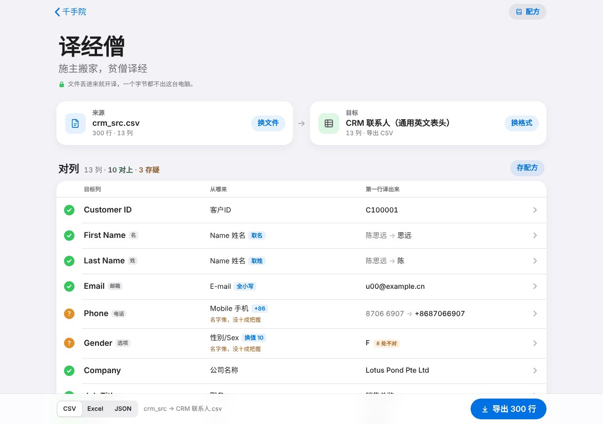
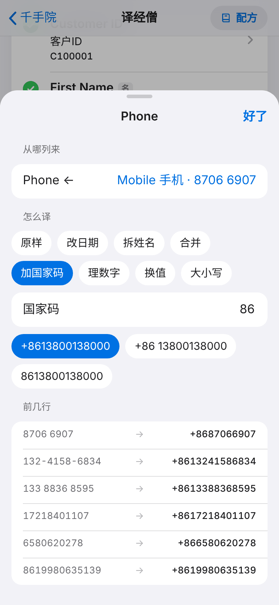
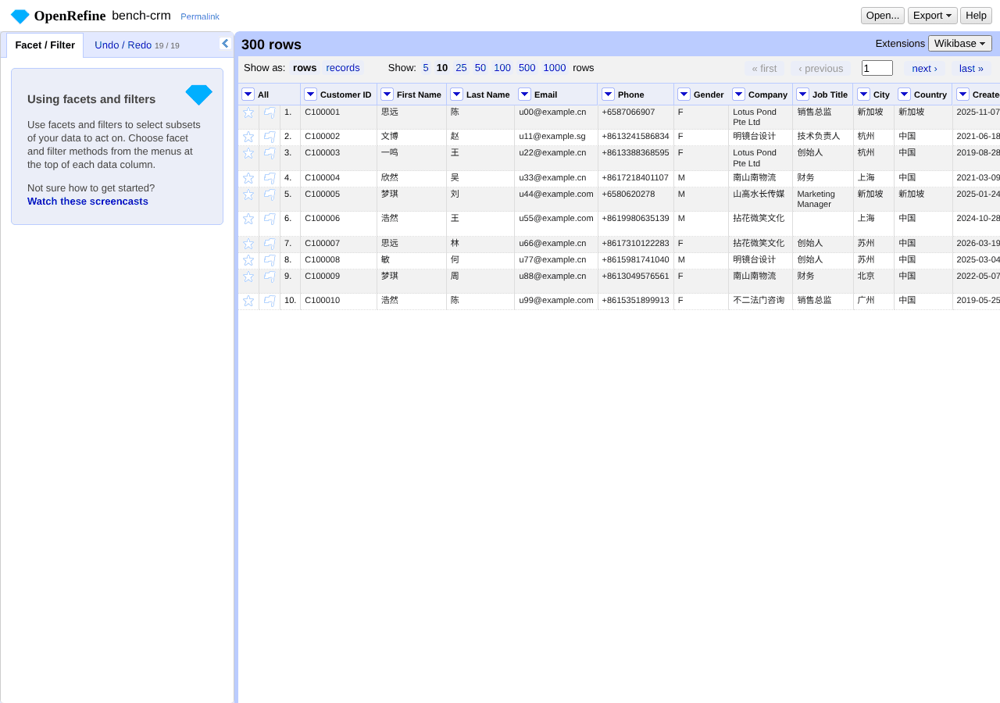
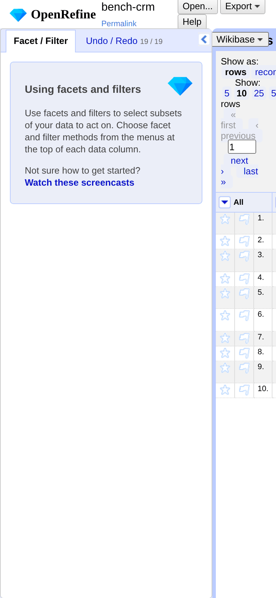

# 译经僧 · 比武报告（2026-11-03，0.1.0 毛坯）

结论：**不过关。** 动手少、速度快、界面好看，三样都赢了；准输了，按规矩「准不许输」，所以判不过。准输的原因都能修，修法见文末的精加工清单。

## 对手

| 对手 | 比没比 | 原因 |
|---|---|---|
| Zapier | 没比 | 要注册账号（这趟规定不注册）。留给 Song 的电脑 |
| Make | 没比 | 同上 |
| convertcsv.com、tableconvert.com（网页替补） | 没比 | 沙盒白名单拦了（proxy 403） |
| **OpenRefine 3.8.7**（开源，Java） | **真比了** | 从 GitHub Releases 下载，在沙盒里本地跑。同类工具里它最像「拿文件对列、导出新格式」 |

## 材料（`bench/gen.py`，全部虚构）

`python3 gen.py --big` 会生成到 `bench/data/`（不进仓库）。`bench/samples/` 里放了几份小样本和标准答案。

| 场景 | 来源 → 目标 | 刁钻处 |
|---|---|---|
| crm | 旧 CRM 导出（300 行）→ 内置「CRM 联系人」 | 表头上方有标题行和空行；列名中英混写（`Name 姓名`、`性别/Sex`）；有同义列（手机和座机）；日期 10 种写法，其中有 DD/MM；姓名要拆，含复姓、英文名、中间带空格；新加坡号码大多没写国家码；金额带 ¥、￥、RMB、S$、元和千分位；男/女/先生/女士/Male/f/未知；空行和只含空格的行；3000 字备注，里面有逗号、引号和换行 |
| crm_gbk | 同一份内容存成 GBK 编码 | 编码 |
| shop_cn2shopify | 网店中文商品表（120 行）→ Shopify | 状态写法有 出售中/在售/上架/仓库中；标签用 `\|`、`，`、`;`、空格分隔；重量写成 500g、1.2kg、0.35 千克；价格带 ¥ 和千分位；库存写成「1,234」「12 件」；条码以 0 开头；长 HTML 描述 |
| shopify2shop_cn | Shopify 真实导出格式（60 个商品，104 行是纯图片行）→ 网店中文 | 变体行的标题、品牌、状态等是空的，要往下填；纯图片行要删；同义列（Product Category 和 Type）；archived 要换成下架 |
| coa | 金蝶式科目表，GBK 编码，有两行标题 → Chart of Accounts | 子科目名称前面带缩进空格；类别只写「损益」，要按科目代码分成 Revenue 或 Expense；余额有括号负数和千分位 |
| crm_100k | 10 万行 × 13 列（22.7MB） | 测速度 |

对答案用 `compare.py`：按主键对行，逐格比较。纯数字按数值比，Gender/Status 这类选项不分大小写。多出来的行另外数。

## 怎么跑

- **我们的**（`run_ours.js` + `fixes_ours.js`）：在仓库根起 http.server，用 Playwright 在 1280 宽的真实界面里操作：点按钮、选文件、点列、下拉选择、填值。动手次数 = 点击 + 选文件 + 下拉 + 输入框。分两档：
  - **零调整**：丢文件 → 选模板 → 导出。
  - **合理修**：界面上能看出问题、也能修的都修上（选错的列改过来、空着的换值补上）；界面修不了的就不修。
- **OpenRefine**（`or_run.py`）：走「专家路线」。用它的 HTTP 接口执行界面上真有的操作：导入选项、改列名、写 GREL 转换、向下填充、删行、重排列、导出。动手次数按 `or_run.py` 里的 COST 表折算，例如改一次列名 = 5 下，写一条 GREL = 5～6 下（其中 1 下是写一行代码）。我为了把它做到全对调试过两次：日期格式顺序会错解析 DD/MM；Shopify 最后一列带 `\r`，填充和判断都失效，要勾「去首尾空白」。**调试的这些动手没计入**，所以它的点数是偏低估的。
- 用时：机器时间。我们的 = 读入、对列、全表扫错，加上导出（不含人点）。OpenRefine = 建项目 + 执行操作 + 导出。同一台沙盒，2 核。

## 四样数字

### 准（错几格 / 总格数）

| 场景 | 我们·零调整 | 我们·合理修 | OpenRefine·专家 |
|---|---|---|---|
| crm | 32 / 3900 | 32 | **0** |
| crm_gbk | 32 / 3900 | 32 | **0** |
| shop_cn2shopify | 223 / 1800 | 103 | **0** |
| shopify2shop_cn | 520 / 1364，另多出 104 行 | 444，另多出 104 行 | **0** |
| coa | 90 / 225 | 10 | **0** |
| crm_100k | 12 606 / 1 300 000 | 12 606 | **0** |

**错了界面却没报的格子**，也就是用户看不出来的错：crm 里新加坡号码被加上 +86（24 格）；Shopify 的重量 0.25kg 变成 0（39 格）；标签分隔符没换（64 格）；科目「损益」被自动全换成 Revenue（10 格）。界面亮了黄标的错：未知性别（8 格）、Shopify 变体行空格子。

### 少动手（下）

| 场景 | 我们·零调整 | 我们·合理修 | OpenRefine·专家（其中 GREL 条数） |
|---|---|---|---|
| crm | **3** | 3 | 121（7） |
| crm_gbk | **3** | 3 | 123（7） |
| shop_cn2shopify | **5** | 8 | 132（8） |
| shopify2shop_cn | **6** | 12 | 107（1） |
| coa | **5** | 12 | 59（3） |

OpenRefine 不写 GREL、只导入再导出的话，目标模板的列名一个都对不上。

### 快（10 万行 × 13 列，22.7MB CSV）

| | 读入 | 对列 + 转换 | 导出 | 合计 |
|---|---|---|---|---|
| 我们的（浏览器内） | 0.30 秒 | 0.95 秒（含全表扫错） | 1.18 秒 | **2.4 秒** |
| OpenRefine | 0.80 秒 | 4.41 秒 | 0.29 秒 | 5.5 秒 |

小文件两边都在 0.1～0.8 秒以内，差别感觉不到。

### 好看（`bench/shots/`）

| | 电脑 1280 | 手机 390 |
|---|---|---|
| 我们的 |  |  |
| OpenRefine |  |  |

OpenRefine 是 2010 年代的数据清洗界面：英文、菜单套菜单、靠写表达式。390 宽下表格被挤到右边一条，基本不能用。我们的在两个宽度下都排得整齐，每列都能看到「从哪来」和「第一行译成什么」。好看我们明显赢。

## 判

| | 规矩 | 结果 |
|---|---|---|
| 准 | 不许输 | **输**：OpenRefine 专家路线全对，我们合理修后仍错 10～444 格（Shopify 另多 104 行） |
| 少动手 | 不许多 | 赢：3～12 下对 59～132 下 |
| 快 | 不能明显落后 | 赢：2.4 秒对 5.5 秒 |
| 好看 | 不能明显落后 | 赢 |

公平地说：OpenRefine 全对，靠的是会写 GREL，加上看过标准答案后的调试。白领基本做不到。但规矩写的是「准不许输」，我们有 4 类错连界面上都不报，这条必须先补上。

## 输在哪（按错格多少排）

1. **Shopify 变体行不会往下填，纯图片行不会删**：444 格错，另多出 104 行。界面也没有「向下填充」和「删空行」。
2. **值替换只能一对一，也不能换成空**：标签分隔符换不了（64 格）；「未知」换不成空（8 格，在 10 万行里是 2530 格）；「损益」要看科目代码才能分 Revenue 还是 Expense（10 格，而且没报错）。
3. **电话只能填一个国家码**：同一张表里中国和新加坡号码混着，新加坡号码会被安上 +86（24 格，10 万行里 10 076 格）。最糟的是加完以后号码位数不对（+86 后面只有 8 位），界面也不报错。
4. **数字不认单位**：1.2kg、0.35 千克换不成克（39 格），也不报错。
5. 对列小失误：Shopify 的 `Product Category` 抢了「分类」，正确的是 `Type`；科目表的「类别」和「科目全名」没对上（零调整时错 90 格，用户点两下能修好）。

## 精加工清单（按要紧排）

1. **一对多 / 多行**：加一个「向下填充空格」开关（每列都能开），加「删掉主键为空的行」。这样 Shopify 导出这一大类就能搬。
2. **值替换升级**：允许换成空；允许「按另一列的条件换」（例如损益：代码以 60 开头 → Revenue）；加「拆了再拼」（分隔符统一）。
3. **电话按国家列选国家码**：来源里有国家列时，自动按国家加码；号码位数不合规的标黄、数进「处不对」。
4. **数字带单位**：kg/千克/g/克 自动换算成目标单位；数字里有不认识的单位，就报「处不对」，不再静默丢掉。
5. **静默错要变成报错**：凡是自动换值没有十足把握的（损益→Revenue 这种一对多），都标存疑。
6. 对列：一个来源列名同时像两个目标概念时（Product Category 和 Type），优先选完全同名的。

## 没做 / 留给 Song

- Zapier、Make 要注册账号，这趟没比，留到 Song 的电脑上比。网页替补 convertcsv、tableconvert 被沙盒拦了。
- 没改产品功能，也没撞上致命 bug。
