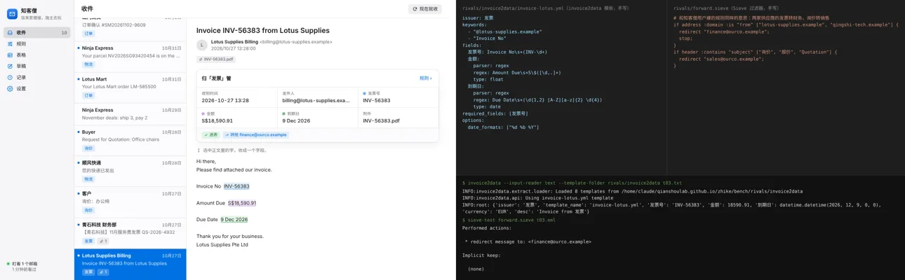
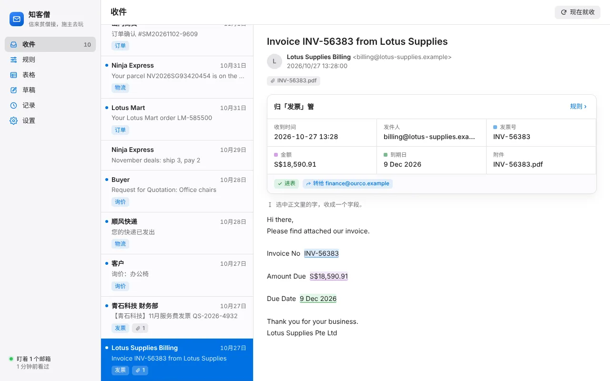
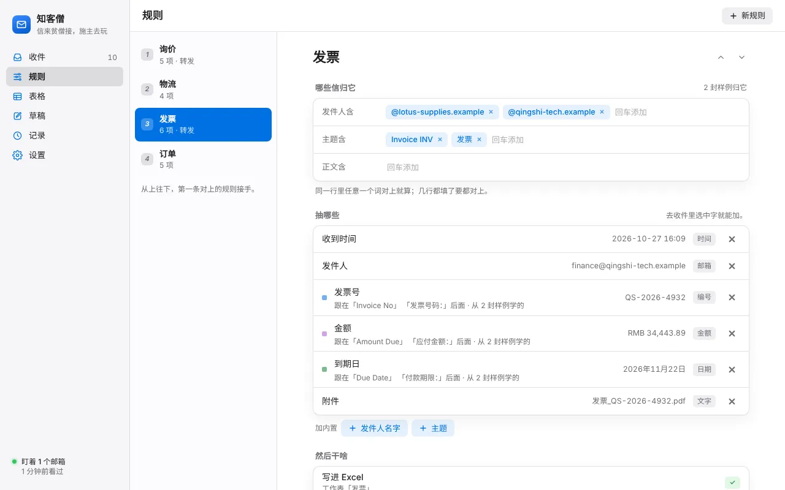
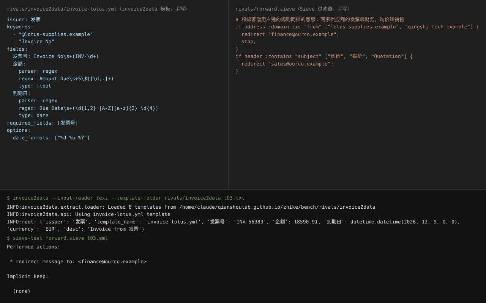

# 知客僧 · 比武报告

2026-11-03，云端沙盒（Linux）。被比的是 `zhike/app` 当前 main（0.1.0 毛坯，加上本趟修的一个界面 bug，见下面「顺手修的」）。

## 对手

| 对手 | 比了没 | 原因 |
|---|---|---|
| Parseur | **没比** | 要注册账号，邮件得发到它给的收件地址或在网页里上传。这趟不注册任何账号，也不对外发信。留给 Song 的电脑 |
| Mailparser（mailparser.io） | **没比** | 同上：要注册账号，邮件要发到它的地址 |
| invoice2data（开源，pip 装） | **真比：抽字段** | 和 Parseur 同一路子：每种来信写一个模板（关键词认信 + 每个字段一条正则）。不认识邮件格式，替它用知客僧的 mailparse 把信转成文字，前面加 From/Subject 两行，等于白送它一个邮件解析器 |
| Dovecot Sieve（开源邮件过滤器，apt 装，`sieve-test` 离线跑） | **真比：判断转发** | Thunderbird 在这台沙盒里只有 snap 版，装不上；Sieve 是服务器那头的同类过滤器，按发件人/主题决定转给谁，规则意思和 Thunderbird 的消息过滤器一样 |

替补组合 = invoice2data（抽字段）+ Sieve（转发）。两样都没界面，配置是手写的文本文件。

## 怎么比的

- **材料**：`gen_mails.py` 按随机数造信（全是编的 .example 域名，人名只用「客户甲」这类）。
  - `train/` 10 封：用户「看得见」、拿来建规则的样例，只有常见写法：山门商贸订单（中文纯文本）、Lotus Mart 订单（只有 HTML）、莲花供应发票（只有 HTML 表格）、青石科技发票（中文、中文附件名）、两家快递、中英两封询价、两封垃圾。
  - `test/` 200 封：订单 50、发票 40、物流 36、询价 30、转发套转发 14（一层 8、两层 6）、垃圾 30。刁钻的：纯 HTML、同一字段几种写法（订单号/订单编号/订单号码、实付金额/实付款/应付总额、Tracking Number/Tracking #、运单号：/快递单号 空格）、金额币种 ¥ ￥ RMB 元 S$ USD € SGD $、日期 2026-11-01 / 2026/11/1 / 2026年11月1日 / Nov 1, 2026 / 01/11/2026 / 1 November 2026 / 11月5日、GB18030 正文 + RFC2047 编码的中文附件名、口语询价（没有「标签：值」）、垃圾：域名差一个字母的冒充发票、主题带「订单确认」的中奖信、同域名的促销信、主题带「询价」的推广信、快递公司广告。
  - 每封配标准答案（`truth.json`）：归哪条规则、每个字段的值、该不该转、转给谁（发票 → finance@，询价 → sales@，其它不转）。
  - 仓库里只放脚本和 `samples/`（10 封样例 + 6 封刁钻的 + 它们的答案，共 72 KB）。复跑：`python gen_mails.py DATA --seed 2`，然后下面两条。
- **知客僧**（`run_zhike.py`）：本地假 IMAP/SMTP（`zhike.fakeservers`）当邮箱；`devserver` 起真界面，Playwright 像用户一样点：打开样例信 → 点虚线建议或拖选一段 → 弹窗里改字段名 → 添加；再去「规则」页改规则名、加发件人/主题条件、打开转发、填地址。点完以后往信箱投 200 封，引擎跑一轮：真收信、真写 Excel、真通过假 SMTP 转发。打分用引擎记录里的抽取原文和转发结果。
- **替补**（`run_rivals.py`）：照同样 10 封样例手写 8 个 invoice2data 模板（`rivals/invoice2data/*.yml`）和 1 个 Sieve 脚本（`rivals/forward.sieve`）。写法是一个会正则的人看样例照着写的，没对着测试集调。
- **打分**（`score.py`）：两边的输出先用同一套归一化（金额取数字、日期统一成 年-月-日、电话只留数字……）再和答案比。有答案的字段一处算一处；归错规则或没认出来，这封的字段全算错。
- 主跑用随机数 2，再用随机数 3 换一批 200 封复跑一遍，看结论稳不稳。

## 四样数字

### 准

| | 知客僧 | 替补 | 复跑（随机数 3）知客僧 / 替补 |
|---|---|---|---|
| 字段错（共 517 处） | **147**（对 71.6%） | 269（对 48.0%） | 168 / 290（共 518） |
| 去掉「附件名」再比（invoice2data 根本不支持附件名） | **137 / 467** | 219 / 467 | 157 / 468 · 239 / 468 |
| 抽出来但值不对 | 0 | 0 | 0 / 0 |
| 转发错（共 200 封，80 封该转） | 24 | 24 | 27 / 27 |
| └ 漏转 / 误转 | 16 / 8 | 16 / 8 | 23 / 4 · 23 / 4 |
| 垃圾信进了表 | **8**（输） | 0 | 4 / 0 |
| 转发套转发那 14 封的字段（52 处） | **全漏 52**（输） | 漏 10（只漏附件名） | 53 / 11 |

两边错的全是「没抽到」，没有一处抽了个错值。知客僧错在哪（随机数 2，147 处）：
- 转发套转发 52 处：同事转来的信，发件人是同事，规则按发件人认不出来。替补的模板关键词在正文里也能找到原发件人，所以认得出。
- 没见过的标签写法 70 来处：订单编号/订单号码、实付款/应付总额、金额合计、到期日、Tracking #、快递单号（后面没冒号）、手机。替补一样漏，而且漏得更多：invoice2data 的必填字段没抽到就整封丢掉，金额/日期的正则也只认样例那一种币种和日期格式。
- 口语询价和没见过的询价主题（「想问下价格」「Price enquiry」）：两边都认不出。
- 误转 8 封 = 主题带「询价」的推广垃圾，两边规则一样都中招；知客僧还把它们写进了询价表（替补没进，因为它的模板必须抽到「产品」才算）。

转发判断两边打平，因为规则意思完全一样（发件人域名 / 主题关键词），这一项比的是操作方式，不是聪明程度。

进 Excel 能不能直接算账（只知客僧有表）：金额 69/69 格是数字；日期 110/119 格是日期，剩下 9 格是「11月5日」这种没年份的，进表成了文字。

### 少动手

| | 知客僧 | 替补 |
|---|---|---|
| 4 条规则合计 | **107 下**：点/拖 76 下 + 打字 31 次（共 175 个字，都是字段名、规则名、域名、邮箱地址），0 条正则 | 9 个文件 111 行 1892 个字符，其中 22 条正则；要懂 YAML、正则、日期格式符（`%d %b %Y`）、Sieve 语法 |
| 每条规则 | 订单 26 · 发票 32 · 物流 20 · 询价 29 | 每个模板 7–17 行，一家来信一个模板，两家就得写两个 |
| 最简单的一条（一个发件人、3 个字段） | 8 下（点 3 个虚线建议、改 2 个字段名、按 3 次添加）+ 改规则名 2 下 | 17 行 YAML，3 条正则 |

知客僧打字最多的是字段名：同一个字段在第二家信里叫法不同（Order Number / 订单号），弹窗猜出来的名字要改成统一的，31 次打字里 17 次是这个，其余是规则名 4 次、条件 8 次、转发地址 2 次。

### 快

| | 知客僧 | 替补 |
|---|---|---|
| 200 封一批，端到端 | **5.1 秒**（复跑 5.3）：IMAP 收信 → 认规则 → 抽字段 → 写 Excel → SMTP 转发 72 封 | invoice2data 0.39 秒 + Sieve 3.2 秒 = 3.6 秒（复跑 3.3）；不收信、不写表、不发信 |
| 同口径：解析 + 认规则 + 抽字段 | **0.31 秒** | 0.39 秒（含白送它的邮件解析） |
| 建 4 条规则（Playwright 自动点，含等界面刷新） | 45 秒 | 手写文本，没法自动计时 |

知客僧多出来的时间花在真收信、真写 Excel、真发 72 封转发上，核心比替补快。

### 好看

截图在 `shots/`：知客僧是 Playwright 从真界面截的（devserver + 本趟比武的规则和样例信），不是介绍页的图。



| 知客僧 · 收件（发票信，字段高亮、归哪条规则、进表/转发标签） | 知客僧 · 规则页 |
|---|---|
|  |  |

替补的「界面」：文本编辑器 + 命令行。



没得比：替补没有界面，结果是一行 Python 字典；invoice2data 还默认把币种标成 EUR（信里是 S$）。真正该比好看的是 Parseur 的网页界面，这趟没比成。

## 判

| 线 | 结果 |
|---|---|
| 准不许输 | **总分过线**：字段错 147 比 269，转发打平。**两个分项输**：转发套转发（52 处对 10 处）、垃圾进表（8 封对 0 封） |
| 动手不许多 | **过线**：107 下、0 条正则，对 1892 个字符、22 条正则 |
| 快不能明显落后 | **过线**：核心 0.31 秒对 0.39 秒；端到端 5.1 秒里有替补根本不做的收信、写表、发信 |
| 好看不能明显落后 | **过线**（对的是没界面的替补） |

对替补过线。Parseur、Mailparser 没比，所以这不算最后的判，它俩得等 Song 的电脑上真比。

## 精加工清单（按要紧排）

1. **转发信认原信**：认出「---------- Forwarded message」「-----Original Message-----」「发件人：」这些块，规则条件也看块里的原发件人和原主题，字段在原信那段里抽。这一条能补回 52 处字段和 10 封漏转。
2. **同一字段的常见别名**：内置同义词（订单号/订单编号/订单号码、实付金额/实付款/应付总额/金额合计、付款期限/到期日、运单号/快递单号、Tracking Number/Tracking #、联系电话/手机/电话），标签后面没冒号只有空格也认；再加一个「这封没抽到 → 选一下就补一个样例」的入口。剩下的漏抽大半是这种。
3. **防垃圾进表、防误转**：规则加「排除词」，或者勾「这几个字段都没抽到就不进表、不转发」。推广信主题带「询价」就进了表、转给了销售。
4. 没年份的日期（11月5日）进 Excel 时按收信时间补年份，现在进表是文字。
5. 「200 箱」「500 reams」这种数量记成数字（单位丢掉或另放一列），现在是文字，不能求和。
6. 口语询价（没有「标签：值」）：用户填了 Gemini 钥匙时让 AI 兜底抽，没填就照现在这样留空。

## 顺手修的（产品代码，单独一次提交）

**收了字段后马上改规则，刚收的字段会丢**（`ui/app.js`）。弹窗「添加」后界面只重拿了邮件，没重拿规则。这时去规则页改名、加条件、开转发，界面会把手里那份旧规则（没有刚收的字段）存回去，把新字段冲掉，而且不报错。比武里每条规则第二封样例的最后一个字段都这么丢了（下单日期、到期日、电话只剩一种写法）。改成「添加」后连规则一起重拿（`reloadAll`）。顺带解决：新建规则后，下一次弹窗的规则下拉要等心跳（最多 4 秒）才看得到它。修完重跑，字段错 184 → 147。Python 自测 36 个照样全过；这个修复没有自动测试（界面没有测试框架），靠本比武脚本验证。

## 留给 Song 电脑的

1. **Zhike.exe 在 Windows 真机跑一轮**：这趟只在 Linux 跑了核心和浏览器里的界面。要看的是 WebView2 窗口、托盘、凭据管理器存密码、Excel 开着时写表排队、真实 QQ/163/Gmail 收信（用自己的测试邮箱）。修 bug 的那次提交会触发打包，新的 Zhike.exe 在 release zhike-latest。
2. **Parseur、Mailparser 真比**：各注册一个免费账号；把 `bench/samples/` 里的信（或用 `gen_mails.py` 在自己电脑生成的 200 封）上传或发到它们给的地址；照同样的 10 封样例建规则，记点击次数；导出结果后用 `score.py` 打分（把导出改成 `pred_*.json` 的格式）。重点看：它们认不认转发信、垃圾会不会进表、点几下。

## 文件

```
bench/
  gen_mails.py      造信 + 标准答案（随机数可换）
  run_zhike.py      知客僧：假邮箱 + 真界面 Playwright 点规则 + 引擎跑 200 封
  run_rivals.py     替补：invoice2data + Sieve
  score.py          统一打分
  rivals/           替补的手写模板和过滤脚本
  samples/          10 封样例 + 6 封刁钻的 + 答案
  shots/            截图
```

复跑（Linux，要 Playwright、`pip install invoice2data`、`apt install dovecot-sieve`）：

```
python gen_mails.py /tmp/d --seed 2
python run_zhike.py /tmp/d /tmp/o && python run_rivals.py /tmp/d /tmp/o
python score.py /tmp/d/truth.json /tmp/o/pred_zhike.json
python score.py /tmp/d/truth.json /tmp/o/pred_rivals.json
```
