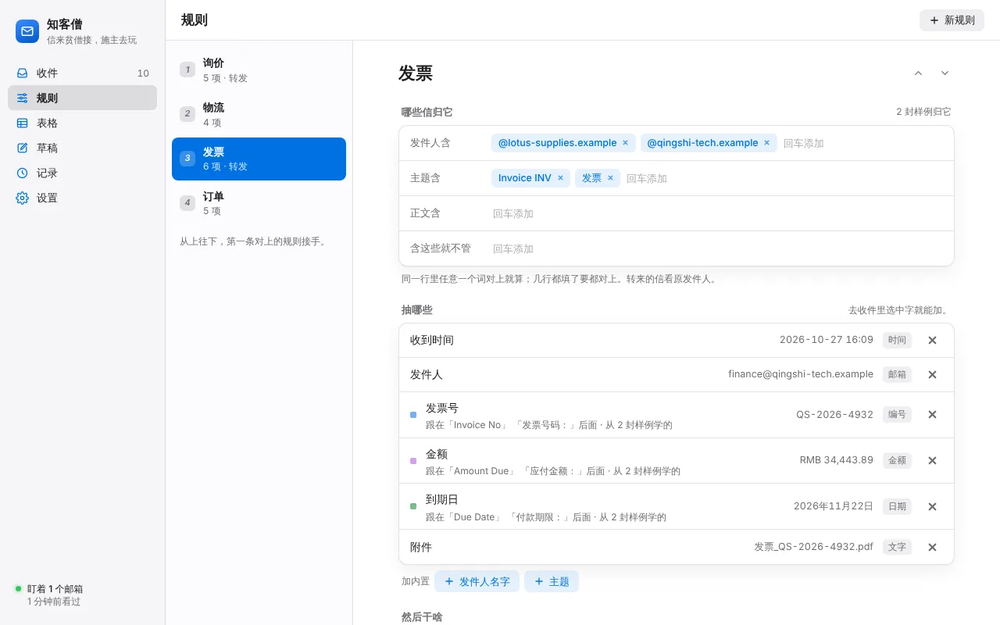

# 知客僧 · 比武报告

2026-11-03，云端沙盒（Linux）。被比的是 `zhike/app` 当前 main（0.1.0 毛坯，加上本趟修的一个界面 bug，见下面「顺手修的」）。

## 对手

| 对手 | 比了没 | 原因 |
|---|---|---|
| Parseur | **没比** | 要注册账号，邮件得发到它给的收件地址或在网页里上传。这趟不注册任何账号，也不对外发信。留给 Song 的电脑 |
| Mailparser（mailparser.io） | **没比** | 同上：要注册账号，邮件要发到它的地址 |
| invoice2data（开源，pip 装） | **真比：抽字段** | 和 Parseur 同一路子：每种来信写一个模板（关键词认信 + 每个字段一条正则）。不认识邮件格式，替它用知客僧的 mailparse 把信转成文字，前面加 From/Subject 两行，等于白送它一个邮件解析器 |
| Dovecot Sieve（开源邮件过滤器，apt 装，`sieve-test` 离线跑） | **真比：判断转发** | Thunderbird 在这台沙盒里只有 snap 版，装不上；Sieve 是服务器那头的同类过滤器，按发件人/主题决定转给谁，规则意思和 Thunderbird 的消息过滤器一样 |

替补组合 = invoice2data（抽字段）+ Sieve（转发）。两样都没界面，配置是手写的文本文件。

## 怎么比的

- **材料**：`gen_mails.py` 按随机数造信（全是编的 .example 域名，人名只用「客户甲」这类）。
  - `train/` 10 封：用户「看得见」、拿来建规则的样例，只有常见写法：山门商贸订单（中文纯文本）、Lotus Mart 订单（只有 HTML）、莲花供应发票（只有 HTML 表格）、青石科技发票（中文、中文附件名）、两家快递、中英两封询价、两封垃圾。
  - `test/` 200 封：订单 50、发票 40、物流 36、询价 30、转发套转发 14（一层 8、两层 6）、垃圾 30。刁钻的：纯 HTML、同一字段几种写法（订单号/订单编号/订单号码、实付金额/实付款/应付总额、Tracking Number/Tracking #、运单号：/快递单号 空格）、金额币种 ¥ ￥ RMB 元 S$ USD € SGD $、日期 2026-11-01 / 2026/11/1 / 2026年11月1日 / Nov 1, 2026 / 01/11/2026 / 1 November 2026 / 11月5日、GB18030 正文 + RFC2047 编码的中文附件名、口语询价（没有「标签：值」）、垃圾：域名差一个字母的冒充发票、主题带「订单确认」的中奖信、同域名的促销信、主题带「询价」的推广信、快递公司广告。
  - 每封配标准答案（`truth.json`）：归哪条规则、每个字段的值、该不该转、转给谁（发票 → finance@，询价 → sales@，其它不转）。
  - 仓库里只放脚本和 `samples/`（10 封样例 + 6 封刁钻的 + 它们的答案，共 72 KB）。复跑：`python gen_mails.py DATA --seed 2`，然后下面两条。
- **知客僧**（`run_zhike.py`）：本地假 IMAP/SMTP（`zhike.fakeservers`）当邮箱；`devserver` 起真界面，Playwright 像用户一样点：打开样例信 → 点虚线建议或拖选一段 → 弹窗里改字段名 → 添加；再去「规则」页改规则名、加发件人/主题条件、打开转发、填地址。点完以后往信箱投 200 封，引擎跑一轮：真收信、真写 Excel、真通过假 SMTP 转发。打分用引擎记录里的抽取原文和转发结果。
- **替补**（`run_rivals.py`）：照同样 10 封样例手写 8 个 invoice2data 模板（`rivals/invoice2data/*.yml`）和 1 个 Sieve 脚本（`rivals/forward.sieve`）。写法是一个会正则的人看样例照着写的，没对着测试集调。
- **打分**（`score.py`）：两边的输出先用同一套归一化（金额取数字、日期统一成 年-月-日、电话只留数字……）再和答案比。有答案的字段一处算一处；归错规则或没认出来，这封的字段全算错。
- 主跑用随机数 2，再用随机数 3 换一批 200 封复跑一遍，看结论稳不稳。

## 四样数字

### 准

| | 知客僧 | 替补 | 复跑（随机数 3）知客僧 / 替补 |
|---|---|---|---|
| 字段错（共 517 处） | **147**（对 71.6%） | 269（对 48.0%） | 168 / 290（共 518） |
| 去掉「附件名」再比（invoice2data 根本不支持附件名） | **137 / 467** | 219 / 467 | 157 / 468 · 239 / 468 |
| 抽出来但值不对 | 0 | 0 | 0 / 0 |
| 转发错（共 200 封，80 封该转） | 24 | 24 | 27 / 27 |
| └ 漏转 / 误转 | 16 / 8 | 16 / 8 | 23 / 4 · 23 / 4 |
| 垃圾信进了表 | **8**（输） | 0 | 4 / 0 |
| 转发套转发那 14 封的字段（52 处） | **全漏 52**（输） | 漏 10（只漏附件名） | 53 / 11 |

两边错的全是「没抽到」，没有一处抽了个错值。知客僧错在哪（随机数 2，147 处）：
- 转发套转发 52 处：同事转来的信，发件人是同事，规则按发件人认不出来。替补的模板关键词在正文里也能找到原发件人，所以认得出。
- 没见过的标签写法 70 来处：订单编号/订单号码、实付款/应付总额、金额合计、到期日、Tracking #、快递单号（后面没冒号）、手机。替补一样漏，而且漏得更多：invoice2data 的必填字段没抽到就整封丢掉，金额/日期的正则也只认样例那一种币种和日期格式。
- 口语询价和没见过的询价主题（「想问下价格」「Price enquiry」）：两边都认不出。
- 误转 8 封 = 主题带「询价」的推广垃圾，两边规则一样都中招；知客僧还把它们写进了询价表（替补没进，因为它的模板必须抽到「产品」才算）。

转发判断两边打平，因为规则意思完全一样（发件人域名 / 主题关键词），这一项比的是操作方式，不是聪明程度。

进 Excel 能不能直接算账（只知客僧有表）：金额 69/69 格是数字；日期 110/119 格是日期，剩下 9 格是「11月5日」这种没年份的，进表成了文字。

### 少动手

| | 知客僧 | 替补 |
|---|---|---|
| 4 条规则合计 | **107 下**：点/拖 76 下 + 打字 31 次（共 175 个字，都是字段名、规则名、域名、邮箱地址），0 条正则 | 9 个文件 111 行 1892 个字符，其中 22 条正则；要懂 YAML、正则、日期格式符（`%d %b %Y`）、Sieve 语法 |
| 每条规则 | 订单 26 · 发票 32 · 物流 20 · 询价 29 | 每个模板 7–17 行，一家来信一个模板，两家就得写两个 |
| 最简单的一条（一个发件人、3 个字段） | 8 下（点 3 个虚线建议、改 2 个字段名、按 3 次添加）+ 改规则名 2 下 | 17 行 YAML，3 条正则 |

知客僧打字最多的是字段名：同一个字段在第二家信里叫法不同（Order Number / 订单号），弹窗猜出来的名字要改成统一的，31 次打字里 17 次是这个，其余是规则名 4 次、条件 8 次、转发地址 2 次。

### 快

| | 知客僧 | 替补 |
|---|---|---|
| 200 封一批，端到端 | **5.1 秒**（复跑 5.3）：IMAP 收信 → 认规则 → 抽字段 → 写 Excel → SMTP 转发 72 封 | invoice2data 0.39 秒 + Sieve 3.2 秒 = 3.6 秒（复跑 3.3）；不收信、不写表、不发信 |
| 同口径：解析 + 认规则 + 抽字段 | **0.31 秒** | 0.39 秒（含白送它的邮件解析） |
| 建 4 条规则（Playwright 自动点，含等界面刷新） | 45 秒 | 手写文本，没法自动计时 |

知客僧多出来的时间花在真收信、真写 Excel、真发 72 封转发上，核心比替补快。

### 好看

截图在 `shots/`：知客僧是 Playwright 从真界面截的（devserver + 本趟比武的规则和样例信），不是介绍页的图。


| 知客僧 · 收件（发票信，字段高亮、归哪条规则、进表/转发标签） | 知客僧 · 规则页 |
|---|---|
|  |  |

替补的「界面」：文本编辑器 + 命令行。


没得比：替补没有界面，结果是一行 Python 字典；invoice2data 还默认把币种标成 EUR（信里是 S$）。真正该比好看的是 Parseur 的网页界面，这趟没比成。

## 判

| 线 | 结果 |
|---|---|
| 准不许输 | **总分过线**：字段错 147 比 269，转发打平。**两个分项输**：转发套转发（52 处对 10 处）、垃圾进表（8 封对 0 封） |
| 动手不许多 | **过线**：107 下、0 条正则，对 1892 个字符、22 条正则 |
| 快不能明显落后 | **过线**：核心 0.31 秒对 0.39 秒；端到端 5.1 秒里有替补根本不做的收信、写表、发信 |
| 好看不能明显落后 | **过线**（对的是没界面的替补） |

对替补过线。Parseur、Mailparser 没比，所以这不算最后的判，它俩得等 Song 的电脑上真比。

## 精加工清单（按要紧排）

1. **转发信认原信**：认出「---------- Forwarded message」「-----Original Message-----」「发件人：」这些块，规则条件也看块里的原发件人和原主题，字段在原信那段里抽。这一条能补回 52 处字段和 10 封漏转。
2. **同一字段的常见别名**：内置同义词（订单号/订单编号/订单号码、实付金额/实付款/应付总额/金额合计、付款期限/到期日、运单号/快递单号、Tracking Number/Tracking #、联系电话/手机/电话），标签后面没冒号只有空格也认；再加一个「这封没抽到 → 选一下就补一个样例」的入口。剩下的漏抽大半是这种。
3. **防垃圾进表、防误转**：规则加「排除词」，或者勾「这几个字段都没抽到就不进表、不转发」。推广信主题带「询价」就进了表、转给了销售。
4. 没年份的日期（11月5日）进 Excel 时按收信时间补年份，现在进表是文字。
5. 「200 箱」「500 reams」这种数量记成数字（单位丢掉或另放一列），现在是文字，不能求和。
6. 口语询价（没有「标签：值」）：用户填了 Gemini 钥匙时让 AI 兜底抽，没填就照现在这样留空。

## 顺手修的（产品代码，单独一次提交）

**收了字段后马上改规则，刚收的字段会丢**（`ui/app.js`）。弹窗「添加」后界面只重拿了邮件，没重拿规则。这时去规则页改名、加条件、开转发，界面会把手里那份旧规则（没有刚收的字段）存回去，把新字段冲掉，而且不报错。比武里每条规则第二封样例的最后一个字段都这么丢了（下单日期、到期日、电话只剩一种写法）。改成「添加」后连规则一起重拿（`reloadAll`）。顺带解决：新建规则后，下一次弹窗的规则下拉要等心跳（最多 4 秒）才看得到它。修完重跑，字段错 184 → 147。Python 自测 36 个照样全过；这个修复没有自动测试（界面没有测试框架），靠本比武脚本验证。

## 留给 Song 电脑的

1. **Zhike.exe 在 Windows 真机跑一轮**：这趟只在 Linux 跑了核心和浏览器里的界面。要看的是 WebView2 窗口、托盘、凭据管理器存密码、Excel 开着时写表排队、真实 QQ/163/Gmail 收信（用自己的测试邮箱）。修 bug 的那次提交会触发打包，新的 Zhike.exe 在 release zhike-latest。
2. **Parseur、Mailparser 真比**：各注册一个免费账号；把 `bench/samples/` 里的信（或用 `gen_mails.py` 在自己电脑生成的 200 封）上传或发到它们给的地址；照同样的 10 封样例建规则，记点击次数；导出结果后用 `score.py` 打分（把导出改成 `pred_*.json` 的格式）。重点看：它们认不认转发信、垃圾会不会进表、点几下。

## 文件

```
bench/
  gen_mails.py      造信 + 标准答案（随机数可换）
  run_zhike.py      知客僧：假邮箱 + 真界面 Playwright 点规则 + 引擎跑 200 封
  run_rivals.py     替补：invoice2data + Sieve
  score.py          统一打分
  rivals/           替补的手写模板和过滤脚本
  samples/          10 封样例 + 6 封刁钻的 + 答案
  shots/            截图
```

复跑（Linux，要 Playwright、`pip install invoice2data`、`apt install dovecot-sieve`）：

```
python gen_mails.py /tmp/d --seed 2
python run_zhike.py /tmp/d /tmp/o && python run_rivals.py /tmp/d /tmp/o
python score.py /tmp/d/truth.json /tmp/o/pred_zhike.json
python score.py /tmp/d/truth.json /tmp/o/pred_rivals.json
```

## 0.2.0 复赛

2026-11-03，同一台云端沙盒，同一套材料（`gen_mails.py` 随机数 2 主跑、随机数 3 复跑，各 200 封），同一个 `run_zhike.py`（真界面 Playwright 点规则，点法一下没改）和 `score.py`。
替补的模板和过滤脚本没改，同样的信产出不变，沿用首赛数字。`run_zhike.py` 只加了两样：开跑前删掉上次的 Excel；多记一个「同口径核心」计时（解析 + 认规则 + 挡垃圾 + 抽字段，200 封取 3 次最快）。

### 改了什么（按精加工清单的顺序）

1. **转发信认原信**：扒出最里层的原发件人、原主题，规则按原信认。
2. **同义标签**：订单编号/订单号码/Order #、实付款/应付总额/金额合计、到期日、快递单号（没冒号）、Tracking #、手机……学到一种写法，同组别名都认；收件里「没找到」一点，再选一下就补一个样例。
3. **防垃圾进表、防误转**：推销词 + 字段没抽全 → 挡下（记录里可放行）；发件域名冒充熟人 → 挡下；规则加「含这些就不管」。另加「按内容认」：发件人不限的规则（询价），主题没对上但学过的字段抽到一大半，也认。
4. **没年份的日期**按收信时间补年份。
5. **数量**进 Excel 是数字，单位放进单元格格式。
6. **口语询价**：填了 Gemini 钥匙时让 AI 兜底找没抽到的字段，值必须在原文里找得到；没钥匙照旧留空（比武里没钥匙，这条不计分）。

另外照拍板做了：PDF 附件文字可抽、自动更新（下好新 exe、核 sha256、换自己重启）、微软登录代码（等注册应用）。顺手把邮件解析从 `policy.default` 换成 `compat32`，快了约 7 倍、输出一字不差。

### 四样数字

| | 0.1.0 首赛 | **0.2.0 复赛** | 替补 | 复跑（随机数 3）0.1 → 0.2 / 替补 |
|---|---|---|---|---|
| 字段错（517 处） | 147 | **8**（对 98.5%） | 269 | 168 → **9** / 290（共 518） |
| 归错规则 / 没认出 | 20 封 | **0** | — | 2 封 |
| 转发错（200 封，80 封该转） | 24 | **0** | 24 | 27 → **2** / 27 |
| 垃圾信进了表 | 8（输） | **0** | 0 | 4 → **0** / 0 |
| 转发套转发那 14 封的字段 | 漏 52（输） | **漏 0** | 漏 10 | 53 → **0** / 11 |
| 动手（建 4 条规则） | 107 下 | **107 下**，0 条正则 | 1892 个字符、22 条正则 | 108 下 |
| 核心：解析 + 认规则 + 抽字段 | 0.31 秒 | **0.09 秒** | 0.39 秒 | 0.09 秒 |
| 端到端 200 封（收信 → 写表 → 转发） | 5.1 秒 | **2.2 秒** | 3.6 秒（不收信、不写表、不发信） | 2.3 秒 / 3.3 秒 |
| Excel 能直接算账 | 金额 69/69、日期 110/119 | **金额 104/104、日期 140/140、数量 23/23** | 没有表 | 同 |

剩下的 8 处错（随机数 2）全在口语询价：「我们想订 200 箱A4 复印纸……电话 +65 …」这种没有「标签：值」的信，数量抽不到 7 处、英文「Call me at …」的电话 1 处。替补同样漏。填了 Gemini 钥匙时走 AI 兜底，这趟没钥匙没计。

动手没变：新加的本事（认原信、同义词、挡垃圾、按内容认、补年份、数量）全是自动的，不多点一下。

好看：浏览器真流程（`tests/test_ui_e2e.py`，示例 → 连假邮箱 → 用转来的信建规则 → 收信 → 推销被挡 → 放行 → 表格）浅色、深色各跑一遍，页面报错 0、接口报错 0；窗口 1180×760。介绍页手机 390、电脑 1280 宽，浅深两套，没有横向滚动、没有报错。新截图：

| 收件（发票信：正文 + PDF 附件里的采购单号） | 规则页（多了「含这些就不管」） |
|---|---|
|  |  |

### 判

两个输掉的分项都补上了：转发套转发 0 对 10、垃圾进表 0 对 0（平）。准、动手、快、好看四样都不输替补。Parseur / Mailparser 还是没比（要注册账号）。

## 0.3.0 复赛（去掉没必要的步骤 + 好看）

2026-11-03，同一台云端沙盒，同一套材料（`gen_mails.py` 随机数 2 主跑、随机数 3 复跑，各 200 封）、同一个 `score.py`。
0.2.0 的数字是今天开工前用 git 里 0.2.0 的代码（9426474）重跑的，跟当时的复赛一致（字段错 8 / 9、转发错 0 / 2、107 下）。
0.3.0 的比武脚本换成 0.3.0 的真人用法（`run_zhike.py`）：拟好的规则摆在眼前 → 发票那张填 finance@、询价那张填 sales@ → 点「收下 4 条」。
0.2 手点那套留在 `run_zhike_v020.py`（要对着 0.2.0 的代码跑）。替补（invoice2data + Sieve）没动，沿用首赛数字。

### 步骤账（`bench/steps.py`，Playwright 真走，两版同一个剧本，结果在 `results/steps-0.2.0.json`、`results/steps-0.3.0.json`）

剧本：
- **第一次用**：邮箱里已经有比武那 10 封样例（两家订单、两家发票、两家快递、两封询价、一封推销、一封冒充发票）。要的结果：订单 / 发票 / 物流 / 询价各一张表，发票转 finance@、询价转 sales@。
  建好以后来 4 封新信，进表、转发 = 结果到手。两版结果一样：四张表各进 1 行，转出 2 封。
- **第二次用**（第二天开机）：夜里来了 2 封老熟人的信，外加一家新供应商（白塔文具）的发票，要进「发票」表、转财务。
  结果到手 = 白塔的发票进了「发票」表、转出去了。
- 邮箱是本机假的（公司邮箱那种，要自己填服务器）。「点托盘图标」「开机」「打开 Excel」这种窗口外的事在浏览器里模拟（见 steps.py 开头）。

**第一次用：121 步 → 15 步**（QQ、163、Gmail 这种程序认得服务器的：115 → 9）

| # | 0.2.0 这一步 | 下数 | 必要？ | 理由 | 0.3.0 |
|---|---|---|---|---|---|
| 1 | 双击 Zhike.exe | 1 | 必要 | 用不用是人定的 | 留着 |
| 2 | 点示例横幅上的「连邮箱」（跳到设置） | 1 | 没必要 | 第一次打开、还没连邮箱，人下一步只会去连 | 去掉：一打开就是连邮箱那一屏（一句话 + 两个框 +「用示例试试」） |
| 3 | 打邮箱地址 | 1 | 必要 | 程序不知道 | 留着 |
| 4 | 打应用专用密码 | 1 | 必要 | 程序不知道 | 留着；回车就连；密码错就在密码框下面红一行说怎么办 |
| 5 | 填收信 / 发信服务器、端口、加密（只有公司邮箱要） | 6 | 必要 | 公司邮箱的服务器程序猜不出 | 留着；QQ/163/Gmail 两版都自己认；加密方式从下拉换成分段控件 |
| 6 | 点「连上」 | 1 | 必要 | 填完了没有只有人知道；靠打字停顿猜，半截密码去试会把邮箱撞锁 | 留着 |
| 7 | 连上后点「收件」 | 1 | 没必要 | 连上以后人只会去看信、建规则 | 去掉：连上直接摆出贫僧拟好的规则 |
| 8 | 打开样例信 7、点虚线建议 16 / 拖选 6、弹窗里选放进哪条规则 11、每个值点「收下」22 | 62 | 没必要 | 「标签：值」「标签  值」程序认得出；同一类信几家的同一个字段，同义词表本来就知道；人在这里只是照着点 | 自动做：拟规则时自己挑字段；卡片上列出每列和样例值，一眼看对不对 |
| 9 | 字段名改成统一叫法（Order Number → 订单号 这种） | 17 | 没必要 | 同义词表知道它们是同一列 | 自动做：规范名（订单号、金额、下单日期、到期日、运单号、预计送达、产品、数量、电话） |
| 10 | 规则改名 | 4 | 没必要 | 有订单号的是订单、有发票号的是发票…… | 自动起名（卡片上能改，改不改随意） |
| 11 | 加发件人 3、加主题词 5、删掉猜错的发件人 1、加内置「附件」1 | 10 | 没必要 | 几家的发件域名、主题说法程序看得见；询价谁都会来问，本来就不该限发件人；两家发票都带附件 | 自动做，条件写在卡片上 |
| 12 | 去「规则」4、选规则 3、回「收件」3 | 10 | 没必要 | 只是在页面之间来回 | 去掉：一屏拟好 |
| 13 | 打开「自动转发」开关 | 2 | 没必要 | 填了转给谁就是要转 | 去掉：填了地址就转 |
| 14 | 填转给谁 | 2 | 必要 | 发给谁程序不知道 | 留着，填在拟好的那张卡上 |
| 15 | —（0.2.0 的判断散在 22 下「收下」里） | — | 必要 | 收不收这几条是人的判断 | 一下「收下 4 条」；不要的那张关掉，记住不再拟；收了能撤销 |
| 16 | 去「表格」、打开 Excel | 2 | 必要 | 看结果 | 留着（托盘菜单里也有「打开 Excel」） |

0.3.0 这 15 步：双击 → 打邮箱 → 打密码 → 公司邮箱的服务器 6 下 → 连上 → 发票转给 → 询价转给 → 收下 4 条 → 表格 → 打开 Excel。

**第二次用（第二天开机，来了新供应商的发票）：21 步 → 4 步**

| # | 0.2.0 这一步 | 下数 | 必要？ | 理由 | 0.3.0 |
|---|---|---|---|---|---|
| — | 开机后去开程序、再连邮箱 | 0 | — | 0.2.0 就不用：第一次跑写了开机自启，密码在凭据管理器 | 0 下不变。但 0.2.0 的开机自启在「Run 键还不存在」的 Windows 上悄悄没写上（CI 测出来的，0.3.0 修了）；0.3.0 改在连上头一个邮箱那一刻写，当场说一句、一下能关。Windows CI 真测：`Zhike.exe --tray` 起来不弹窗、密码从凭据管理器拿、自己连上次的邮箱、关机时来的新信进表并转发、旧信不重复、Run 键写对、再双击亮出原来那个窗口 |
| — | 老熟人的 2 封信 | 0 | — | 规则早有了 | 0 下不变 |
| 1 | 点托盘图标打开窗口 | 1 | 必要 | 这家要不要归进发票，得人拿主意 | 留着；0.3.0 托盘先冒泡「新来一类信，贫僧拟了 1 条规则：发票」，窗口一开直接摆出拟好的那张（0.2.0 什么都不说，得人自己发现有封信没人管） |
| 2 | 在收件里找到白塔那封 | 1 | 没必要 | 哪封没规则管，程序知道 | 自动做 |
| 3 | 3 个字段：点虚线建议、改字段名对上表里那列、选放进「发票」、收下 | 12 | 没必要 | 同义词表知道 Invoice Number 就是发票号；放进哪条规则看字段就认得出 | 自动做：拟成「归进「发票」」，卡片上列出对上的字段和值 |
| 4 | 去规则、选发票、加发件人、加主题词、回收件 | 5 | 没必要 | 新发件人的域名、主题说法程序看得见 | 自动做 |
| — | 白塔这封发票本身：0.2.0 已经错过，只能等下一封 | — | — | — | 收下那一下，刚才那封也照办（进表、转财务），提示条上说「刚才那 1 封也照办了」 |
| 5 | —（新） | — | 必要 | 归不归进去是人的判断 | 一下「收下 1 条」 |
| 6 | 去「表格」、打开 Excel | 2 | 必要 | 看结果 | 留着 |

**另去掉的**（不在主流程里）：删规则不再弹「确定吗」、移除邮箱也直接做，都给「撤销」；改密码不再弹系统输入框，就地一个框；每封信冒一个托盘泡（200 封冒 200 个）改成只在要人拿主意时冒。

### 一、准

| | 0.2.0（今天重跑） | **0.3.0** | 替补 |
|---|---|---|---|
| 字段错（随机数 2，517 处） | 8 | **8** | 269 |
| 归错规则 / 没认出 | 0 | **0** | — |
| 转发错（80 封该转） | 0 | **0** | 24 |
| 垃圾信进了表 | 0 | **0** | 0 |
| 随机数 3：字段错 / 归错 / 转发错（518 处、81 封该转） | 9 / 2 / 2 | **9 / 1 / 1** | 290 / — / 27 |
| Excel 能直接算账 | 金额 104/104、日期 140/140、数量 23/23 | 同 | 没有表 |

拟出来的 4 条（`rules_zhike.json`）跟 0.2 比武里人手点出来的效果一样：订单 = @shanmen-shop / @lotus-mart + 主题「订单确认」「Your Lotus Mart order」，字段 订单号 / 下单日期 / 金额；
发票 = @lotus-supplies / @qingshi-tech（冒充的 lotus-supp1ies 没算进去）+ 附件列；物流同理；询价不限发件人，主题认 询价 / 报价 / quotation / enquiry / inquiry。
随机数 3 多认对一封：主题「Price enquiry」的口语询价，0.2 的手写条件没写 enquiry。剩下的错还是口语询价里没有「标签：值」的数量、电话（跟 0.2 一样，填了 Gemini 钥匙才走 AI 兜底）。
跑完 200 封以后贫僧没再乱拟规则（推销、冒充的都没拿来拟），也没冒一个泡（没有回信草稿、没有密码错）。

### 二、少动手（建 4 条规则）

| | 点 / 拖 | 打字 | 合计 | 正则 |
|---|---|---|---|---|
| **0.3.0** | **1** | **2（40 个字，都是转给谁）** | **3 下** | 0 |
| 0.2.0 | 76 | 31（175 个字） | 107 下 | 0 |
| 替补 | — | 9 个文件 111 行 1892 个字符 | — | 22 条 |

Playwright 自动点（含开页面、等界面）：0.2.0 44.9 秒，0.3.0 3.6 秒。

### 三、快

这台沙盒同时在跑别的会话（4 核，负载 2 左右），单跑一遍端到端抖动有 ±0.3 秒，所以两版**交替**跑（0.2.0 一遍、0.3.0 一遍……），比中位数和成对差。
同样的 200 封、各自那一版建出来的 4 条规则；0.2.0 用 git 里 9426474 的代码。

| | 0.2.0 | **0.3.0** | 替补 |
|---|---|---|---|
| 核心：解析 + 认规则 + 挡垃圾 + 抽字段（200 封；每次取 5 遍最快，交替 8 次的中位数） | 0.092 秒（随机数 3：0.092） | **0.092 秒（0.091）** | 0.39 秒 |
| 端到端 200 封：收信 → 写表 → 转发（交替 8 次的中位数） | 2.75 秒（随机数 3：2.55） | **2.76 秒（2.62）**；成对差中位数 +0.015 秒（0.00） | 3.6 秒（不收信、不写表、不发信） |
| 同上，接上界面那一圈（每轮后看要不要拟新规则、要不要冒泡） | — | 2.79 秒（2.75）；成对差中位数 +0.01 秒（+0.10）；单独量这一下约 0.01 秒 | — |
| 拟规则（10 封样例 → 4 条） | — | 约 0.001 秒 | — |
| `run_zhike.py` 单跑一遍（参考，抖动大） | 2.39 / 2.48 秒，核心 0.09 / 0.10 | 2.60 / 2.69 秒，核心 0.10 / 0.13 | — |

核心一样快（解析、认规则、抽字段的代码这趟没动）；端到端两版成对差在 0 附近，落在这台机器的抖动里。新加的「每轮看一眼要不要拟规则」只在这一轮来了没规则管的信时才算，量出来约 0.01 秒。

### 四、好看（照 `_ops/设计规范.md` 逐节）

截图在 `bench/shots-0.3/`（`bench/shots-0.3.py` 跑出来，跑的时候页面报错 0）：
- 程序窗口 8 张（1180×760 = 窗口默认大小，2 倍清晰度）：`1-empty`（第一次打开：一句话 + 连邮箱 +「用示例试试」）、`2-working`（正在连，顺手看看最近的信）、
  `3-result`（收下以后的收件：发票信抽出的字段、进表、转给财务）、`4-error`（密码不对，红在密码框下面）× `light / dark`。
- 补充：`x-recs-*`（贫僧拟了 4 条规则）、`x-extend-*`（第二天：归进「发票」）、`x-rules-*`（规则页）、`x-table-*`（表格）。
- 介绍页：`intro-390-*`、`intro-1280-*`（浅深各一，整页）；390、1280 都没有横向滚动、没有坏图、没有报错。
- 参照：`ref-apple-macos-1280.png`、`ref-apple-iphone-390.png`（沙盒打得开 apple.com）。

- [x] 总原则：一屏一件事、一个主按钮（连邮箱那屏是「连上」，拟好的规则那屏是「收下 N 条」，表格页是「打开 Excel」）；能自动的不出按钮（挑字段、起列名、填条件、开转发都没按钮了）；只有一个主色，其余全灰；浅深两套各配各的（深色卡片 #1c1c1e 抬起、不用阴影，主色当字用时提亮）。
- [x] 颜色：规范变量原样抄进 `ui/style.css`、介绍页；知客僧赭 #C2552A 上白字 4.54:1 够；深色里主色当字用提亮成 #F08A5D（黑底 8.5:1），按钮底不变。主色只在主按钮、选中（侧栏图标、列表选中行、开关、徽标）、链接、字段高亮。0.2 的蓝、紫、绿、橙四色字段高亮改成一个主色浅底；「挡下了」「Excel 候着」用 --doubt 黄底，不用红框。
- [x] 字：只用系统字；数字等宽；页面标题 28、首屏大标题 34（程序）/ clamp(40,6vw,64)（介绍页）、信的主题 22、小标题 17、正文 15（程序）/ 17（介绍页）、辅助 13、注脚 12，没有小于 12 的字；字重只 400 / 600 / 700（0.2 的 500 全换掉）。
- [x] 形：卡片 18、按钮 12（大按钮 14）、输入框 10、小标签 8；间距 4 的倍数；分组列表行高 ≥ 48，分隔线从文字左边起；顶栏、拟好规则那屏的底栏、浮层菜单、点选弹窗、提示条都是毛玻璃；图标全换 2px 线性圆头。
- [x] 图标：跟总舵首页卡片同一个图形同一个颜色（#F09A6B→#C2552A 渐变圆角方块 + 白信封 + 赭色信封盖），`app/zhike/icon.py` 画；exe 图标 = 窗口图标（pywebview 从 exe 里取）、托盘同一个（16–40 像素那几档信封盖加粗）；介绍页 favicon 用同一个 SVG。0.2 的蓝色信封不要了。
- [x] 动：过渡 240ms 统一 --ease；连邮箱超 1 秒有小转圈 + 一句在干啥；「现在就收」的图标转着；收下、删掉给一个从下面滑上来的提示条；尊重 reduced-motion。
- [x] 控件：系统 select / checkbox / prompt / confirm 全没了——加密方式、多久看一次、回信方式是分段控件，「放进哪条规则」是浮层菜单，开关是 iOS 式；删规则、移除邮箱给「撤销」；空状态一句话 +「用示例试试」（一点就是示例收件箱，字段、表格、草稿都有）；出错一句人话 + 怎么办，放在出事的那个框下面。
- [x] 布局：窗口默认 1180×760（≥ 1100×720）；左边栏 220（分组列表）+ 右边内容；标题栏干净（系统标题栏 + 页面里一个大标题，右边最多两个按钮）。介绍页最宽 980，手机 390 单列不横滚，首屏一句大标题、一句副标题、下载按钮。
- [~] 能点的地方 ≥ 44×44：主按钮 36（规范说电脑可 36）、侧栏行 44；条件小标签上的「×」是 24×24（跟 macOS 的标签一样，鼠标点），不改。
- [~] 拖放：这尊没有要丢文件的地方，没做。

### 判（自评）

| 项 | 规矩 | 结果 |
|---|---|---|
| 准 | 不许比上一版退步 | 不退：字段错 8 对 8、转发错 0 对 0；随机数 3 字段错 9 对 9，归错 2→1、转发错 2→1 |
| 快 | 不许比上一版退步 | 不退：核心 0.092 对 0.092 秒；端到端交替 8 次中位数 2.76 对 2.75 秒（随机数 3：2.62 对 2.55），成对差 +0.015 / 0.00 秒，在机器抖动里 |
| 步骤 | 没必要的全去掉 | 第一次 121→15（认得服务器的 115→9）、第二次 21→4；留下的每步都是人在给信息（邮箱、密码、公司邮箱服务器、转给谁）或拿主意（用不用、连上、收不收、看结果） |
| 好看 | 照规范 | 照上面逐节，两处 [~] 写了原因 |

### 还差

1. 只能在 Song 的电脑上：托盘气泡长什么样、托盘菜单真点、真重启 Windows 后开机自启起来、Windows 拦一下（没代码签名）。CI 测了 exe 照开机自启那样起来、不弹窗、连邮箱、进表、转发、Run 键、再打开亮窗口。
2. 拟规则只认同义词表里那几类（订单、发票、物流、询价）和「同一家 ≥2 封同样字段」；Song 自己邮箱里的真信（QQ、163、公司邮箱）拟得准不准，要他连上自己的邮箱看一眼卡片。合同、对账单这类还得人点一次。
3. 公司邮箱的服务器还得人填（没做 imap.<域名> 试探）；Outlook 仍等 Song 注册微软应用（docs/微软登录注册.md）；Parseur / Mailparser 仍没比（要注册账号）。
